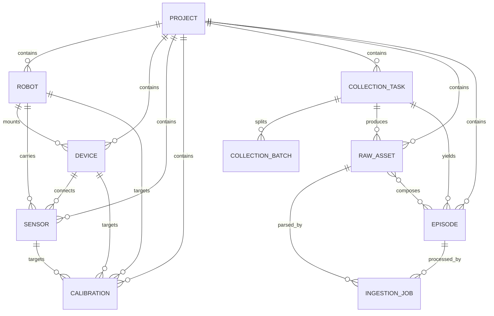

# DDP 阶段 1 领域模型与 API/数据契约草案

- 状态：草案（待评审，**未冻结**）
- Owner：System Architect
- 日期：2026-11-08
- 关联任务：DDP-101
- 关联规范：§5、§6、§16、§17、§19、§24
- 关联 ADR：ADR-0002、ADR-0003、ADR-0004、ADR-0005
- 契约基线：`packages/contracts/openapi.yaml` 0.1.0（阶段 0）
- 目标契约：`DDP API 1.0.0-draft`、`ddp.canonical/1.0.0-draft`
- 边界：只定义设计与契约草案，**不修改** `packages/contracts/**`、`backend/**`、`apps/web/**`。

## 0. 结论摘要

1. 设备域与采集域按机器人、设备、传感器、标定、采集任务、原始资产、Episode 七个核心聚合建模，全部强制 `project_id`。
2. 状态只允许通过领域动作迁移，禁止通用 `PATCH status`；前端不得直接写状态字段。
3. API 统一使用 `/api/v1/projects/{project_id}/...`；服务端校验成员资格，不信任客户端传入的 `project_id`。
4. RawAsset 不可覆盖；解析、同步、切片只产生新产物。Episode 验收后冻结，变更创建新版本。
5. Canonical 的时间、坐标系、单位、标定采用“显式声明 + 版本化 + 可追溯”，详见 `docs/data-standards/Canonical草案.md`。
6. 契约冻结前必须完成状态机、错误码、权限矩阵、迁移脚本与跨项目隔离测试的联合评审。

## 1. 模块边界与依赖

沿用 ADR-0002 模块化单体：API/Application 负责用例与事务，Domain 负责实体、值对象、状态机与规则，Infrastructure 负责 Repository、对象存储、队列与外部 Adapter，Worker 负责大文件与异步任务。

```text
Identity & Administration
        ↓
Project Management
        ↓
Device & Robot Management ──→ Calibration
        ↓（只读引用/快照）
Collection Management（任务、批次、SOP 引用）
        ↓
Data Ingestion（上传会话、RawAsset、IngestionJob）
        ↓
Episode Management（Episode、Frame、Observation、Action）
        ↓
Processing / Annotation / Quality / Dataset / Training（后续阶段）
```

- 下游只能通过 Application 公开接口、契约 DTO 或领域事件引用上游，禁止导入上游 Infrastructure 实现。
- 设备域不反向依赖采集域；采集任务只保存设备/传感器 ID 与执行时快照。
- 禁止循环依赖；共享契约草案放 `docs/architecture/contract-draft/`，冻结后才进入 `packages/contracts/`。
- 设备厂商差异通过 `capability_profile` + Adapter 处理，禁止核心业务堆积型号 `if/else`。

## 2. 领域模型



### 2.1 通用约定

- 主键：`*_id` 使用 UUIDv7 字符串（36 字符、小写、时间有序）；业务编码 `*_code` 在项目内唯一，约束 `(project_id, code)`。
- 所有业务表带 `project_id`；子表尽量使用 `(project_id, parent_id)` 复合外键，数据库层兜底租户一致性。
- 公共字段：`version`（乐观锁整数）、`created_at`、`updated_at`、`created_by`、`updated_by`；时间为 UTC `timestamptz`。
- 状态：Domain 使用枚举；数据库建议 `varchar(32) + CHECK`，API 输出大写下划线枚举；禁止任意字符串与未知状态默认成功。
- 大文件只存对象存储；数据库只存元数据、对象 Key、Hash、大小、格式、状态、血缘。
- 软删除仅用于允许撤销的元数据；RawAsset 与已验收 Episode 不允许静默删除。删除/墓碑必须审批、审计并保留引用。

### 2.2 设备域实体

| 实体 | 关键字段 | 约束与说明 |
|---|---|---|
| Robot | `robot_id`、`project_id`、`code`、`name`、`robot_type`、`vendor`、`model`、`serial_number`、`firmware_version`、`hardware_version`、`calibration_profile_id`、`capability_profile`、`status`、`location_id`、`owner_user_id`、`version` | 序列号在项目内唯一；`capability_profile` 描述自由度、移动方式、末端执行器、支持传感器、控制接口、负载等，禁止硬编码型号分支 |
| Device | `device_id`、`project_id`、`robot_id?`、`code`、`name`、`device_type`、`vendor`、`model`、`serial_number`、`firmware_version`、`hardware_version`、`calibration_profile_id`、`capability_profile`、`status`、`location_id`、`owner_user_id`、`version` | `device_type` 如 COMPUTE、CONTROLLER、CAMERA_RIG、TELEOP、GRIPPER、OTHER；设备可独立存在，也可挂载到机器人 |
| Sensor | `sensor_id`、`project_id`、`robot_id?`、`device_id?`、`code`、`sensor_type`、`vendor`、`model`、`serial_number`、`sample_rate_hz`、`resolution_w/h`、`bit_depth`、`channels`、`intrinsic_calibration_id?`、`extrinsic_calibration_id?`、`coordinate_frame`、`sync_mode`、`sync_group`、`firmware_version`、`calibration_profile_id`、`status`、`mount_position`、`version` | `robot_id`/`device_id` 至少一个；`sensor_type` 覆盖 RGB、RGB-D、DEPTH、IMU、JOINT_STATE、END_EFFECTOR、FORCE_TORQUE、MOCAP、AUDIO；采样频率与分辨率必须可解释 |
| CalibrationProfile | `profile_id`、`project_id`、`name`、`scope`、`target_type`、`target_id`、`version`、`schema_version`、`required_types`、`selection_rule` | 定义某类目标需要哪些标定及选择规则；禁止运行时静默回退 |
| CalibrationRecord | `calibration_id`、`project_id`、`profile_id`、`scope`、`target_type`、`target_id`、`calibration_type`、`method`、`parameters`、`parent_frame`、`child_frame`、`valid_from`、`valid_to`、`status`、`evidence_asset_ids`、`source`、`checksum`、`uncertainty`、`performed_by`、`validated_by`、`validated_at`、`supersedes_id`、`version` | `parameters` 按 Canonical 标定 Schema 校验；执行人与校验人必须分离；激活时旧记录原子转为 `SUPERSEDED` |

### 2.3 采集域实体

| 实体 | 关键字段 | 约束与说明 |
|---|---|---|
| CollectionTask | `task_id`、`project_id`、`code`、`name`、`plan_id`、`sop_id`、`scenario_id`、`action_spec_id`、`requirement_id`、`batch_id?`、`priority`、`status`、`assigned_to`、`assigned_robot_id`、`assigned_device_ids`、`location_id`、`scheduled_start/end`、`actual_start/end`、`target_episode_count`、`target_duration_sec`、`submitted_episode_count`、`accepted_episode_count`、`quality_summary`、`reason`、`version` | 任务绑定采集方案、SOP 版本与动作规格版本；分配时校验设备可用性与标定状态；所有状态变化写审计 |
| CollectionBatch | `batch_id`、`project_id`、`task_id`、`code`、`sequence_no`、`status`、`assigned_to`、`scheduled_start/end`、`expected_count`、`submitted_count`、`accepted_count`、`version` | 一个任务拆多个批次；批次不得跨项目；批次状态受任务状态约束 |
| UploadSession | `upload_session_id`、`project_id`、`created_by`、`status`、`allowed_types`、`part_size_bytes`、`object_key_prefix`、`expires_at`、`idempotency_key`、`version` | 分片/断点续传；过期作废；不得直接信任客户端文件名 |
| RawAsset | `asset_id`、`project_id`、`code`、`source_type`、`collection_task_id?`、`batch_id?`、`episode_id?`、`upload_session_id?`、`original_filename`、`object_key`、`size_bytes`、`content_type`、`format`、`sha256`、`status`、`captured_at`、`device_time_raw`、`sensor_snapshot`、`raw_metadata`、`storage_class`、`retention_policy_id`、`quarantine_reason`、`uploaded_by`、`verified_at`、`version` | 不可覆盖；`(project_id, sha256)` 幂等去重；对象 Key 不包含用户可控路径；隔离区资产不得进入可训练数据集 |
| IngestionJob | `job_id`、`project_id`、`job_type`、`raw_asset_ids`、`input_manifest_key`、`status`、`idempotency_key`、`attempt`、`max_attempts`、`timeout_sec`、`pipeline_id`、`pipeline_version`、`parser_id`、`parser_version`、`config_hash`、`started_at`、`finished_at`、`error_code`、`error_summary`、`output_refs`、`log_ref`、`metrics`、`version` | 每次解析必须记录 Parser/Pipeline/配置版本；失败可重试但不得产生重复产物 |
| Episode | `episode_id`、`project_id`、`code`、`task_id?`、`batch_id?`、`raw_asset_ids`、`robot_id?`、`device_ids`、`sensor_ids`、`start_time_ns`、`end_time_ns`、`duration_ns`、`time_domain`、`canonical_schema_version`、`pipeline_id`、`pipeline_version`、`segmentation_rule_version`、`status`、`quality_status`、`annotation_status`、`success`、`failure_reason`、`scene_labels`、`language_instruction`、`frame_count`、`calibration_snapshot`、`manifest_key`、`manifest_sha256`、`episode_version`、`supersedes_id`、`version` | 验收后不可变；修订创建新 `episode_version`；必须记录标定快照与数据血缘 |

## 3. 状态机

> 所有迁移由领域服务执行：校验前置条件、执行角色、幂等键、审计事件；非法迁移返回 `state_transition_invalid`（409）。`CANCELLED`、`RETIRED`、`COMPLETED`、`ARCHIVED` 等终态不得回退。

### 3.1 机器人/设备/传感器

```text
PROVISIONED → ACTIVE → IN_MAINTENANCE → ACTIVE
                    ├→ FAULT → IN_MAINTENANCE → ACTIVE
                    ├→ SUSPENDED → ACTIVE
                    └→ RETIRED（终态）
```

| 迁移 | 前置条件 | 执行角色 | 失败/审计 |
|---|---|---|---|
| PROVISIONED→ACTIVE | 档案完整、能力描述合法；采集就绪另需有效标定 | Device Operator、Project Manager | 缺字段 `validation_failed`；写审计 |
| ACTIVE→IN_MAINTENANCE | 无执行中的绑定任务，或任务已暂停 | Device Operator | 有在途任务 `conflict` |
| IN_MAINTENANCE→ACTIVE | 维修记录完整、复检通过 | Device Operator、Quality Inspector | 未复检 `state_transition_invalid` |
| ACTIVE/IN_MAINTENANCE→FAULT | 故障可上报 | 任意项目成员上报，Device Operator 确认 | 记录故障码与时间 |
| FAULT→IN_MAINTENANCE | 已受理维修 | Device Operator | 写维修记录 |
| 任意非终态→SUSPENDED | 管理原因明确 | Project Manager、Project Owner | 必须填写原因 |
| SUSPENDED→ACTIVE | 原因解除 | Project Manager | 写审计 |
| 任意非终态→RETIRED | 无在途任务、无未完成上传、无有效引用或已归档 | Project Owner + Device Operator | 终态；影响历史数据时只禁止新使用 |

### 3.2 标定

```text
DRAFT → SUBMITTED → VALIDATED → ACTIVE → SUPERSEDED（终态）
   ↑         └→ REJECTED ←──────────┘
   └──────────────┘
ACTIVE → REVOKED（终态）；ACTIVE → EXPIRED（终态，由有效期任务触发）
```

| 迁移 | 前置条件 | 执行角色 | 说明 |
|---|---|---|---|
| DRAFT→SUBMITTED | 参数完整、目标存在、证据 Hash 已登记 | Device Operator | 提交后只读 |
| SUBMITTED→VALIDATED | 参数 Schema、量纲、坐标系、证据校验通过；执行人≠校验人 | Quality Inspector 或独立 Device Operator | 四眼原则 |
| SUBMITTED→REJECTED | 校验失败并记录原因 | Quality Inspector | 可回到 DRAFT 修订 |
| REJECTED→DRAFT | 修订参数/证据 | Device Operator | 新版本号 |
| VALIDATED→ACTIVE | 有效期合法、与同范围记录冲突已处理 | Project Manager、Project Owner | 同范围旧 ACTIVE 原子转 SUPERSEDED |
| ACTIVE→REVOKED | 标定错误、设备变更或事故 | Project Owner + Quality Inspector | 影响 Episode 质量结论，需重评估 |
| ACTIVE→EXPIRED | 超过 `valid_to` | 系统任务 | 记录到期时间 |

### 3.3 采集任务

规范给定主链路：

```text
DRAFT → PENDING_REVIEW → APPROVED → READY → ASSIGNED
      → IN_PROGRESS → SUBMITTED → DATA_CHECKING → ACCEPTED → COMPLETED

DATA_CHECKING → REJECTED → REWORK → SUBMITTED
IN_PROGRESS → PAUSED / BLOCKED / CANCELLED
```

补充合法迁移：

| 迁移 | 前置条件 | 执行角色 |
|---|---|---|
| DRAFT→PENDING_REVIEW | 任务信息、SOP/方案版本、目标数量完整 | Collection Manager |
| PENDING_REVIEW→DRAFT | 退回修改并填原因 | Project Manager |
| PENDING_REVIEW→APPROVED | 审核通过，非创建人 | Project Manager、Project Owner |
| APPROVED→READY | 设备/场地/人员资源可分配 | Collection Manager |
| READY→ASSIGNED | 人员、机器人、设备、场地均已分配且可用 | Collection Manager |
| ASSIGNED→IN_PROGRESS | 开工检查通过 | Collector（被分配人）、Collection Manager |
| IN_PROGRESS→PAUSED/BLOCKED | 暂停/阻塞原因明确 | Collector、Collection Manager |
| PAUSED/BLOCKED→IN_PROGRESS | 原因解除 | Collection Manager |
| IN_PROGRESS→SUBMITTED | 数据已上传、自检完成 | Collector |
| SUBMITTED→DATA_CHECKING | 自动质检任务已创建 | 系统 |
| DATA_CHECKING→ACCEPTED | 质量门禁通过 | Quality Inspector |
| DATA_CHECKING→REJECTED | 不合格项记录完整 | Quality Inspector |
| REJECTED→REWORK | 返工范围与责任人明确 | Quality Inspector、Collection Manager |
| REWORK→SUBMITTED | 返工完成并重新自检 | Collector |
| ACCEPTED→COMPLETED | Episode 与交付物齐备 | Collection Manager |
| 非终态→CANCELLED | 取消原因明确且无未结上传 | Project Manager、Project Owner |

### 3.4 批次

```text
PLANNED → READY → IN_PROGRESS → SUBMITTED → ACCEPTED
                         └→ PAUSED/BLOCKED → IN_PROGRESS
SUBMITTED → REJECTED → REWORK → SUBMITTED
任意非终态 → CANCELLED
```

批次迁移必须与所属任务状态兼容；任务取消时批次级联取消并写审计。

### 3.5 RawAsset

```text
INITIATED → UPLOADING → UPLOADED → VALIDATING → VALID → ARCHIVED（终态）
                                      ├→ QUARANTINED → VALIDATING
                                      └→ REJECTED（元数据保留）
任意非终态 → TOMBSTONED（审批后，元数据保留、对象按保留策略处理）
```

| 迁移 | 前置条件 | 说明 |
|---|---|---|
| INITIATED→UPLOADING | 上传会话有效、类型白名单通过 | 记录分片与幂等键 |
| UPLOADING→UPLOADED | 分片完整、大小一致 | 未完成返回 `upload_incomplete` |
| UPLOADED→VALIDATING | 已计算 SHA256、内容签名检查已排队 | 异步执行 |
| VALIDATING→VALID | 大小、Hash、签名、格式、可解析性通过 | 才可进入解析 |
| VALIDATING→QUARANTINED | 可疑文件/恶意扫描命中/元数据冲突 | 隔离区，不得训练 |
| VALIDATING→REJECTED | 类型伪造、Hash 不符、损坏严重 | 记录错误码，原始文件保留 |
| VALID→ARCHIVED | 按保留策略归档 | 不影响血缘 |
| 任意非终态→TOMBSTONED | 法务/保留策略审批 | 禁止普通用户触发 |

### 3.6 IngestionJob

```text
QUEUED → RUNNING → SUCCEEDED（终态）
            ├→ FAILED → QUEUED（重试，attempt+1）
            └→ CANCELLING → CANCELLED（终态）
```

- 重试只允许可重试错误；达到 `max_attempts` 后保持 FAILED。
- 幂等键相同且输入未变时返回既有 Job，不重复产生产物。
- 超时、取消、失败均记录错误码、摘要、日志引用与已产生产物。

### 3.7 Episode

```text
PENDING → PROCESSING → READY → QUALITY_CHECKING → ACCEPTED → COMPLETED → ARCHIVED
              └→ FAILED → PROCESSING
QUALITY_CHECKING → REJECTED → PROCESSING（新版本）
任意非终态 → INVALIDATED（原资产失效/标定撤销/血缘断裂）
```

| 迁移 | 前置条件 | 执行角色 |
|---|---|---|
| PENDING→PROCESSING | 至少一个 VALID RawAsset，切片规则版本确定 | Data Engineer、系统 |
| PROCESSING→READY | Canonical 产物与 Manifest 生成、Hash 校验通过 | 系统 |
| READY→QUALITY_CHECKING | 质检规则版本确定 | Quality Inspector、系统 |
| QUALITY_CHECKING→ACCEPTED | 技术/采集/标定/同步质量门禁通过 | Quality Inspector |
| QUALITY_CHECKING→REJECTED | 问题项与证据完整 | Quality Inspector |
| ACCEPTED→COMPLETED | Manifest 冻结、血缘完整、标签状态满足交付要求 | Collection Manager |
| COMPLETED→ARCHIVED | 保留策略触发 | 系统/Data Engineer |
| 任意非终态→INVALIDATED | 原始资产不可用、标定被撤销、数据污染 | Project Owner + Quality Inspector |

## 4. API 草案

### 4.1 通用约定

- 前缀：`/api/v1`。项目资源统一 `/api/v1/projects/{project_id}/...`；服务端从 Token 解析用户，再校验项目成员/角色，**路径 `project_id` 必须与资源归属一致**。
- 客户端 Query/Body 中的 `project_id` 不作为权威来源；冲突时返回 `validation_failed`。跨项目资源统一按 `resource_not_found`（404）处理，避免 IDOR 枚举；非项目成员访问项目路由返回 `project_scope_denied`（403）。
- 鉴权：`Authorization: Bearer <token>`；`X-Request-Id` 可选；写操作支持 `Idempotency-Key`，作用域为 `(project_id, user_id, key)`，至少保留 24 小时。
- 乐观锁：`PATCH`/动作接口必须带 `If-Match: "<version>"`；缺失返回 `precondition_required`（428），版本不符返回 `version_conflict`（409）。
- 分页：Cursor `?cursor=&limit=`，`limit` 默认 20、最大 100；响应 `{items, next_cursor}`；排序字段白名单。
- 错误体沿用现有 `ErrorEnvelope`：`{"error":{"code","message","request_id"}}`。字段级明细建议在 1.0.0 冻结时以可选 `error.details` 兼容新增，并走契约变更流程。
- 所有下载/预览使用短期签名 URL，必须审计；禁止把对象存储长期密钥返回前端。

### 4.2 错误码

| HTTP | code | 含义 | 可重试 |
|---|---|---|---|
| 401 | `unauthenticated` | 未登录/Token 失效 | 否 |
| 403 | `forbidden` | 权限不足（兼容阶段 0） | 否 |
| 403 | `project_scope_denied` | 非项目成员或项目已停用 | 否 |
| 404 | `resource_not_found` / `not_found` | 资源不存在或跨项目不可见 | 否 |
| 409 | `conflict` | 通用状态冲突（兼容阶段 0） | 否 |
| 409 | `state_transition_invalid` | 非法状态迁移 | 否 |
| 409 | `version_conflict` | 乐观锁版本不符 | 是（重读后） |
| 409 | `duplicate_resource` | 业务键/Hash 重复 | 否 |
| 409 | `idempotency_key_reused` | 幂等键复用但请求体不同 | 否 |
| 409 | `upload_incomplete` | 分片未完成 | 是 |
| 409 | `resource_immutable` | 不可变资源被修改 | 否 |
| 410 | `upload_session_expired` | 上传会话过期 | 是（新建会话） |
| 413 | `file_too_large` | 超过大小上限 | 否 |
| 415 | `file_type_unsupported` | 类型白名单不通过 | 否 |
| 422 | `validation_failed` | 参数/Schema 校验失败 | 否 |
| 422 | `file_signature_mismatch` | 内容签名与声明类型不符 | 否 |
| 422 | `hash_mismatch` | SHA256 不一致 | 否 |
| 422 | `calibration_invalid` | 标定参数不合法 | 否 |
| 422 | `calibration_not_active` | 采集时间点无有效标定 | 否 |
| 428 | `precondition_required` | 缺少 `If-Match` | 否 |
| 429 | `rate_limited` | 触发限流 | 是（退避） |
| 500 | `internal_error` | 未预期错误 | 视情况 |
| 503 | `dependency_unavailable` | 数据库/对象存储/队列不可用 | 是 |

### 4.3 设备域端点

> 以下路径均省略 `/api/v1` 前缀；“项目范围”列均为服务端强制校验，未特别说明即为当前项目。

| 方法 | 路径 | 说明 | 主要错误码 |
|---|---|---|---|
| GET/POST | `/projects/{project_id}/robots` | 列表/创建机器人 | `project_scope_denied`、`validation_failed`、`duplicate_resource` |
| GET/PATCH | `/projects/{project_id}/robots/{robot_id}` | 详情/修改档案（不含状态） | `resource_not_found`、`version_conflict`、`resource_immutable` |
| POST | `/projects/{project_id}/robots/{robot_id}/activate` | PROVISIONED→ACTIVE | `state_transition_invalid` |
| POST | `/projects/{project_id}/robots/{robot_id}/suspend` | 挂起 | `state_transition_invalid`、`conflict` |
| POST | `/projects/{project_id}/robots/{robot_id}/retire` | 退役 | `conflict`、`state_transition_invalid` |
| GET/POST | `/projects/{project_id}/devices` | 列表/创建设备 | 同上 |
| GET/PATCH | `/projects/{project_id}/devices/{device_id}` | 详情/修改 | 同上 |
| POST | `/projects/{project_id}/devices/{device_id}/maintenance` | 上报维护/故障 | `validation_failed` |
| POST | `/projects/{project_id}/devices/{device_id}/retire` | 退役 | 同上 |
| GET/POST | `/projects/{project_id}/sensors` | 列表/创建传感器 | 同上；`robot_id`/`device_id` 至少一个 |
| GET/PATCH | `/projects/{project_id}/sensors/{sensor_id}` | 详情/修改 | 同上 |
| POST | `/projects/{project_id}/sensors/{sensor_id}/fault` | 上报故障 | `state_transition_invalid` |
| POST | `/projects/{project_id}/sensors/{sensor_id}/retire` | 退役 | 同上 |
| GET/POST | `/projects/{project_id}/calibration-profiles` | 标定配置版本 | `duplicate_resource` |
| GET/POST | `/projects/{project_id}/calibrations` | 列表/创建标定草案 | `calibration_invalid` |
| GET/PATCH | `/projects/{project_id}/calibrations/{calibration_id}` | 详情/修改 DRAFT | `resource_immutable` |
| POST | `/projects/{project_id}/calibrations/{calibration_id}/submit` | 提交校验 | `state_transition_invalid` |
| POST | `/projects/{project_id}/calibrations/{calibration_id}/validate` | 校验通过 | `calibration_invalid`、`forbidden`（执行人=校验人） |
| POST | `/projects/{project_id}/calibrations/{calibration_id}/reject` | 校验驳回 | `state_transition_invalid` |
| POST | `/projects/{project_id}/calibrations/{calibration_id}/activate` | 激活 | `calibration_not_active`、`conflict` |
| POST | `/projects/{project_id}/calibrations/{calibration_id}/revoke` | 作废 | `forbidden`、`state_transition_invalid` |

### 4.4 采集、接入与 Episode 端点

| 方法 | 路径 | 说明 | 主要错误码 |
|---|---|---|---|
| GET/POST | `/projects/{project_id}/collection-tasks` | 列表/创建任务 | `validation_failed`、`duplicate_resource` |
| GET/PATCH | `/projects/{project_id}/collection-tasks/{task_id}` | 详情/修改（不含状态） | `resource_not_found`、`version_conflict` |
| POST | `/projects/{project_id}/collection-tasks/{task_id}/actions/{action}` | 状态动作：`submit-review`、`approve`、`return-draft`、`ready`、`assign`、`start`、`pause`、`resume`、`block`、`unblock`、`submit`、`accept`、`reject`、`rework`、`cancel`、`complete` | `state_transition_invalid`、`forbidden`；`action` 必须在白名单 |
| GET/POST | `/projects/{project_id}/collection-tasks/{task_id}/batches` | 批次列表/拆分 | `state_transition_invalid` |
| GET/PATCH | `/projects/{project_id}/batches/{batch_id}` | 批次详情/修改 | 同上 |
| POST | `/projects/{project_id}/batches/{batch_id}/actions/{action}` | 批次状态动作 | 同上 |
| POST | `/projects/{project_id}/upload-sessions` | 创建上传会话 | `file_type_unsupported`、`file_too_large` |
| POST | `/projects/{project_id}/upload-sessions/{session_id}/parts` | 获取分片上传地址 | `upload_session_expired` |
| POST | `/projects/{project_id}/upload-sessions/{session_id}/complete` | 完成上传并登记 RawAsset | `upload_incomplete`、`hash_mismatch`、`file_signature_mismatch` |
| DELETE | `/projects/{project_id}/upload-sessions/{session_id}` | 中止会话 | `upload_session_expired` |
| GET | `/projects/{project_id}/raw-assets` | 列表/筛选 | `project_scope_denied` |
| GET | `/projects/{project_id}/raw-assets/{asset_id}` | 详情 | `resource_not_found` |
| GET | `/projects/{project_id}/raw-assets/{asset_id}/download-url` | 短期下载地址 | `forbidden`、`resource_not_found`；强审计 |
| POST | `/projects/{project_id}/raw-assets/{asset_id}/revalidate` | 重新校验 | `state_transition_invalid` |
| POST | `/projects/{project_id}/raw-assets/{asset_id}/release-quarantine` | 隔离区放行 | `forbidden`、`validation_failed`；需双人审批 |
| POST | `/projects/{project_id}/raw-assets/{asset_id}/tombstone` | 元数据墓碑 | `forbidden`、`conflict`；需 Approver |
| POST | `/projects/{project_id}/raw-assets/{asset_id}/ingest` | 创建解析/切片 Job | `resource_immutable`、`state_transition_invalid` |
| GET | `/projects/{project_id}/ingestion-jobs` | Job 列表 | `project_scope_denied` |
| GET | `/projects/{project_id}/ingestion-jobs/{job_id}` | Job 详情 | `resource_not_found` |
| POST | `/projects/{project_id}/ingestion-jobs/{job_id}/retry` | 重试 | `job_not_retryable`、`state_transition_invalid` |
| POST | `/projects/{project_id}/ingestion-jobs/{job_id}/cancel` | 取消 | `state_transition_invalid` |
| GET | `/projects/{project_id}/ingestion-jobs/{job_id}/log-url` | 日志短期地址 | `resource_not_found` |
| GET/POST | `/projects/{project_id}/episodes` | 列表/创建（手工创建需特权） | `validation_failed`、`calibration_not_active` |
| GET/PATCH | `/projects/{project_id}/episodes/{episode_id}` | 详情/修改允许的可变元数据 | `resource_immutable`、`version_conflict` |
| POST | `/projects/{project_id}/episodes/{episode_id}/actions/{action}` | `quality-check`、`accept`、`reject`、`rework`、`complete`、`archive`、`invalidate` | `state_transition_invalid`、`forbidden` |
| GET | `/projects/{project_id}/episodes/{episode_id}/manifest` | Canonical Manifest | `resource_not_found` |
| GET | `/projects/{project_id}/episodes/{episode_id}/preview` | 预览元数据/代理地址 | `resource_not_found`、`forbidden` |
| GET | `/projects/{project_id}/episodes/{episode_id}/download-url` | 数据下载 | `forbidden`；强审计 |

接口约束：

- `POST /collection-tasks/{task_id}/actions/{action}` 的 `action` 使用白名单映射到领域命令，禁止把 `action` 直接当 SQL/状态字段使用。
- `PATCH` 不允许修改 `status`、`project_id`、`sha256`、`object_key`、`manifest_sha256`、`version`。
- 上传完成必须校验：大小、类型白名单、内容签名、SHA256、文件名安全、权限、存储路径；不能只依赖扩展名。
- 所有异步 Job 必须有超时、最大重试、幂等键、失败记录与可观测指标。

## 5. 权限边界

权限模型：平台角色 + 项目角色 + 资源授权，默认拒绝；前端只做展示，服务端为准。

| 动作 | 平台管理员 | 项目 Owner | 项目经理 | 采集经理 | 采集员 | 设备操作员 | 质检员 | 数据工程师 | 算法工程师 | 审计员 | 只读 |
|---|---|---|---|---|---|---|---|---|---|---|---|
| 查看设备/传感器基础档案 | △ | ✔ | ✔ | ✔ | △（仅任务快照） | ✔ | ✔ | ✔ | ✔ | ✔ | ✔ |
| 查看序列号/精确位置/标定参数 | △ | ✔ | ✔ | △ | ✕ | ✔ | △ | ✔ | △ | ✔ | ✕ |
| 创建/修改机器人/设备/传感器 | ✕ | ✔ | △ | ✕ | ✕ | ✔ | ✕ | ✕ | ✕ | ✕ | ✕ |
| 提交标定草案 | ✕ | ✔ | ✕ | ✕ | ✕ | ✔ | ✕ | ✕ | ✕ | ✕ | ✕ |
| 校验标定 | ✕ | △（不得校验本人） | ✕ | ✕ | ✕ | △（独立人员） | ✔ | ✕ | ✕ | ✕ | ✕ |
| 激活/作废标定 | ✕ | ✔ | △ | ✕ | ✕ | △ | △ | ✕ | ✕ | ✕ | ✕ |
| 设备启用/故障/维修/退役 | ✕ | ✔ | △ | ✕ | ✕ | ✔ | ✕ | ✕ | ✕ | ✕ | ✕ |
| 创建/编辑采集任务 | ✕ | ✔ | ✔ | ✔ | ✕ | ✕ | ✕ | ✕ | ✕ | ✕ | ✕ |
| 审核/批准任务 | ✕ | ✔ | ✔ | ✕ | ✕ | ✕ | ✕ | ✕ | ✕ | ✕ | ✕ |
| 分配人员/设备/场地 | ✕ | ✔ | ✔ | ✔ | ✕ | ✕ | ✕ | ✕ | ✕ | ✕ | ✕ |
| 开始/暂停/恢复/异常上报 | ✕ | ✔ | ✔ | ✔ | △（仅本人任务） | ✕ | ✕ | ✕ | ✕ | ✕ | ✕ |
| 提交采集数据 | ✕ | ✔ | ✔ | ✔ | △（仅本人任务） | ✕ | ✕ | ✕ | ✕ | ✕ | ✕ |
| 质检接受/驳回 | ✕ | ✔ | △ | ✕ | ✕ | ✕ | ✔ | ✕ | ✕ | ✕ | ✕ |
| 返工/取消/完成任务 | ✕ | ✔ | ✔ | △（返工） | ✕ | ✕ | △（返工） | ✕ | ✕ | ✕ | ✕ |
| 上传 RawAsset | ✕ | ✔ | ✔ | ✔ | △（仅本人任务） | ✕ | ✕ | ✔ | ✕ | ✕ | ✕ |
| 下载原始数据 | △ | ✔ | ✔ | △ | △（本人任务） | △ | △ | ✔ | △（授权） | △（审计用途） | ✕ |
| 隔离区放行/墓碑 | △ | △（墓碑需双人） | ✕ | ✕ | ✕ | ✕ | △（技术评估） | ✔（放行） | ✕ | ✕ | ✕ |
| 触发/重试/取消接入 Job | ✕ | ✔ | ✕ | ✕ | ✕ | ✕ | ✕ | ✔ | ✕ | ✕ | ✕ |
| Episode 质检/验收/失效 | ✕ | ✔ | △ | ✕ | ✕ | ✕ | ✔ | △（失效技术评估） | ✕ | ✕ | ✕ |

图例：✔ 允许；△ 需资源授权、审批或职责分离；✕ 默认拒绝。平台管理员访问项目业务数据必须是显式 break-glass 授权并强审计。采集员默认只看到被分配任务的设备快照，不暴露全量设备档案。

必须审计：所有状态迁移、标定激活/作废、RawAsset 下载/放行/墓碑、权限变更、跨项目拒绝、Episode 验收/失效、契约/迁移变更。审计日志只追加，包含操作者、项目、资源、动作、前后状态、请求 ID、时间、结果。

## 6. 迁移策略

### 6.1 数据库迁移

- 统一使用 Alembic；当前 `0001_baseline` 为空链。阶段 1 建议拆分（具体由 BE 实施，Architect 评审）：
  - `0002_stage1_identity_project`
  - `0003_stage1_device_calibration`
  - `0004_stage1_collection`
  - `0005_stage1_ingestion_episode`
  - `0006_stage1_constraints_indexes`
- 采用 expand/contract：先加可空列/新表 → 幂等回填 → 双读/双写（仅必要场景）→ 切换读路径 → 观察期 → 删除旧结构。
- 回填脚本必须按 `project_id` 分批、可重入、有进度与失败记录；大表索引使用 `CREATE INDEX CONCURRENTLY`；不得长时间锁表。
- `NOT NULL` 只能在回填完成后添加；破坏性变更必须提供回滚或补偿方案，并经用户单独批准。
- 唯一约束与索引建议：`(project_id, code)`、`(project_id, sha256)`、`(project_id, idempotency_key)`、`(project_id, status, created_at)`、`collection_task_id`、`raw_asset_id`、`episode_id`、`sensor_id`。
- 状态字段使用 `varchar + CHECK`，Domain/契约枚举为权威；新增状态必须走契约与迁移双重评审。
- 所有迁移必须可审查、附升级/回滚命令与验证 SQL；涉及数据迁移必须备份并演练。

### 6.2 数据迁移与版本

- Raw 永不改写；Canonical 版本升级生成新产物，旧版本保留可读。
- 每次处理记录 `canonical_schema_version`、`pipeline_id/version`、`parser_id/version`、`config_hash`。
- Episode 修订创建新 `episode_version` 与 `supersedes_id`，不覆盖旧版本。
- 历史数据回放/重建必须能从 RawAsset + Pipeline 版本 + 参数复现。

## 7. 契约冻结与变更流程

### 7.1 冻结对象

OpenAPI、JSON Schema、Canonical Schema、事件契约、权限矩阵、状态机、迁移与索引策略。冻结产物必须有版本号、SHA256、批准人、日期与变更记录。

### 7.2 版本规则

- HTTP 主版本在路径：`/api/v1`；OpenAPI 使用 SemVer。
- Canonical：`ddp.canonical/<major>.<minor>.<patch>`。
- 事件：`event_type` 带版本（如 `ddp.raw_asset.validated.v1`）并使用 `event_version`；事件包含 `event_id`、`occurred_at`、`producer`、`aggregate_id`、`project_id`、`correlation_id`、`payload`。
- 兼容性：新增可选字段为 minor；删除/重命名字段、改类型/语义、把可选改必填、改变状态迁移或错误码语义为 major。新增枚举值默认 minor，但客户端必须有不识别回退，否则按 major。
- 废弃：标记 `deprecated` 与 `sunset_at`，至少保留 30 天或一个 minor 版本（取较长者），期间双版本并存。

### 7.3 变更流程

1. 提出：在 `docs/architecture/contract-draft/` 提交差异、影响面（FE/BE/QA/数据/迁移）与兼容性判断。
2. 评审：System Architect 主持；涉及破坏性变更必须建 ADR 并获用户批准；涉及迁移/权限/路由需对应 Owner 会签。
3. 实施：更新契约 → 生成/更新类型 → 补契约测试与跨项目隔离测试 → 更新文档与 Changelog。
4. 验证：OpenAPI lint、Schema 校验、兼容性 diff、状态机测试、Alembic 升级/回滚、权限越权测试。
5. 冻结：打版本与 SHA256 清单，记录批准人、日期、基线；通知所有角色。
6. 发布后：观察错误率与客户端兼容；回滚点必须是上一冻结版本与上一迁移 revision。

### 7.4 冻结门禁清单

- [ ] 实体字段、必填/可空、枚举与状态机一致。
- [ ] 所有 API 有路径、方法、错误码、项目范围、权限、幂等、分页与限流说明。
- [ ] 所有资源有跨项目隔离与越权测试用例。
- [ ] Canonical 时间、坐标系、单位、标定字段完整且可校验。
- [ ] 错误体与阶段 0 `ErrorEnvelope` 兼容。
- [ ] RawAsset 不可变、Episode 版本化、血缘可追溯。
- [ ] 迁移可升级/回滚，回填幂等并有验证 SQL。
- [ ] 契约测试与 CI 门禁通过；未跑测试不得声称冻结。

## 8. 验收自检与未决项

对照 DDP-101：

| 验收项 | 本文位置 | 状态 |
|---|---|---|
| 设备域与采集域实体、状态机 | §2、§3 | 已覆盖 |
| API 路径/方法/错误码/项目范围 | §4 | 已覆盖 |
| Canonical 时间/坐标系/单位/标定 | 见 `docs/data-standards/Canonical草案.md` | 已覆盖 |
| 迁移策略 | §6 | 已覆盖 |
| 权限边界 | §5 | 已覆盖 |
| 契约冻结与变更流程 | §7 | 已覆盖 |

未决项（需用户/评审批准）：

1. Robot 与 Device 的边界：当前采用“Robot 独立聚合，Device 可挂载到 Robot”；若后续统一为设备子类型，需要 ADR。
2. 标定激活是否必须四眼：当前要求执行人与校验人分离，激活由 Project Manager/Project Owner 或独立 Device Operator 执行。
3. 错误体是否在 1.0.0 增加可选 `error.details`：当前保持阶段 0 三字段，新增字段需契约变更。
4. 删除/保留策略：RawAsset 墓碑与对象生命周期规则需与法务/客户合同确认。
5. 采集任务动作接口是否拆为显式端点：当前用白名单 `actions/{action}`，冻结前可改为每动作独立端点。
6. 数据库状态用原生 enum 还是 `varchar + CHECK`：当前建议后者，需在迁移评审中确认。
