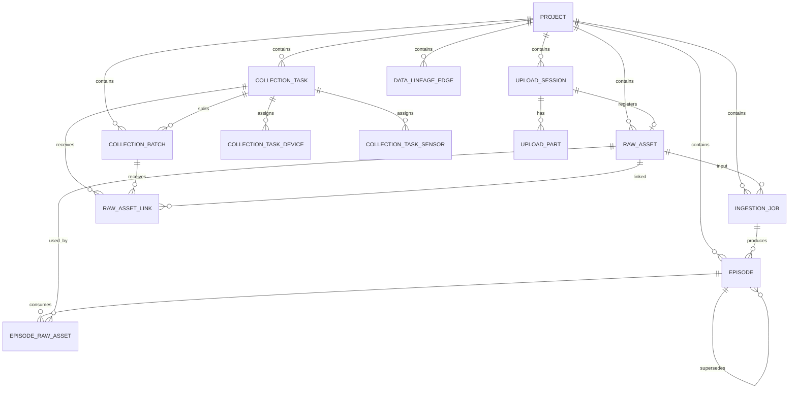

# DDP 阶段 2 采集/上传/RawAsset/Episode 领域与 API 契约 v1（草案）

- 状态：**草案（DRAFT，未冻结，待评审与用户批准）**
- Owner：System Architect
- 任务：DDP-301（P0）
- 日期：2026-11-08
- 契约草案版本：`ddp.stage2/1.0.0-draft`
- 关联 ADR：ADR-0002（模块化单体）、ADR-0003（数据分层）、ADR-0004（项目隔离）、ADR-0005（对象存储）、ADR-0009（设备域冻结）、ADR-0010（本阶段冻结决策）
- 关联文档：`docs/architecture/阶段1-领域模型与契约草案.md`、`docs/architecture/阶段1-设备域契约冻结-v1.md`、`docs/data-standards/Canonical草案.md`、`docs/product/PRD-阶段0-1主链路.md`
- 机器可读草案目录：`docs/architecture/contract-draft/collection/`
- 勘误：`docs/architecture/阶段2-契约勘误-v1.md`（ARCHIVED/FAILED 终态语义、动作白名单、OpenAPI 外部引用）
- 边界：只写 `docs/architecture/**`、`docs/adr/**`、`docs/data-standards/**`；**不修改** `backend/**`、`apps/web/**`、`backend/migrations/**`，也**不直接修改** `packages/contracts/**`。当前 `packages/contracts/openapi.yaml` 是已实现端点快照（`0.2.0`），阶段 2 端点尚未实现，不能伪装为可用。

## 0. 结论摘要

1. **上传传输态与资产态分离**：`UploadSession` 负责分片、断点、幂等与过期；`RawAsset` 只在上传完成时登记，初始为 `VALIDATING`，不再承担 `INITIATED/UPLOADING/UPLOADED` 传输态。
2. **RawAsset 内容不可变、按内容寻址**：对象 Key 由服务端生成；`sha256 + size_bytes` 为内容指纹；同一项目内相同内容不产生第二个可用资产，重复上传通过 `raw_asset_links` 关联到任务/批次。
3. **上传协议可测试**：预签名分片 URL + 分片确认 + `ListParts` 权威核对 + 整文件 SHA256 异步校验；分片可乱序、可重试、可断点续传；完成接口幂等。
4. **完成即登记，校验异步**：`complete` 做分片完整性、大小、内容签名与声明 Hash 一致性检查，返回 `202`；整文件 Hash、格式可解析性与恶意扫描由 `VALIDATE` Job 完成，失败进入 `REJECTED` 或隔离区。
5. **隔离区为逻辑状态 + 扫描报告对象**：`QUARANTINED` 资产禁止解析、切片、下载；放行必须双人审批并重新校验；墓碑只改状态、保留元数据与血缘，不物理删除对象。
6. **Episode 基础切片可复现**：Episode 明确记录 `raw_asset_ids`、起止时间、时间基准、标定快照、切片规则版本、Pipeline 版本与 Manifest Hash；`READY` 起冻结数据字段，修订创建新 `episode_version` 并通过 `supersedes_id` 链接。
7. **血缘只追加**：`data_lineage_edges` 记录 `RAW_ASSET → INGESTION_JOB → EPISODE` 等关系；不更新、不删除；Episode 失效保留历史并追加失效边。
8. **项目隔离与 DB 兜底**：所有表带 `project_id`；跨项目引用用复合外键/投影表阻断；状态机由领域动作 + 数据库触发器双重兜底；乐观锁统一 `If-Match`。
9. **错误码完整且可区分**：上传、分片、Hash、签名、隔离、Episode、血缘、存储依赖均有稳定错误码，未知错误不得默认成功。
10. **当前只是草案**：ADR-0010 为“已提议（待批准）”；未运行任何测试或迁移，全部标记 `NOT RUN`。

## 1. 模块边界与依赖

沿用 ADR-0002 模块化单体与分层依赖：

```text
Identity & Administration
        ↓
Project Management
        ↓
Device & Robot Management ──→ Calibration（只读引用/快照）
        ↓
Collection Management（任务、批次、分配、开工检查、提交）
        ↓
Data Ingestion（上传会话、分片、RawAsset、校验/隔离、IngestionJob）
        ↓
Episode Management（基础切片、Manifest、CalibrationSnapshot、血缘）
        ↓
Processing / Annotation / Quality / Dataset / Training（后续阶段）
```

- `backend/app/domain/collection`、`backend/app/domain/ingestion`、`backend/app/domain/episodes` 为领域层；不得依赖 Web、ORM、对象存储 SDK、队列。
- `backend/app/application` 负责用例编排、事务边界、幂等记录、审计/outbox；`backend/app/infrastructure` 负责 Repository、对象存储、队列适配。
- `backend/app/workers` 负责大文件 Hash 校验、格式探测、解析、切片、Manifest 生成；不得在 HTTP 请求线程处理大文件。
- 下游只能通过 Application 公开接口、契约 DTO 或领域事件引用上游；禁止导入其他模块 Infrastructure 实现。
- 设备域不反向依赖采集域；采集任务只保存设备/传感器 ID 与执行时快照，不复制设备业务规则。
- 共享契约草案放 `docs/architecture/contract-draft/collection/`；冻结并经批准后才允许由契约 Owner 更新 `packages/contracts/`。

## 2. 通用约定

### 2.1 标识与序列化

| 项 | 规则 |
|---|---|
| 主键 | 服务端生成 UUIDv7；API/JSON 为 36 字符小写带连字符；DB 使用 `uuid` |
| 业务编码 | `code` 项目内唯一，约束 `(project_id, code)`；不作为外键 |
| 项目隔离 | 所有业务表带 `project_id`；所有读写经服务端 `ProjectScope`；客户端传入的 `project_id` 不作权威来源 |
| 时间 | DB `timestamptz`；API RFC3339 UTC（`Z` 后缀）；进入领域层前统一 UTC；禁止 naive datetime |
| 纳秒时间 | `*_ns` 在 JSON 中使用十进制字符串（避免超过 2^53）；DB 使用 `bigint` |
| 枚举 | 大写下划线；DB `varchar(32) + CHECK`；未知值拒绝，不默认成功 |
| JSON | 禁止 `NaN`/`Infinity`；`raw_metadata`/`metrics` 上限 64 KiB、深度 8、键数 256；超限 `validation_failed` |
| 数值 | `size_bytes` 为非负整数；`duration_ns = end_time_ns - start_time_ns`，必须大于 0 |
| 内容 Hash | 统一 `sha256:<64 位小写十六进制>`；ETag 不是内容 Hash，禁止混用 |

### 2.2 并发、幂等与不可变

- `CollectionTask`、`CollectionBatch`、`UploadSession`、`IngestionJob`、`Episode` 使用整数 `version` 乐观锁；动作接口必须带 `If-Match: "<version>"`。缺失返回 `428 precondition_required`，不匹配返回 `409 version_conflict`。
- `RawAsset` 使用 `version` 仅表示状态/元数据更新的乐观锁；内容字段从创建起不可变。
- 写操作支持 `Idempotency-Key`，作用域 `(project_id, user_id, key)`，至少保留 24 小时；同键同请求返回首次结果（`Idempotent-Replayed: true`），同键不同请求返回 `409 idempotency_key_reused`。
- `UploadSession` 创建、`complete`、`ingest`、Episode 创建与动作必须支持幂等键；分片确认按 `(session_id, part_number)` 幂等。
- `PATCH` 不得修改 `project_id`、各 `*_id`、`status`、`sha256`、`size_bytes`、`object_key`、`manifest_sha256`、`version`、审计字段及已冻结字段。
- 状态只能通过具名动作迁移；禁止通用 `PATCH status`、禁止 SQL 直写状态。

### 2.3 分页、请求与审计

- 列表统一 `?cursor=&limit=`；`limit` 默认 20、最大 100；响应 `{items, next_cursor}`；排序字段白名单，非法返回 `validation_failed`。
- 鉴权：`Authorization: Bearer <token>`；`X-Request-Id` 可选；服务端校验项目成员资格与项目角色。
- 跨项目资源统一返回 `404 resource_not_found`，避免 IDOR 枚举；非项目成员访问项目路由返回 `403 project_scope_denied`。
- 所有状态迁移、上传完成/中止、下载签名 URL 签发、隔离放行、墓碑、Episode 验收/失效、权限拒绝、跨项目拒绝写追加式审计与事务性 outbox；审计失败则业务事务回滚（fail-closed）。

## 3. 领域模型

### 3.1 聚合与关系



### 3.2 CollectionTask

| 字段 | 类型/必填 | 约束与说明 |
|---|---|---|
| `task_id` | UUID / 是 | UUIDv7，服务端生成 |
| `project_id` | UUID / 是 | 服务端强制 |
| `code` | string(64) / 是 | `(project_id, code)` 唯一 |
| `name` | string(200) / 是 | 非空 |
| `requirement_id`、`plan_id`、`sop_id`、`scenario_id`、`action_spec_id` | UUID / 条件 | 必须同项目；SOP/方案/动作规格必须固定版本 |
| `sop_version`、`action_spec_version` | string(64) / 条件 | 创建时快照，不可静默漂移 |
| `status` | enum / 是 | 初始仅 `DRAFT`；迁移见 §4.1 |
| `priority` | enum / 是 | `P0/P1/P2` |
| `assigned_to` | UUID / 否 | 必须是本项目成员；进入 `ASSIGNED` 起必填 |
| `assigned_robot_id` | UUID / 否 | 同项目；状态必须 `ACTIVE`；进入 `ASSIGNED` 起必填（若任务要求机器人） |
| `assigned_device_ids`、`assigned_sensor_ids` | array<UUID> / 否 | 存入连接表；必须同项目；设备/传感器必须 `ACTIVE`；去重排序 |
| `location_id` | UUID / 否 | 必须同项目 |
| `scheduled_start`、`scheduled_end` | timestamptz / 否 | `end > start` |
| `actual_start`、`actual_end` | timestamptz / 否 | 由动作写入；`actual_end > actual_start` |
| `target_episode_count` | int ≥ 0 / 是 | 目标 Episode 数 |
| `target_duration_sec` | int ≥ 0 / 是 | 目标时长 |
| `submitted_episode_count`、`accepted_episode_count` | int ≥ 0 / 是 | 由 Episode 统计投影；不得由客户端写 |
| `quality_summary` | object / 否 | 只读投影，记录最近质检结论与规则版本 |
| `status_reason`、`blocked_reason` | string(1000) / 条件 | `PAUSED/BLOCKED/REJECTED/CANCELLED` 等必填 |
| `version` | int ≥ 1 / 是 | 乐观锁 |
| `created_at/by`、`updated_at/by` | 审计 / 是 | 服务端写入 |

### 3.3 CollectionBatch

| 字段 | 类型/必填 | 约束与说明 |
|---|---|---|
| `batch_id` | UUID / 是 | UUIDv7 |
| `project_id`、`task_id` | UUID / 是 | `(project_id, task_id)` 复合外键 |
| `code` | string(64) / 是 | `(project_id, code)` 唯一 |
| `sequence_no` | int ≥ 1 / 是 | `(project_id, task_id, sequence_no)` 唯一 |
| `status` | enum / 是 | 初始仅 `PLANNED`；迁移见 §4.2 |
| `assigned_to` | UUID / 否 | 同项目成员 |
| `scheduled_start/end` | timestamptz / 否 | `end > start` |
| `expected_count` | int ≥ 0 / 是 | 计划数量 |
| `submitted_count`、`accepted_count` | int ≥ 0 / 是 | 由 Episode 统计投影 |
| `status_reason` | string(1000) / 条件 | 暂停、阻塞、驳回、返工、取消必填 |
| `version` | int ≥ 1 / 是 | 乐观锁 |
| 审计字段 | — | 服务端写入 |

### 3.4 UploadSession 与 UploadPart

`UploadSession` 是上传传输聚合，不承载业务资产内容。

| 字段 | 类型/必填 | 约束与说明 |
|---|---|---|
| `upload_session_id` | UUID / 是 | UUIDv7 |
| `project_id` | UUID / 是 | 服务端强制 |
| `collection_task_id`、`batch_id` | UUID / 否 | 必须同项目；`batch_id` 必须属于 `collection_task_id` |
| `status` | enum / 是 | 初始 `CREATED`；迁移见 §4.3 |
| `original_filename` | string(255) / 是 | 仅展示；清洗后保存；不得用于对象 Key |
| `declared_content_type` | string(200) / 是 | 必须在白名单；实际内容另行签名探测 |
| `declared_size_bytes` | int > 0 / 是 | 必须在项目配额内 |
| `expected_sha256` | string / 否 | 客户端声明的整文件 Hash；用于完成时一致性与去重提示，不作为最终权威 |
| `format_hint` | enum / 否 | `MCAP/ROSBAG2/HDF5/MP4/PARQUET/CSV/JSON/ZIP` 等；最终以签名/解析为准 |
| `part_size_bytes` | int / 是 | 服务端决定并返回；满足对象存储分片约束 |
| `max_size_bytes` | int / 是 | 本次会话上限，来自项目策略；契约不承诺固定容量 |
| `allowed_content_types` | array<string> / 是 | 本次会话允许类型 |
| `expires_at` | timestamptz / 是 | 固定过期时间；过期后不可继续分片或完成 |
| `completed_at`、`aborted_at` | timestamptz / 否 | 由动作写入 |
| `failure_code`、`failure_summary` | string / 否 | 失败时记录稳定错误码与摘要 |
| `uploaded_bytes`、`uploaded_part_count` | int ≥ 0 / 是 | 服务端按分片确认/对象存储核对投影 |
| `deduplicated` | boolean / 是 | 完成时是否命中已有可用资产 |
| `deduplicated_asset_id` | UUID / 否 | 命中的既有资产；验证通过后才建立使用关系 |
| `asset_id` | UUID / 否 | 本次会话登记/命中的 RawAsset |
| `version` | int ≥ 1 / 是 | 乐观锁 |
| 审计字段 | — | 服务端写入 |

`UploadPart`：

| 字段 | 类型/必填 | 约束与说明 |
|---|---|---|
| `upload_session_id`、`project_id` | UUID / 是 | 复合外键 |
| `part_number` | int 1..10000 / 是 | `(project_id, session_id, part_number)` 唯一 |
| `size_bytes` | int > 0 / 是 | 除最后一片外不得小于配置的最小分片 |
| `etag` | string(256) / 是 | 对象存储返回值；客户端确认时回传；服务端在完成时与 ListParts 比对 |
| `sha256` | string / 是 | 分片字节 SHA256，`sha256:<64hex>`；与上传头校验值一致 |
| `recorded_at` | timestamptz / 是 | 服务端时间 |
| `version` | int ≥ 1 / 是 | 分片记录版本；同分片同内容幂等，不同内容冲突 |

### 3.5 RawAsset

| 字段 | 类型/必填 | 约束与说明 |
|---|---|---|
| `asset_id` | UUID / 是 | UUIDv7；服务端生成 |
| `project_id` | UUID / 是 | 服务端强制 |
| `code` | string(64) / 是 | 项目内唯一；服务端可生成 |
| `source_type` | enum / 是 | `UPLOAD/DEVICE/IMPORT` |
| `collection_task_id`、`batch_id` | UUID / 否 | 首次来源上下文；多任务使用通过 `raw_asset_links` |
| `upload_session_id` | UUID / 否 | 上传来源；一个会话最多登记一个 RawAsset |
| `original_filename` | string(255) / 是 | 展示用，已清洗 |
| `object_key` | string(1024) / 是 | 服务端生成；创建后不可变；见 §7 |
| `size_bytes` | int > 0 / 是 | 与对象存储一致 |
| `content_type` | string(200) / 是 | 服务端探测/规范化后的类型 |
| `format` | enum / 是 | 服务端探测的格式；未知进入隔离或拒绝 |
| `sha256` | string / 是 | 整文件 SHA256，`sha256:<64hex>`；创建时写入声明值，验证后不可变 |
| `status` | enum / 是 | 初始 `VALIDATING`；迁移见 §4.4 |
| `captured_at` | timestamptz / 否 | 设备采集时间；未知则空并记录原因 |
| `ingested_at` | timestamptz / 是 | 平台接收时间 |
| `device_ids`、`sensor_ids` | array<UUID> / 否 | 同项目；存入连接表；用于血缘与筛选 |
| `sensor_snapshot` | object / 否 | 采集时传感器描述快照；不得替代实时主数据 |
| `device_time_raw` | object / 否 | 原始时间值与时间域，至少 `value`、`domain`、`clock_id` |
| `raw_metadata` | object / 否 | Parser 前的原始元数据；大小/深度受限 |
| `storage_class` | enum / 是 | `STANDARD/INFREQUENT/ARCHIVE` |
| `retention_policy_id` | UUID / 否 | 保留策略；删除/归档必须审批 |
| `quarantine_reason`、`quarantine_codes` | string / array / 条件 | `QUARANTINED` 必填；稳定码见 §6.3 |
| `scan_report_key` | string(1024) / 否 | 恶意扫描报告对象 Key |
| `verified_at`、`archived_at`、`tombstoned_at` | timestamptz / 否 | 对应状态时间 |
| `duplicate_of_asset_id` | UUID / 否 | 内容冲突/竞争失败时指向既有资产；不得形成环 |
| `uploaded_by` | UUID / 是 | 服务端主体或系统 |
| `version` | int ≥ 1 / 是 | 状态/元数据乐观锁 |
| 审计字段 | — | 服务端写入 |

不可变内容字段：`asset_id`、`project_id`、`source_type`、`object_key`、`size_bytes`、`content_type`、`format`、`sha256`、`upload_session_id`、`created_at/by`。状态相关字段只能经动作迁移。

### 3.6 IngestionJob

| 字段 | 类型/必填 | 约束与说明 |
|---|---|---|
| `job_id` | UUID / 是 | UUIDv7 |
| `project_id` | UUID / 是 | 服务端强制 |
| `job_type` | enum / 是 | `VALIDATE/PARSE_METADATA/SEGMENT_EPISODE/REVALIDATE` |
| `raw_asset_id`、`raw_asset_ids` | UUID / array / 是 | 同项目；`VALIDATE` 至少一个 |
| `input_manifest_key` | string(1024) / 否 | 批量输入清单；不得含跨项目引用 |
| `status` | enum / 是 | 初始 `QUEUED`；迁移见 §4.5 |
| `idempotency_key` | string(128) / 否 | `(project_id, idempotency_key)` 唯一 |
| `attempt`、`max_attempts` | int / 是 | `attempt` 从 1 开始；达到上限后保持 `FAILED` |
| `timeout_sec` | int > 0 / 是 | 必须设置；超时转 `FAILED`，错误码 `job_timeout` |
| `pipeline_id`、`pipeline_version`、`parser_id`、`parser_version` | string / 条件 | 处理类 Job 必填；记录版本以复现 |
| `config_hash` | string / 否 | 配置规范化 Hash |
| `started_at`、`finished_at` | timestamptz / 否 | 由 Worker 写入 |
| `error_code`、`error_summary` | string / 条件 | 失败必填；错误码见 §9 |
| `output_refs` | array<object> / 否 | 产物类型、Key、Hash、大小；不得覆盖 Raw |
| `log_ref` | string(1024) / 否 | 日志对象 Key；短期签名访问 |
| `metrics` | object / 否 | 耗时、读字节、记录数等；不承诺性能指标 |
| `version` | int ≥ 1 / 是 | 乐观锁 |
| 审计字段 | — | 服务端写入 |

### 3.7 Episode 与关联表

| 字段 | 类型/必填 | 约束与说明 |
|---|---|---|
| `episode_id` | UUID / 是 | UUIDv7 |
| `episode_lineage_id` | UUID / 是 | 同一谱系稳定；修订共享 |
| `episode_version` | int ≥ 1 / 是 | 谱系内连续；`(project_id, episode_lineage_id, episode_version)` 唯一 |
| `project_id` | UUID / 是 | 服务端强制 |
| `code` | string(64) / 是 | `(project_id, code)` 唯一；修订可新 code 或同 code 新版本 |
| `task_id`、`batch_id` | UUID / 否 | 同项目；必须与 RawAsset 来源兼容 |
| `robot_id`、`device_ids`、`sensor_ids` | UUID / array / 否 | 同项目；来自采集快照 |
| `raw_asset_ids` | array<UUID> / 是 | 通过 `episode_raw_assets` 连接；不得引用跨项目/隔离/墓碑资产 |
| `start_time_ns`、`end_time_ns`、`duration_ns` | string int64 / 是 | UTC 纳秒；`start < end`；`duration = end - start` |
| `time_domain` | enum / 是 | Canonical 统一为 `UTC` |
| `time_base` | object / 是 | 见 Canonical §3.1；必须声明 sync_status |
| `canonical_schema_version` | string(64) / 是 | 例如 `ddp.canonical/1.0.0-draft` |
| `pipeline_id`、`pipeline_version`、`segmentation_rule_version` | string / 是 | 切片可复现 |
| `status` | enum / 是 | 初始 `PENDING`；迁移见 §4.6 |
| `quality_status` | enum / 是 | `NOT_CHECKED/PASS/WARN/FAIL` |
| `annotation_status` | enum / 是 | 阶段 2 固定 `NOT_STARTED` |
| `success`、`failure_reason` | boolean / string / 条件 | 采集成功标记；失败必须记录原因 |
| `scene_labels`、`language_instruction` | array/string / 否 | 标注前元数据；不得冒充审核标签 |
| `frame_count` | int ≥ 0 / 是 | Manifest 统计 |
| `calibration_snapshot` | array<object> / 是 | 至少含 `calibration_id`、`calibration_version`、`checksum`、`target_type`、`target_id` |
| `manifest_key`、`manifest_sha256` | string / 是 | 对象存储 Key 与 Hash；`READY` 起不可变 |
| `preview_refs` | array<object> / 否 | 代理/抽帧引用；不改变原始数据 |
| `supersedes_id` | UUID / 否 | 同谱系前驱；`(project_id, supersedes_id)` 唯一 |
| `version` | int ≥ 1 / 是 | 乐观锁 |
| 审计字段 | — | 服务端写入 |

关联表：

| 表 | 关键列 | 约束 |
|---|---|---|
| `collection_task_devices` | `project_id, task_id, device_id` | 复合外键到 `(project_id, id)`；主键三元组 |
| `collection_task_sensors` | `project_id, task_id, sensor_id` | 同上 |
| `raw_asset_links` | `project_id, asset_id, collection_task_id, batch_id, upload_session_id, link_type` | `asset_id` 复合外键；`(project_id, asset_id, task_id, batch_id, link_type)` 唯一；只追加 |
| `episode_raw_assets` | `project_id, episode_id, asset_id, role, start_time_ns, end_time_ns, sha256_snapshot, size_bytes_snapshot` | `(project_id, episode_id, asset_id, role)` 唯一；复合外键；只追加 |
| `data_lineage_edges` | `edge_id, project_id, from_node_type, from_node_id, to_node_type, to_node_id, relation, metadata, created_by, created_at` | 只追加；唯一关系；项目一致 |
| `idempotency_records` | `project_id, user_id, key, method, path, request_hash, response_status, response_ref, expires_at` | `(project_id, user_id, key)` 唯一；TTL ≥ 24h |

## 4. 状态机

> 机器可读权威：`docs/architecture/contract-draft/collection/state-machines.v1.json`。所有迁移由领域动作执行：校验前置条件、角色、幂等键、乐观锁、审计；非法迁移返回 `409 state_transition_invalid`，终态不得回退。所有动作请求可带 `reason`，必填性见各表。

### 4.1 CollectionTask

```text
DRAFT → PENDING_REVIEW → APPROVED → READY → ASSIGNED
      → IN_PROGRESS → SUBMITTED → DATA_CHECKING → ACCEPTED → COMPLETED

PENDING_REVIEW → DRAFT（退回修改）
IN_PROGRESS ↔ PAUSED
IN_PROGRESS ↔ BLOCKED
DATA_CHECKING → REJECTED → REWORK → SUBMITTED
任意非终态 → CANCELLED（终态）
```

| 迁移 | 动作 | 前置条件 | 允许角色 | 必填原因 | 错误码 |
|---|---|---|---|---|---|
| DRAFT→PENDING_REVIEW | `submit-review` | 名称、方案/SOP 版本、目标数量完整 | CM、PM、PO | 否 | `validation_failed` |
| PENDING_REVIEW→DRAFT | `return-draft` | 非创建人可退回 | PM、PO | 是 | `state_transition_invalid`、`forbidden` |
| PENDING_REVIEW→APPROVED | `approve` | 审核通过；非创建人 | PM、PO | 否 | `state_transition_invalid` |
| APPROVED→READY | `ready` | 资源可分配；SOP/方案版本未失效 | CM、PM | 否 | `conflict` |
| READY→ASSIGNED | `assign` | 人员、机器人、设备、传感器、场地均同项目且可用 | CM、PM、PO | 否 | `validation_failed`、`conflict` |
| ASSIGNED→IN_PROGRESS | `start` | 开工检查通过：设备 ACTIVE、标定 ACTIVE、SOP 版本匹配、自检完成 | CL（本人）、CM | 否 | `calibration_not_active`、`state_transition_invalid` |
| IN_PROGRESS→PAUSED | `pause` | 无未结上传或已暂停上传 | CL（本人）、CM | 是 | `validation_failed` |
| PAUSED→IN_PROGRESS | `resume` | 暂停原因解除 | CL（本人）、CM | 是 | `state_transition_invalid` |
| IN_PROGRESS→BLOCKED | `block` | 阻塞原因明确 | CL（本人）、CM | 是 | `validation_failed` |
| BLOCKED→IN_PROGRESS | `unblock` | 阻塞原因解除 | CM、PM | 是 | `state_transition_invalid` |
| ASSIGNED/IN_PROGRESS/PAUSED/BLOCKED→SUBMITTED | `submit` | 至少一个关联 RawAsset `VALID` 且自检清单完成 | CL（本人）、CM | 否 | `validation_failed` |
| SUBMITTED→DATA_CHECKING | 系统 | 自动质检 Job 已创建 | 系统 | 否 | `dependency_unavailable` |
| DATA_CHECKING→ACCEPTED | `accept` | 质量门禁通过 | QI | 否 | `validation_failed`、`forbidden` |
| DATA_CHECKING→REJECTED | `reject` | 不合格项与证据完整 | QI | 是 | `validation_failed` |
| REJECTED→REWORK | `rework` | 返工范围、责任人明确 | QI、CM | 是 | `state_transition_invalid` |
| REWORK→SUBMITTED | `submit` | 返工完成并重新自检 | CL（本人）、CM | 否 | `validation_failed` |
| ACCEPTED→COMPLETED | `complete` | 批次全部终态；`accepted_episode_count >= target_episode_count` 或有 PO 豁免 | CM、PO | 豁免时是 | `conflict`、`validation_failed` |
| 任意非终态→CANCELLED | `cancel` | 无未结上传/解析；原因明确 | PM、PO | 是 | `conflict`、`validation_failed` |

**明确禁止**（示例，非穷举）：`DRAFT→APPROVED`、`DRAFT→IN_PROGRESS`、`APPROVED→SUBMITTED`、`SUBMITTED→ACCEPTED`、`DATA_CHECKING→COMPLETED`、`ACCEPTED→IN_PROGRESS`、`COMPLETED→*`、`CANCELLED→*`。上述一律 `409 state_transition_invalid`，不得由前端直接写状态。

### 4.2 CollectionBatch

```text
PLANNED → READY → IN_PROGRESS → SUBMITTED → ACCEPTED（终态）
                     ↔ PAUSED / BLOCKED
SUBMITTED → REJECTED → REWORK → SUBMITTED
任意非终态 → CANCELLED（终态）
```

| 迁移 | 动作 | 前置条件 | 允许角色 | 必填原因 |
|---|---|---|---|---|
| PLANNED→READY | `ready` | 所属任务为 READY/ASSIGNED/IN_PROGRESS | CM、PM | 否 |
| READY→IN_PROGRESS | `start` | 任务为 IN_PROGRESS；人员/设备已分配 | CL（本人）、CM | 否 |
| IN_PROGRESS↔PAUSED/BLOCKED | `pause/resume/block/unblock` | 任务状态兼容；原因明确 | CL（本人）、CM | 是 |
| IN_PROGRESS/PAUSED/BLOCKED→SUBMITTED | `submit` | 至少一个 `VALID` 资产；任务允许提交 | CL（本人）、CM | 否 |
| SUBMITTED→ACCEPTED | `accept` | 质检通过；任务为 DATA_CHECKING/ACCEPTED/COMPLETED | QI | 否 |
| SUBMITTED→REJECTED | `reject` | 问题项完整 | QI | 是 |
| REJECTED→REWORK→SUBMITTED | `rework/submit` | 返工完成 | QI/CM、CL | 是/否 |
| 任意非终态→CANCELLED | `cancel` | 任务取消或批次取消原因明确 | CM、PM、PO | 是 |

批次不得领先于任务：任务未到 `IN_PROGRESS` 时批次不得 `IN_PROGRESS`；任务取消时未终态批次级联 `CANCELLED` 并写审计。批次 `ACCEPTED` 后不得回退；修订通过新批次。

### 4.3 UploadSession

```text
CREATED → UPLOADING → COMPLETING → COMPLETED（终态）
              ↑            │
              └────────────┘（可重试完整性错误）
CREATED/UPLOADING → ABORTED / EXPIRED（终态）
CREATED/UPLOADING/COMPLETING → FAILED（终态，安全或不可恢复错误）
```

| 迁移 | 触发 | 前置条件 | 说明 |
|---|---|---|---|
| CREATED→UPLOADING | 首次请求分片 URL 或首次分片确认 | 会话未过期；项目/任务权限通过 | 写审计 |
| CREATED/UPLOADING→COMPLETING | `complete` | `If-Match` 匹配；分片已确认 | 进入完成事务 |
| COMPLETING→COMPLETED | 系统 | ListParts 与确认记录一致；大小/签名通过；对象存储完成 | 登记/命中 RawAsset；发 outbox；创建 VALIDATE Job |
| COMPLETING→UPLOADING | 系统 | `upload_incomplete`、`size_mismatch`、`upload_part_conflict` 等可重试 | 返回 409，客户端补传/修正后重试 |
| COMPLETING→FAILED | 系统 | `file_signature_mismatch`、安全拦截、对象存储不可恢复 | 记录 failure_code；需新建会话 |
| CREATED/UPLOADING→ABORTED | `abort` | 权限通过；无已完成登记 | 中止 multipart；保留审计 |
| CREATED/UPLOADING→EXPIRED | 系统 | `now >= expires_at` | 410；分片按生命周期清理 |
| 任意非终态→FAILED | 系统 | 不可恢复错误 | 终态；不得重开 |

禁止：`CREATED→COMPLETED`、`COMPLETED→UPLOADING`、`EXPIRED→*`、`ABORTED→*`、`FAILED→*`。`COMPLETED` 后 RawAsset 校验失败不回退会话；改用新会话或新资产修订。

### 4.4 RawAsset

```text
VALIDATING → VALID / QUARANTINED / REJECTED
QUARANTINED → VALIDATING（放行/重新校验）→ VALID / REJECTED
VALID → ARCHIVED（归档可用态；除墓碑外不可再迁移）
VALID → QUARANTINED（事后安全事件）
VALID / QUARANTINED / REJECTED / ARCHIVED → TOMBSTONED（终态）
```

| 迁移 | 触发 | 前置条件 | 允许角色 |
|---|---|---|---|
| VALIDATING→VALID | `VALIDATE` Job 成功 | 大小、Hash、签名、格式、可解析性、扫描通过；无内容冲突 | 系统 |
| VALIDATING→QUARANTINED | 扫描可疑/不可用、格式不支持但可保留 | 记录 `quarantine_codes` 与报告 Key | 系统 |
| VALIDATING→REJECTED | Hash/大小/签名不符、严重损坏、安全拦截 | 记录错误码；元数据保留 | 系统 |
| QUARANTINED→VALIDATING | `release-quarantine` / `revalidate` | 双人审批；扫描报告满足策略 | DE 提案 + QI/PO 批准 |
| QUARANTINED→REJECTED | 复核失败 | 记录原因与证据 | QI、DE |
| VALID→QUARANTINED | 事后安全事件 | QI + DE 双人审批；记录原因 | QI + DE |
| VALID→ARCHIVED | 保留策略 | 对象存储生命周期可达；不影响血缘 | 系统/DE |
| VALID/QUARANTINED/REJECTED/ARCHIVED→TOMBSTONED | `tombstone` | 法务/保留策略审批；双人；禁止普通用户 | PO + QI |

`ARCHIVED` 是归档可用态，不是绝对终态：可被 Episode 引用，且仅允许再迁移到 `TOMBSTONED`；`REJECTED` 与 `TOMBSTONED` 才是绝对终态，不可再迁移。禁止：`VALID→VALIDATING`（原地重验必须经 `QUARANTINED` 审批路径）、`REJECTED→VALID`、`TOMBSTONED→*`、`ARCHIVED→VALID`。

### 4.5 IngestionJob

```text
QUEUED → RUNNING → SUCCEEDED（终态）
             ├→ FAILED → QUEUED（可重试且 attempt < max_attempts）
             └→ CANCELLING → CANCELLED（终态）
QUEUED → CANCELLING → CANCELLED
```

- 重试只允许可重试错误；`max_attempts` 用尽或不可重试错误保持 `FAILED`（条件终态）。
- 幂等键相同且输入/配置未变时返回既有 Job，不重复产生产物。
- 超时、取消、失败均记录错误码、摘要、日志引用与已产生产物；不得静默成功。
- 禁止：`SUCCEEDED→*`、`CANCELLED→*`、`RUNNING→QUEUED`（必须先 FAILED）、`FAILED→RUNNING`（必须重新入队）。

### 4.6 Episode

```text
PENDING → PROCESSING → READY → QUALITY_CHECKING → ACCEPTED → COMPLETED → ARCHIVED（终态）
              │  ↑
              ↓  │（同一行重试，数据/规则不变）
            FAILED
QUALITY_CHECKING → REJECTED（该版本终态；修订创建新 episode_version）
任意非终态 → INVALIDATED（终态）
```

| 迁移 | 触发 | 前置条件 | 允许角色 |
|---|---|---|---|
| PENDING→PROCESSING | 系统/DE | 至少一个 `VALID/ARCHIVED` RawAsset；切片规则版本确定；标定快照有效 | 系统、DE |
| PROCESSING→READY | 系统 | Manifest 生成、Hash 校验、时间/帧/流完整性通过 | 系统 |
| PROCESSING→FAILED | 系统 | 解析/切片失败；记录错误码与日志 | 系统 |
| FAILED→PROCESSING | `retry` | 数据与规则未变；attempt < max | DE |
| READY→QUALITY_CHECKING | `quality-check` | 质检规则版本确定 | QI、系统 |
| QUALITY_CHECKING→ACCEPTED | `accept` | 质量门禁通过；标定/时间同步/流完整性满足 | QI |
| QUALITY_CHECKING→REJECTED | `reject` | 问题项与证据完整 | QI |
| ACCEPTED→COMPLETED | `complete` | Manifest 冻结、血缘完整、标签状态满足交付要求 | CM |
| COMPLETED→ARCHIVED | `archive` | 保留策略触发 | 系统/DE |
| 任意非终态→INVALIDATED | `invalidate` | 原始资产不可用/标定撤销/污染；影响评估完成 | PO + QI |

**不可变与修订**：`READY` 起冻结 `raw_asset_ids`、`start/end/duration`、`time_base`、`calibration_snapshot`、`manifest_key/manifest_sha256`、`pipeline/rule` 版本；`ACCEPTED` 起额外冻结质量结论。修订必须创建新 `episode_id`，`episode_version+1`，`supersedes_id` 指向旧版本；旧版本保持原状态，不原地修改。禁止：`PENDING→ACCEPTED`、`READY→ACCEPTED`、`REJECTED→ACCEPTED`、`INVALIDATED→*`、`ARCHIVED→*`、`COMPLETED→IN_PROGRESS`。

### 4.7 跨状态机不变量

1. 批次状态不得领先任务；任务取消时未终态批次级联取消。
2. RawAsset 必须 `VALID/ARCHIVED` 才能被 IngestionJob 或 Episode 使用；`QUARANTINED/REJECTED/TOMBSTONED` 一律拒绝。
3. RawAsset 变为 `QUARANTINED/TOMBSTONED` 时，所有引用它的非终态 Episode 必须 `INVALIDATED`，并追加血缘边；已 `ARCHIVED` 的历史 Episode 不删除，但标记 `quality_status=FAIL` 并审计。
4. Episode 只能引用同项目、同任务/批次兼容的资产；跨项目统一 404。
5. 所有状态迁移与审计/outbox 同事务；审计写入失败则迁移失败。
