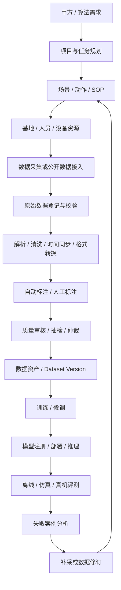

# DDP 目标业务架构蓝图

> 本文是长期目标架构，不是当前系统现状。实施前必须通过仓库审计确认差距。

## 1. 目标闭环



经营管理与上述流程共享项目、任务、供应商、基地、有效工时、质量、交付和结算数据。

## 2. 业务域与模块

| 业务域 | 模块范围 | 关键对象 |
|---|---|---|
| 工作台与项目 | 工作台、客户、项目、需求、交付批次 | Customer、Project、Requirement、DeliveryBatch |
| 资源运营 | 供应商、城市、基地、团队、人员、排班、物料 | Supplier、Base、Team、Person、Inventory |
| 设备与生产 | 机器人、传感器、场景、动作、SOP、采集任务 | Device、Scenario、Task、Session、Episode |
| 数据接入治理 | 数据源、导入、解析、处理、格式转换 | DataSource、ImportJob、Asset、Stream |
| 标注与质量 | 标签 Schema、标注任务、自动标注、审核、抽检 | AnnotationTask、Annotation、Review、QualityResult |
| 数据资产 | 数据目录、Dataset、Version、Split、导出 | Dataset、DatasetVersion、DatasetSample |
| 模型闭环 | 训练、模型注册、部署、推理、评测、失败回流 | TrainingRun、ModelVersion、Deployment、Evaluation |
| 经营分析 | 收入、成本、毛利、产能、回款、供应商绩效 | CostLedger、Acceptance、Receivable、Payment |
| 系统支撑 | 用户、角色、权限、审计、日志、任务、集成 | User、Role、AuditEvent、BackgroundJob |

## 3. 端到端业务对象

建议统一数据层级：

```text
DataSource
  └── Dataset / CollectionProject
        └── TaskDefinition / CollectionTask
              └── Session
                    └── Episode
                          ├── MediaAsset
                          ├── SensorStream
                          ├── Observation
                          ├── ControlCommand
                          ├── ExecutionState
                          ├── Annotation
                          ├── QualityResult
                          └── TimelineEvent
```

公开数据集可能没有设备、基地、操作员等字段，应允许为空，不能补造信息。

## 4. 核心追溯关系

训练与数据追溯链：

`ModelVersion → TrainingRun → DatasetVersion → DatasetSample → Episode → Session → Task → Source`

生产数据还应能追溯到项目、场景、设备、操作员、供应商和基地（仅在来源确实提供这些信息时）。

## 5. 数据原则

1. 原始数据不可原地覆盖。
2. 派生数据必须记录来源和处理版本。
3. 文件记录 URI、大小、格式、校验和。
4. 时间序列明确时间戳来源、单位和同步状态。
5. 动作数据明确维度、单位、坐标系、关节顺序和语义。
6. Dataset Version 应可复现，不静默覆盖。
7. 模型预测、人工修订和最终审核结论分层保存。
8. 训练记录关联 Dataset Version、代码 Commit、配置和产物。
9. 数据集来源、License、Revision 和访问条件必须留存。

## 6. 当前 MVP 的优先闭环

```text
Hugging Face
  → Dataset 登记
  → 许可与访问条件核验
  → 小样本导入 / Streaming
  → 本地缓存与完整性校验
  → 格式 Adapter
  → Episode / 视频 / 元数据解析
  → 样本审看与时间轴
  → 人工审核
  → 基础质量报告
  → 可追溯 Dataset Version / 导出
```

## 7. 架构实施原则

- 先沿用现有模块化结构；不得为符合图示而重建工程。
- 优先模块化单体和 Adapter；没有规模证据不拆微服务。
- 复用现有认证、存储、任务队列、UI 组件和日志设施。
- Label Studio、LeRobot、Hugging Face、FFmpeg、OpenCV、ROS、MCAP 等按实际需要集成。
- 真实机器人控制必须独立经过权限校验和安全联锁；当前 MVP 不发送运动指令。
- 经营核算规则必须由业务口径确认，不能将历史项目价格写死为全局规则。
