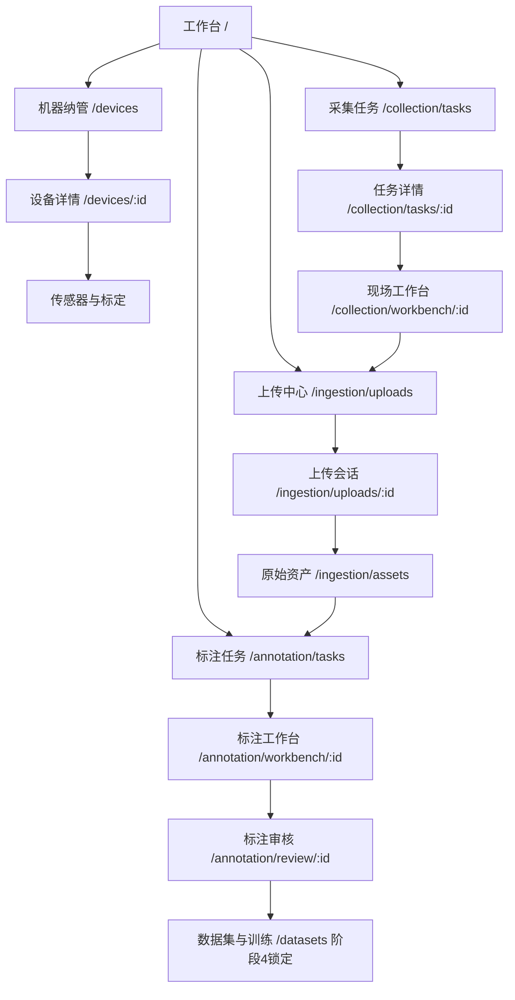

# DDP 阶段 0–1 主链路信息架构与页面规范

> 文档编号：DDP-UX-001  
> 任务：DDP-102  
> 版本：v1.0  
> 日期：2026-11-08  
> Owner：UX Designer  
> 状态：待评审  
> 建设基线：`docs/DDP_具身智能数据闭环平台建设总规范_V1.0_FINAL.md`  
> 关联：`docs/02-差距分析与实施计划-2026-11-08.md`、ADR-0003、ADR-0004、ADR-0005  
> 适用范围：阶段 0 工作台骨架、阶段 1 机器纳管，以及阶段 2–3 采集、上传、标注工作台的前瞻规范。  
> 边界：本文只定义信息架构、交互、页面状态与体验验收建议；不定义业务状态机、权限规则、API 契约和数据库结构。

---

## 0. 摘要

1. 主链路固定为：**机器纳管 → 采集任务 → 现场采集 → 上传与接入 → 标注与审核**；数据集与训练在阶段 4 之前保持锁定。
2. 导航沿用现有 `AppLayout` 的一级菜单，不新增第二套导航体系；业务页面按“列表 → 详情抽屉/详情页 → 作业工作台”组织。
3. 设计系统唯一基线为 **Ant Design 5 + `apps/web/src/styles/tokens.css`**。不引入 Tailwind、MUI、Element Plus 或另一套组件库。
4. 每个页面必须覆盖 **Loading / Empty / Error / Forbidden / Partial / Stale / Disabled**，现场工作台额外覆盖 **Offline / Pending / Success / Failed / Conflict**。
5. 现场工作台以“低学习成本、明显操作、SOP 就近可见、弱网上传可恢复、错误可理解”为第一优先级。
6. 当前阶段 0 已实现的工作台仅展示健康检查、平台元信息和检查清单；本文中设备、采集、上传、标注页面均为规划态，不代表代码已实现。

---

## 1. 目的、范围与非目标

### 1.1 目的

- 冻结主链路页面地图、导航层级、路由建议和页面之间的跳转关系。
- 为每个页面定义信息层级、关键操作、操作反馈和状态覆盖。
- 为现场采集与上传定义弱网、断点续传、错误提示和恢复路径。
- 为 Frontend Engineer 提供可实施的布局、组件、交互和响应式说明。
- 为 Product Manager / QA 提供可用性风险和验收场景。

### 1.2 范围

- 工作台（阶段 0 现有，阶段 1–2 扩展）。
- 机器纳管：设备列表、设备详情、传感器与标定记录。
- 数据采集：采集任务列表、任务详情、现场采集工作台。
- 数据接入：上传中心、上传会话详情、原始资产/接入状态。
- 标注中心：标注任务列表、标注工作台、标注审核。
- 全局状态、错误提示、响应式、表格/筛选/抽屉/弹窗/表单规范。

### 1.3 非目标

- 不设计数据集构建、训练交付、模型评测、运营分析、供应商与基地管理。
- 不替代 PRD、领域状态机、RBAC 权限矩阵、OpenAPI 契约。
- 不规定具体接口字段和数据库表结构；文中出现的字段仅作为页面展示需求，最终以 Architect 冻结契约为准。
- 不引入新的 UI 组件库、图标库、主题体系或第二套设计令牌。
- 不实现代码、不修改 `tokens.css`、不修改路由文件。

---

## 2. 设计基线与约束

### 2.1 现有系统事实

| 项 | 现状 | 对 UX 的约束 |
|---|---|---|
| 前端框架 | React 18 + TypeScript strict + Vite | 页面与组件使用函数式组件，状态显式建模 |
| 组件库 | Ant Design 5.22.5 | 所有基础控件优先使用 AntD，不自建平行组件库 |
| 路由 | React Router 6 | 页面使用路由；筛选、分页、标签页写入 query string |
| 布局 | `AppLayout`：左侧 232px Sider + Header + Content | 新增页面沿用此骨架；窄屏折叠 Sider |
| 设计令牌 | `apps/web/src/styles/tokens.css`：`--ddp-bg`、`--ddp-surface`、`--ddp-border`、`--ddp-text`、`--ddp-text-muted`、`--ddp-brand` | 品牌色、背景、边框、文本沿用现有变量；状态色使用 AntD 语义 token |
| 现有导航 | 工作台、项目管理、机器纳管、数据采集、数据接入、标注中心、数据集与训练 | 不重命名一级菜单；未开放项保持 disabled 并说明阶段 |
| 错误契约 | `ErrorEnvelope`：`error.code`、`error.message`、`error.request_id` | Error/Forbidden 状态必须展示 `request_id` 便于定位 |
| 前端错误封装 | `ApiError(status, message)` | 页面按 HTTP 状态和错误码映射为可理解提示 |

### 2.2 唯一设计系统

- **基础控件**：Button、Input、Select、Table、Form、Drawer、Modal、Tabs、Tag、Alert、Result、Skeleton、Spin、Upload、Progress、Timeline、Descriptions、Empty、Tooltip、Popconfirm 等全部使用 AntD。
- **布局与样式**：使用 AntD `ConfigProvider` 主题能力与现有 `--ddp-*` CSS 变量；新增样式只允许扩展 `tokens.css` 中的 `--ddp-*` 变量，不新建另一套 CSS 变量命名体系。
- **业务封装**：允许在 `apps/web/src/components/ui` 或模块内封装 `PageHeader`、`FilterBar`、`StateBoundary`、`StatusTag`、`UploadQueue` 等组合组件，但这些组件只能组合 AntD 与现有令牌，不得形成第二套视觉语言。
- **专用可视化**：标注工作台的视频、时间轴、波形，以及现场采集的相机预览属于领域专用画布，可在 AntD 外壳内实现；引入播放器/时间轴第三方库需由 Architect 评估，且外壳、按钮、表单、状态提示仍使用 AntD。
- **禁止**：Tailwind、MUI、Element Plus、Bootstrap、另一套图标库、另一套色板、另一套间距体系、无评审的全局样式覆盖。

### 2.3 令牌与视觉规则

| 用途 | 规则 |
|---|---|
| 品牌色 | `--ddp-brand`（#2f6fed），用于主按钮、选中态、关键链接 |
| 页面背景 | `--ddp-bg`（#f5f7fb） |
| 卡片/内容背景 | `--ddp-surface`（#ffffff） |
| 边框 | `--ddp-border`（#e5e9f2） |
| 主文本 | `--ddp-text`（#1b2430） |
| 次要文本 | `--ddp-text-muted`（#6b7785） |
| 成功/警告/错误/信息 | 使用 AntD 语义 token：`colorSuccess`、`colorWarning`、`colorError`、`colorInfo`，不自定义第二套状态色 |
| 圆角 | 控件沿用 AntD 默认；卡片可用 8px；品牌标识维持现有 10px |
| 间距 | 4 / 8 / 12 / 16 / 24 / 32；桌面内容区 24px，窄屏 16px |
| 字体 | 使用 AntD 默认字体栈；不引入新字体文件 |
| 动效 | 150–200ms；尊重 `prefers-reduced-motion` |

### 2.4 布局与栅格

- 桌面使用 AntD 24 栅格，常用 `gutter={16}`；页面内容不设固定最大宽度，但表单和阅读型内容建议限制在 960–1200px。
- 页面垂直间距使用 16 / 24；卡片内边距 16 / 24。
- 页面顶部依次为：面包屑、页面标题、项目上下文与状态、页面级主操作。
- 筛选区与内容区分离；筛选区不随表格横向滚动。
- 详情优先使用抽屉，复杂对象使用独立详情页；现场作业使用独立全屏工作台。

### 2.5 文案规则

- 全部使用简体中文；技术术语可保留英文原词，如 SOP、Episode、Hash、RawAsset。
- 操作按钮使用动词开头：新建任务、开始采集、继续上传、提交自检、重新检测。
- 错误文案必须包含四要素：**发生了什么、可能原因、用户可以做什么、错误码/request_id**。
- 禁止只显示“操作失败”“未知错误”“系统异常”；禁止把堆栈、SQL、内部路径暴露给用户。
- 危险操作必须写清影响范围：将影响多少条记录、是否可恢复、是否可撤销。
- 数字必须有单位；缺失数据不得显示为 0，使用“— / 未知 / 数据未同步”。

### 2.6 可访问性

- 键盘可完成主要操作；焦点顺序与视觉顺序一致；Drawer/Modal 打开后焦点进入并循环。
- 触控目标不小于 44×44px；现场工作台主按钮高度不低于 48px。
- 状态不能只靠颜色表达，必须同时有文字或图标。
- 正文对比度不低于 4.5:1；关键状态文字不低于 4.5:1。
- 表单错误与字段关联；动态状态使用 `aria-live` 提示。
- 不使用仅 hover 才出现的操作；移动端不依赖右键或键盘快捷键。

---

## 3. 角色、权限与项目上下文

> 以下角色与可见性为体验假设，不是权限规则；最终以服务端 RBAC / Project Scope 为准。前端不做权威权限校验。

### 3.1 角色体验假设

| 角色 | 主要任务 | 默认首页 | 关键页面 |
|---|---|---|---|
| 项目负责人 / 项目经理 | 项目进度、任务下发、异常处理 | 工作台 | 工作台、采集任务、任务详情、数据集 |
| 采集负责人 | 任务拆分、人员设备分配、审核提交 | 工作台 | 采集任务、任务详情、现场工作台 |
| 采集员 | 领取任务、现场采集、上传、自检 | 现场工作台 | 现场工作台、上传中心 |
| 设备运维 | 设备登记、标定、巡检、维修 | 机器纳管 | 设备列表、设备详情、标定记录 |
| 标注负责人 | 标注任务分配、进度、审核 | 标注中心 | 标注任务、标注工作台、审核 |
| 标注员 | 领取标注任务、标注、提交 | 标注中心 | 标注任务、标注工作台 |
| 质检 / 审核员 | 抽检、通过/驳回、返工 | 标注中心 | 审核页、任务详情 |
| 算法 / 只读 | 查看数据状态、下载授权数据 | 工作台 | 只读列表与详情 |

### 3.2 菜单可见性

- 菜单按角色和项目授权展示；无权限的菜单默认隐藏。
- 直接输入 URL 访问无权限页面时，必须显示 **Forbidden**，不得只靠前端隐藏。
- 未开放模块显示阶段标签和禁用原因，例如“阶段 4 开放”；直接访问显示“功能未开放”，不伪造空数据。
- 项目管理在阶段 1 开放前保持现有 disabled 状态；机器纳管、数据采集、数据接入、标注中心按阶段门禁逐项启用。

### 3.3 项目上下文

- Header 固定展示当前项目名称、项目编码、环境标识（local/dev/staging/prod）。
- 所有业务页面在标题区或 Header 重复显示项目上下文，避免跨项目误操作。
- 切换项目后：清空当前筛选、返回该模块列表、重新校验权限；未保存表单先提示。
- 不在业务页面提供“全部项目”聚合视图，除非后续有明确授权的只读运营页。
- 客户端传入的 `project_id` 不作为权限依据；页面只展示服务端返回的数据。

---

## 4. 全局信息架构

### 4.1 导航结构

沿用现有 `AppLayout` 一级菜单，页面内部使用 Tabs / 二级导航，不新增一级菜单：

```text
DDP
├── 工作台                    /
├── 项目管理                  /projects（阶段 1，锁定）
├── 机器纳管                  /devices
│   ├── 设备列表              /devices
│   └── 设备详情 / 标定       /devices/:deviceId
├── 数据采集                  /collection
│   ├── 采集任务              /collection/tasks
│   ├── 任务详情              /collection/tasks/:taskId
│   └── 现场工作台            /collection/workbench/:taskId
├── 数据接入                  /ingestion
│   ├── 上传中心              /ingestion/uploads
│   ├── 上传会话详情          /ingestion/uploads/:sessionId
│   └── 原始资产              /ingestion/assets
├── 标注中心                  /annotation
│   ├── 标注任务              /annotation/tasks
│   ├── 标注工作台            /annotation/workbench/:taskId
│   └── 审核                  /annotation/review/:taskId
└── 数据集与训练              /datasets（阶段 4，锁定）
```

### 4.2 页面地图



### 4.3 路由与阶段

| 页面 | 路由 | 主要角色 | 阶段 | 当前状态 |
|---|---|---|---|---|
| 工作台 | `/` | 全部 | 阶段 0 | 已实现骨架 |
| 设备列表 | `/devices` | 设备运维、采集负责人 | 阶段 1 | 规划 |
| 设备详情 | `/devices/:deviceId` | 设备运维、采集负责人 | 阶段 1 | 规划 |
| 采集任务列表 | `/collection/tasks` | 采集负责人、项目经理 | 阶段 2 | 规划 |
| 采集任务详情 | `/collection/tasks/:taskId` | 采集负责人、项目经理 | 阶段 2 | 规划 |
| 现场工作台 | `/collection/workbench/:taskId` | 采集员 | 阶段 2 | 规划 |
| 上传中心 | `/ingestion/uploads` | 采集员、采集负责人 | 阶段 2 | 规划 |
| 上传会话详情 | `/ingestion/uploads/:sessionId` | 采集员、采集负责人 | 阶段 2 | 规划 |
| 原始资产 | `/ingestion/assets` | 数据工程、采集负责人 | 阶段 2 | 规划 |
| 标注任务列表 | `/annotation/tasks` | 标注负责人、标注员 | 阶段 3 | 规划 |
| 标注工作台 | `/annotation/workbench/:taskId` | 标注员 | 阶段 3 | 规划 |
| 标注审核 | `/annotation/review/:taskId` | 质检、标注负责人 | 阶段 3 | 规划 |
| 数据集与训练 | `/datasets` | 算法、项目经理 | 阶段 4 | 锁定 |

### 4.4 页面骨架与信息层级

所有业务页面统一采用五层信息结构：

1. **全局层**：左侧导航、Header、项目上下文、环境标识。
2. **页面层**：面包屑、标题、状态摘要、页面级主操作、更新时间。
3. **摘要层**：关键指标、状态分布、告警、筛选条件。
4. **内容层**：表格、卡片、时间轴、工作台画布。
5. **详情层**：右侧抽屉、弹窗、独立详情页、操作记录。

规则：

- 每个页面只保留一个视觉最强的主操作；次要操作使用普通按钮或“更多”菜单。
- 危险操作放在“更多”中，二次确认必须展示影响范围。
- 页面标题区固定显示“最近更新时间”和数据新鲜度，避免把旧数据当实时数据。
- 详情抽屉不丢失列表筛选与滚动位置；关闭后回到原位置。
- 复杂编辑（创建任务、设备完整档案）使用独立页面或分步表单，不用长弹窗。

### 4.5 URL 与状态持久化

- 列表筛选、分页、排序、Tab 写入 query string，刷新和分享后保持。
- 主对象使用路由（如 `/devices/:deviceId`），快速查看可使用 `?detail=id` 抽屉。
- 返回列表时保留筛选；从工作台返回时保留当前步骤。
- URL 不携带 Token、密码、文件内容、敏感查询条件。
- 未保存表单离开时使用确认弹窗；现场工作台使用更明确的“退出将保留本地草稿”提示。

### 4.6 全局反馈

- Header 常驻：网络状态、待上传数量、待办数量、帮助入口。
- 网络异常：顶部持久 Alert，不使用一闪而过的 message。
- 上传队列：Header 显示“上传中 2 / 待上传 5”，点击进入上传中心。
- 轻量成功反馈使用 `message`；需要用户处理的使用 `notification`；页面级失败使用 `Result` 或 `Alert`。
- 同一错误不重复弹出；同一请求失败只保留一个可操作提示。

---

## 5. 主链路操作流

### 5.1 端到端流程


### 5.2 机器纳管流程

1. 进入机器纳管列表，确认当前项目。
2. 新建设备：填写基础信息 → 能力描述 → 传感器 → 位置与负责人 → 保存草稿或提交。
3. 系统校验序列号唯一性、必填能力、标定信息；冲突时定位到字段。
4. 设备进入“待标定/可用”等状态，具体状态以领域状态机为准。
5. 完成标定登记后，设备可被采集任务选择；标定过期时在列表、详情和任务分配处同时提示。
6. 设备维修、停用、报废等操作必须填写原因并记录操作人。

### 5.3 采集任务与现场流程

```text
创建任务 → 提交审核 → 审批通过 → 分配人员/设备 → 现场领取
→ 开工检查 → 采集中 → 暂停/异常 → 上传 → 自检 → 提交
→ 数据校验 → 通过/返工
```

- 前端不直接修改任务状态，只展示服务端返回的 `allowed_actions` 或等价动作集合。
- 暂停、取消、驳回、返工必须填写原因。
- 现场工作台只呈现当前用户可执行的动作；不可执行动作显示原因。
- 任务状态变化导致当前页面过期时，显示 Conflict 提示并刷新，不静默覆盖。

### 5.4 上传与接入流程

```text
选择任务/批次 → 选择文件 → 本地预检（类型/大小/重名）
→ 创建上传会话 → 分片上传（可暂停/续传）
→ 上传完成 → 服务端校验（大小/类型/签名/Hash）
→ RawAsset 登记 → 隔离区/可用 → 处理任务 → Episode
```

关键原则：

- **“上传完成”不等于“成功”**；只有服务端校验并完成 RawAsset 登记后，才显示“已登记”。
- 上传进度按已上传字节计算；未知总量时使用不确定进度，不伪造百分比。
- 分片失败只重试失败分片；Hash 不匹配才要求整体重传。
- 重复文件按 Hash 识别；是否复用或拒绝由业务规则决定，界面必须明确展示已有资产。
- 上传会话过期时，优先恢复；无法恢复时明确提示重新创建，不静默丢失文件。

### 5.5 标注与审核流程

```text
标注任务创建 → 标注员领取 → 打开工作台 → 加载 Episode/Schema
→ 标注/帧标记 → 自动保存 → 提交 → 审核/抽检
→ 通过 / 驳回并说明原因 → 返工 → 重新提交
```

- 标签 Schema 由服务端版本化下发，前端不写死标签。
- AI 辅助结果必须展示置信度，低置信度突出显示，人工确认后才生效。
- 自动保存状态必须可见：已保存 / 保存中 / 保存失败 / 有未保存更改。
- 提交后进入只读或审核态；审核冲突时保留本地草稿并提示刷新。

---

## 6. 页面规范

> 每页统一包含：目标与用户、路由与阶段、信息层级、关键操作、状态覆盖、响应式与交互要点。  
> 状态覆盖表中的“本页表现”是该页面的最低实现要求，不能只做全局提示。

### 6.1 工作台 `/`

**目标与用户**：所有角色的统一入口，展示当前项目、待办、异常和主链路快捷入口。阶段 0 只展示服务健康、平台元信息和检查清单；阶段 1–2 扩展为角色化待办。

**信息层级**：

1. 项目与角色问候、环境标识。
2. 全局告警：服务异常、网络异常、待上传、待审核。
3. 关键指标卡：我的待办、待上传、待标注、待审核、异常任务。
4. 我的任务/队列：按角色展示。
5. 最近动态与阶段检查清单。

**关键操作**：

| 操作 | 角色 | 反馈 | 限制 |
|---|---|---|---|
| 切换项目 | 全部 | 页面重载该项目的待办 | 无权限项目不显示 |
| 继续现场任务 | 采集员 | 进入现场工作台对应步骤 | 任务非本人或已结束则禁用 |
| 恢复上传 | 采集员 | 进入上传中心并定位会话 | 无待上传时隐藏 |
| 打开 SOP | 采集员 | 侧边抽屉展示当前版本 SOP | 任务未授权时禁用 |
| 刷新服务状态 | 全部 | 重新请求健康检查与元信息 | 请求中按钮 loading |

**状态覆盖**：

| 状态 | 本页表现 | 用户可做 |
|---|---|---|
| Loading | 指标卡与列表使用 Skeleton；不显示 0 占位 | 等待 |
| Empty | 无待办时显示“暂无待办”，提供“查看全部任务” | 跳转任务列表 |
| Error | 单卡片失败只影响该卡片；显示错误摘要、request_id、重试 | 重试或稍后再试 |
| Forbidden | 无项目权限时整页 Result 403，不显示业务数据 | 切换项目/联系管理员 |
| Partial | 健康正常但元信息失败时，保留健康卡片并显示“部分信息不可用” | 重试失败部分 |
| Stale | 指标超过新鲜度阈值时显示“数据更新于…”和刷新按钮 | 刷新 |
| Disabled | 锁定模块显示阶段标签；按钮禁用并说明原因 | 查看阶段说明 |

**响应式**：指标卡桌面 4 列、平板 2 列、手机 1 列；待办列表在手机改为卡片。  
**阶段 0 说明**：现有实现只有健康检查、平台元信息和阶段 0 检查清单；不得用 Mock 业务待办冒充已实现能力。

---

### 6.2 机器纳管：设备列表 `/devices`

**目标与用户**：设备运维和采集负责人查找、登记、维护设备，确认设备可用于采集。

**信息层级**：

1. 页面标题、设备总数、主操作“新建设备”。
2. 状态摘要：可用、使用中、待标定、维修中、停用。
3. 筛选区：关键词、设备类型、状态、厂商/型号、位置、负责人、标定状态。
4. 设备表格。
5. 行内操作与详情抽屉。

**表格建议列**：设备名称、设备 ID、类型、厂商/型号、序列号、状态、能力摘要、位置、负责人、最近标定、最近心跳、更新时间。

**关键操作**：

| 操作 | 角色 | 反馈 | 限制 |
|---|---|---|---|
| 搜索/筛选 | 全部有权限用户 | 列表刷新，条件写入 URL | 无 |
| 新建设备 | 设备运维 | 打开新建页/分步表单 | 无权限时禁用并说明 |
| 查看详情 | 全部有权限用户 | 打开详情抽屉或详情页 | 无 |
| 登记标定 | 设备运维 | 打开标定表单，成功后刷新状态 | 停用/报废设备禁用 |
| 修改状态 | 设备运维 | 二次确认 + 原因 | 状态机不允许时禁用 |
| 健康检查 | 设备运维 | 行内 pending，完成后显示最新状态 | 适配器不支持时显示“不支持” |

**状态覆盖**：

| 状态 | 本页表现 | 用户可做 |
|---|---|---|
| Loading | 表格 Skeleton，保留筛选区 | 等待 |
| Empty | 无设备显示“尚未登记设备”+ 新建；筛选无结果显示“无匹配结果”+ 清空筛选 | 新建/清空筛选 |
| Error | 表格区域 Error，保留筛选条件；显示 request_id 和重试 | 重试 |
| Forbidden | 整页 403，不渲染表格与统计 | 切换项目 |
| Partial | 部分设备状态来自适配器失败时显示“状态未知”，页面顶部提示部分数据不可用 | 重新检测单台设备 |
| Stale | 心跳超时或状态超过阈值时显示“状态可能过期”+ 最近心跳；不得显示为“可用” | 重新检测/刷新 |
| Disabled | 新建、标定、停用等按权限和状态禁用，Tooltip 说明原因 | 查看原因 |

**响应式**：≥1024 使用表格；768–1023 表格横向滚动并固定首列；<768 改为设备卡片，筛选进入全屏抽屉，主操作固定在底部。  
**交互**：行点击打开详情；操作列只保留 1 个主操作 + “更多”；批量操作需业务批准后再设计，默认不提供批量删除。

---

### 6.3 设备详情与标定 `/devices/:deviceId`

**目标与用户**：查看设备完整档案、传感器、标定与运维记录，执行维护动作。

**信息层级**：

1. 标题：设备名称、设备 ID、状态、最近心跳、主操作。
2. 概览：厂商/型号、序列号、固件、硬件版本、位置、负责人、能力摘要。
3. Tabs：概览 / 传感器 / 标定记录 / 运维记录 / 关联采集任务。
4. 右侧或底部操作记录。

**关键操作**：

| 操作 | 角色 | 反馈 | 限制 |
|---|---|---|---|
| 编辑基础信息 | 设备运维 | 打开表单，保存后局部刷新 | 停用/报废只读 |
| 新增/编辑传感器 | 设备运维 | 抽屉表单，校验序列号与采样参数 | 无权限禁用 |
| 登记标定 | 设备运维 | 表单 + 文件/参数 + 有效期 | 设备状态不允许时禁用 |
| 运行健康检查 | 设备运维 | 按钮 loading，展示结果与时间 | 适配器不支持显示 Unsupported |
| 登记维修/巡检 | 设备运维 | 时间线新增记录 | 无权限禁用 |
| 停用/报废 | 设备运维/管理员 | 二次确认 + 原因 + 影响提示 | 使用中设备需先解除关联 |

**状态覆盖**：

| 状态 | 本页表现 | 用户可做 |
|---|---|---|
| Loading | 标题与 Tabs 使用 Skeleton；不先渲染空表单 | 等待 |
| Empty | 传感器/标定/运维记录为空时显示说明和对应新增入口 | 新增 |
| Error | 按 Tab 隔离错误；基础信息失败显示整页错误 | 重试 |
| Forbidden | 整页 403，不显示设备敏感信息 | 切换项目 |
| Partial | 部分传感器能力不支持或数据缺失时逐项显示“不支持/未知” | 查看说明 |
| Stale | 标定过期、心跳超时、状态过期时高亮提示 | 重新标定/检测 |
| Disabled | 编辑、标定、停用按状态和权限禁用，Tooltip 说明 | 查看原因 |

**响应式**：桌面 Tabs 横排；手机 Tabs 可横向滚动，Descriptions 改单列，操作收进“更多”。  
**危险操作**：停用/报废必须显示关联任务数量；有关联时先引导处理，不直接成功。

---

### 6.4 采集任务列表 `/collection/tasks`

**目标与用户**：采集负责人和项目经理管理任务生命周期；采集员查看自己的任务入口。

**信息层级**：

1. 标题、任务总数、主操作“新建任务”。
2. 状态摘要与今日/本周筛选。
3. 筛选：关键词、状态、项目、场景、负责人、设备、时间范围。
4. 任务表格。
5. 详情抽屉/详情页。

**表格建议列**：任务编码、任务名称、场景/动作、状态、负责人、设备、计划时间、进度、数据量、更新时间。

**关键操作**：

| 操作 | 角色 | 反馈 | 限制 |
|---|---|---|---|
| 新建任务 | 采集负责人 | 进入分步创建页 | 无权限禁用 |
| 查看详情 | 有权限用户 | 详情页/抽屉 | 无 |
| 分配人员/设备 | 采集负责人 | 抽屉选择，冲突时提示 | 任务状态不允许时禁用 |
| 提交审核/审批 | 负责人/项目经理 | 确认 + 状态更新 | 按状态机 |
| 暂停/取消 | 负责人 | 必须填写原因 | 已完成任务禁用 |
| 进入现场工作台 | 采集员/负责人 | 打开对应任务工作台 | 非本人或未开始则禁用 |

**状态覆盖**：

| 状态 | 本页表现 | 用户可做 |
|---|---|---|
| Loading | 表格 Skeleton + 筛选保留 | 等待 |
| Empty | 无任务显示新建入口；筛选无结果显示清空筛选 | 新建/清空 |
| Error | 表格 Error + request_id + 重试；筛选不丢失 | 重试 |
| Forbidden | 403，不展示任务统计 | 切换项目 |
| Partial | 部分任务统计不可用或设备分配失败时，顶部 Partial 提示并标注具体任务 | 查看失败项 |
| Stale | 缓存任务状态过期时显示“状态可能已变化”+ 刷新 | 刷新 |
| Disabled | 新建、分配、暂停、取消按权限和状态禁用，说明原因 | 查看原因 |

**响应式**：表格在平板横向滚动；手机改任务卡片，状态与主操作优先，次要字段折叠。

---

### 6.5 采集任务详情 `/collection/tasks/:taskId`

**目标与用户**：查看任务全貌，执行状态允许的管理动作，进入现场工作台。

**信息层级**：

1. 标题：任务名称、编码、状态、负责人、主操作。
2. 状态与进度摘要：计划量、已完成量、异常数、数据量。
3. Tabs：概览 / SOP / 设备与传感器 / 批次与执行 / 数据与上传 / 操作记录。
4. 右侧操作记录或状态时间线。

**关键操作**：

| 操作 | 角色 | 反馈 | 限制 |
|---|---|---|---|
| 编辑草稿 | 采集负责人 | 表单保存 | 仅草稿态 |
| 提交审核 | 采集负责人 | 确认并刷新状态 | 必填项完整 |
| 审批通过/驳回 | 项目经理 | 驳回必须填原因 | 状态允许 |
| 分配/改派 | 采集负责人 | 抽屉选择，冲突提示 | 状态允许 |
| 暂停/恢复/取消 | 负责人 | 确认 + 原因 | 按状态机 |
| 打开现场工作台 | 采集员/负责人 | 新页面全屏工作台 | 非本人或状态不允许禁用 |
| 查看数据/上传 | 有权限用户 | 跳转上传中心并带任务筛选 | 无数据时显示空态 |

**状态覆盖**：

| 状态 | 本页表现 | 用户可做 |
|---|---|---|
| Loading | 标题与 Tabs Skeleton | 等待 |
| Empty | 批次、数据、操作记录为空时分别显示空态与下一步 | 创建批次/上传 |
| Error | 按 Tab 隔离；关键概览失败整页 Error | 重试 |
| Forbidden | 403，不显示 SOP 与人员信息 | 切换项目 |
| Partial | 部分批次上传失败或设备分配不完整时，顶部提示并逐项标注 | 查看失败项 |
| Stale | 收到 409 或状态已变化时提示“任务已被更新”，展示最新状态 | 刷新/重新操作 |
| Disabled | 所有动作按 `allowed_actions` 禁用并说明原因 | 查看原因 |

**响应式**：桌面 Tabs + 两栏；手机单列，操作收进底部操作栏，SOP 可全屏查看。

---

### 6.6 现场采集工作台 `/collection/workbench/:taskId`

**目标与用户**：采集员在现场完成任务确认、开工检查、采集、上传、自检和提交。要求低学习成本、明显操作、SOP 就近可见、弱网可恢复。

**布局（桌面/平板横屏）**：

```text
┌ 顶部：任务名称 / 状态 / 网络 / 上传队列 / 帮助 ─────────────┐
├ 左侧步骤栏 1-5 ┬ 中央当前步骤内容 ┬ 右侧 SOP / 设备状态 ┤
└ 底部固定操作栏：主操作 / 次操作 / 异常上报 ─────────────────┘
```

**布局（手机/竖屏）**：单列；顶部压缩状态栏；SOP 使用底部抽屉；底部固定大按钮；步骤栏改为顶部进度条。

**步骤**：

1. 任务确认：任务、场景、动作、数量、SOP 版本。
2. 开工检查：设备、传感器、标定、时间同步、存储、电量、场景。
3. 采集：开始/暂停/继续，显示录制状态与已产生文件。
4. 上传：上传队列、进度、暂停/续传、校验状态。
5. 自检提交：必填项检查、异常记录、提交。

**信息层级**：

1. 当前任务与状态。
2. 当前步骤与下一步。
3. 阻塞项（红色）与警告项（黄色）。
4. SOP 当前步骤（就近可见）。
5. 上传队列与网络状态。

**关键操作**：

| 操作 | 角色 | 反馈 | 限制 |
|---|---|---|---|
| 开始开工检查 | 采集员 | 逐项显示通过/失败/警告 | 任务未领取或非本人禁用 |
| 重新检测 | 采集员 | 重新执行检查，保留已完成项 | 检查中禁用重复点击 |
| 开始采集 | 采集员 | 明显状态变化“正在采集” | 阻塞项未通过时禁用 |
| 暂停/继续 | 采集员 | 状态与计时变化 | 未开始或已结束禁用 |
| 异常上报 | 采集员 | 选择类型 + 描述 + 可选照片 | 提交中禁用重复提交 |
| 上传/暂停/续传 | 采集员 | 队列进度、速度、剩余时间 | 无文件或离线时按规则处理 |
| 自检提交 | 采集员 | 检查清单 + 结果 | 必填数据未完成时禁用并列出原因 |
| 查看 SOP | 采集员 | 侧栏/全屏，显示版本 | 无权限不加载 |

**状态覆盖**：

| 状态 | 本页表现 | 用户可做 |
|---|---|---|
| Loading | 任务与 SOP Skeleton；未加载完不显示“开始采集” | 等待 |
| Empty | 无任务批次/无采集数据时显示明确空态和下一步 | 返回任务/开始采集 |
| Error | 任务加载失败为阻塞错误；上传失败为单文件错误 | 重试/联系支持 |
| Forbidden | 403，不显示 SOP、设备与任务详情 | 返回/切换账号 |
| Partial | 部分传感器离线、部分文件上传成功时逐项标注；阻塞项与警告项分开 | 继续非阻塞步骤/重试 |
| Stale | SOP 更新、设备心跳过期、时间偏差、任务状态变化时高亮提示 | 重新确认/刷新 |
| Disabled | 开始采集、提交等按检查结果禁用，原因直接显示在按钮下方 | 完成前置检查 |
| Offline | 顶部“离线”横幅；本地草稿与上传队列保留；提交标记“待联网提交” | 继续采集/等待恢复 |
| Pending | 上传中/校验中/提交中显示状态，禁止重复提交 | 等待 |
| Success | 上传登记成功、提交成功显示明确结果与下一步 | 下一任务/返回 |
| Failed | 显示失败原因、可重试动作、request_id | 重试/上报 |
| Conflict | 任务被他人更新或重复提交时提示最新状态 | 刷新/返回 |

**交互要点**：

- 同一时刻只有一个视觉主按钮；主按钮文案随步骤变化。
- 所有阻塞项必须在按钮附近说明“为什么不能继续”和“如何解决”。
- SOP 固定在右侧或底部抽屉，步骤高亮；SOP 版本变化必须重新确认。
- “正在采集”使用持续可见的状态条，不能只靠颜色。
- 退出/返回必须提示未上传数据；优先保留本地草稿。
- 支持横屏与竖屏；现场主按钮高度不低于 48px；不依赖 hover。

---

### 6.7 上传中心 `/ingestion/uploads`

**目标与用户**：集中管理上传队列、断点续传、失败恢复和服务端校验状态。

**信息层级**：

1. 标题与主操作“新建上传”。
2. 队列摘要：待上传、上传中、校验中、失败、已完成。
3. 筛选：任务、状态、文件类型、时间。
4. 上传队列列表。
5. 单个上传会话详情抽屉/页面。

**关键操作**：

| 操作 | 角色 | 反馈 | 限制 |
|---|---|---|---|
| 新建上传 | 采集员/负责人 | 选择任务/批次与文件 | 无权限或任务状态不允许时禁用 |
| 暂停/继续 | 采集员 | 进度停止/恢复 | 已完成/已取消禁用 |
| 重试失败项 | 采集员 | 只重试失败分片或文件 | 校验失败需按原因处理 |
| 取消上传 | 采集员 | 二次确认，说明本地文件不删除 | 已登记禁用 |
| 查看校验结果 | 采集员/负责人 | 打开会话详情 | 无 |
| 打开原始资产 | 有权限用户 | 跳转资产详情 | 未登记时禁用 |

**状态覆盖**：

| 状态 | 本页表现 | 用户可做 |
|---|---|---|
| Loading | 队列 Skeleton，保留摘要卡 | 等待 |
| Empty | 无上传记录显示“暂无上传”+ 新建入口 | 新建上传 |
| Error | 队列加载失败显示 Error + 重试；已存在队列不被清空 | 重试 |
| Forbidden | 403，不显示任务与文件名 | 切换项目 |
| Partial | 部分文件成功、部分失败时，顶部显示“部分完成”，逐文件标注 | 重试失败项 |
| Stale | 会话过期或状态长时间未更新时显示“会话可能已过期”+ 最近更新时间 | 恢复/新建会话 |
| Disabled | 暂停/继续/取消按状态禁用，说明原因 | 查看原因 |
| Offline | 顶部离线提示；队列进入“等待网络”，恢复后自动续传 | 等待/继续本地采集 |

**响应式**：桌面表格；平板横向滚动；手机改为上传卡片，进度条与主操作常驻，详情全屏。  
**禁止**：没有服务端确认时显示 100% 成功；进度条不得用动画伪装真实进度。

---

### 6.8 上传会话详情 `/ingestion/uploads/:sessionId`

**目标与用户**：查看单次上传的完整状态、文件列表、校验结果和关联 RawAsset。

**信息层级**：

1. 会话 ID、任务、设备、创建人、创建时间、状态。
2. 总大小、已上传、Hash、预计剩余。
3. 状态时间线：创建 → 上传 → 校验 → 登记 → 隔离/可用。
4. 文件列表：文件名、大小、类型、进度、状态、错误。
5. 校验结果与关联资产。

**关键操作**：暂停/继续、重试失败项、取消、复制会话 ID、打开原始资产、查看错误详情。

**状态覆盖**：

| 状态 | 本页表现 | 用户可做 |
|---|---|---|
| Loading | 头部与文件列表 Skeleton | 等待 |
| Empty | 会话无文件时说明原因并提供返回上传中心 | 返回/重新选择 |
| Error | 会话加载失败整页 Error；单文件失败影响该行 | 重试 |
| Forbidden | 403，不显示文件名与 Hash | 返回 |
| Partial | 部分文件成功/失败、部分校验未完成时分组展示 | 重试/等待 |
| Stale | 会话状态超过阈值未更新时提示可能过期 | 刷新/恢复 |
| Disabled | 取消/重试按状态禁用 | 查看原因 |

**错误详情**：每个失败文件显示错误码、可理解原因、建议动作、request_id；不显示堆栈。

---

### 6.9 原始资产与接入状态 `/ingestion/assets`

**目标与用户**：查看已登记原始资产、隔离区资产、处理状态和血缘入口。

**信息层级**：标题与统计 → 筛选（任务、格式、状态、时间、设备）→ 资产表格 → 详情抽屉（元数据、Hash、存储引用、校验、处理状态、血缘）。

**关键操作**：筛选、查看详情、下载（受审计与权限控制）、重试处理（按权限）、查看血缘、复制资产 ID。

**状态覆盖**：

| 状态 | 本页表现 | 用户可做 |
|---|---|---|
| Loading | 表格 Skeleton | 等待 |
| Empty | 无资产显示“暂无资产”+ 返回上传中心 | 上传 |
| Error | 列表 Error + 重试 | 重试 |
| Forbidden | 403，不显示资产元数据 | 切换项目 |
| Partial | 部分资产处理中/校验中时按行标注 | 查看详情 |
| Stale | 处理状态过期时显示最近更新时间和刷新 | 刷新 |
| Disabled | 下载/重试按权限和状态禁用 | 查看原因 |

**说明**：该页为阶段 2 支撑页，不替代数据集构建；隔离区资产必须显式标识，不能显示为可训练数据。

---

### 6.10 标注任务列表 `/annotation/tasks`

**目标与用户**：标注负责人分配与跟踪任务；标注员领取和进入工作台。

**信息层级**：标题与任务数 → 状态摘要 → 筛选（状态、项目、Schema、负责人、截止时间）→ 任务表格 → 详情/工作台入口。

**表格建议列**：任务名称、Episode 数、Schema 版本、状态、标注员、进度、截止时间、更新时间。

**关键操作**：筛选、领取、开始标注、查看进度、提交、审核入口、返工。

**状态覆盖**：

| 状态 | 本页表现 | 用户可做 |
|---|---|---|
| Loading | 表格 Skeleton | 等待 |
| Empty | 无任务显示说明；筛选无结果显示清空筛选 | 清空/返回 |
| Error | Error + request_id + 重试 | 重试 |
| Forbidden | 403，不显示任务内容 | 切换项目 |
| Partial | 部分任务进度不可用或 Episode 缺失时标注具体任务 | 查看详情 |
| Stale | 任务状态/进度过期时提示刷新 | 刷新 |
| Disabled | 领取/开始/提交按状态与权限禁用，说明原因 | 查看原因 |

**响应式**：桌面表格；手机任务卡片；主操作“继续标注”固定在卡片底部。

---

### 6.11 标注工作台 `/annotation/workbench/:taskId`

**目标与用户**：标注员高效完成 Episode 标注，保证标签版本、自动保存和提交可追溯。

**布局（桌面）**：

```text
┌ 顶部：任务 / Episode / Schema 版本 / 保存状态 / 提交 ─────────┐
├ 左侧 Episode/帧列表 ┬ 中央视频/多模态画布 ┬ 右侧标签 Schema ┤
└ 底部：时间轴 / 播放控制 / 片段操作 ─────────────────────────┘
```

**信息层级**：

1. 任务与当前 Episode。
2. 保存状态与 Schema 版本。
3. 主画布（视频、多路相机、状态曲线）。
4. 标签面板与时间轴。
5. 问题与历史记录。

**关键操作**：

| 操作 | 角色 | 反馈 | 限制 |
|---|---|---|---|
| 播放/暂停/逐帧 | 标注员 | 画布与时间轴同步 | 媒体未加载禁用 |
| 设置起止点/片段 | 标注员 | 时间轴显示区间 | 只读态禁用 |
| 选择/编辑标签 | 标注员 | 右侧面板更新，自动保存 | Schema 不匹配时提示 |
| 撤销/重做 | 标注员 | 操作历史变化 | 只读态禁用 |
| 自动保存 | 系统 | 显示“保存中/已保存/失败” | 失败必须显式提示 |
| 提交 | 标注员 | 校验必填项后提交 | 未保存/必填缺失时禁用 |
| 上报问题 | 标注员 | 选择类型 + 描述 | 提交中禁用 |
| 下一 Episode | 标注员 | 切换并保留当前保存状态 | 未保存时提示 |

**状态覆盖**：

| 状态 | 本页表现 | 用户可做 |
|---|---|---|
| Loading | 画布 Skeleton + 标签面板占位 | 等待 |
| Empty | 无 Episode 时显示说明与返回入口 | 返回 |
| Error | 媒体加载失败显示格式/网络原因和重试；标签加载失败单独提示 | 重试 |
| Forbidden | 403，不加载媒体与标签 | 返回 |
| Partial | 部分相机/传感器缺失时逐路标注“缺失”，不阻塞其他流 | 继续标注/上报 |
| Stale | Schema 已更新或标注版本冲突时提示；不静默覆盖 | 刷新/查看差异 |
| Disabled | 只读、已提交、审核中禁用编辑并说明 | 查看状态 |
| Offline | 显示离线提示；保留本地草稿，禁止提交；恢复后重新同步 | 等待/重试保存 |
| Pending | 保存中/提交中显示状态，禁止重复提交 | 等待 |
| Success | 保存/提交成功显示结果与下一步 | 下一 Episode |
| Failed | 保存/提交失败显示原因和重试 | 重试 |
| Conflict | 他人已更新或重复提交时保留草稿并提示刷新 | 刷新/对比 |

**AI 辅助**：建议必须显示模型、版本、置信度；低置信度突出；人工确认后才写入标签；不得自动通过。

**响应式**：完整编辑要求 ≥1280px 桌面；平板可提供简化只读/审核；手机显示“请使用桌面或平板进行标注”，并提供任务摘要，不提供不可用的编辑画布。

---

### 6.12 标注审核 `/annotation/review/:taskId`

**目标与用户**：质检/审核员查看标注结果，执行通过、驳回、返工和抽检。

**信息层级**：任务与 Episode 信息 → 标注版本与 Schema → 画布/标签对比 → 问题列表 → 审核动作与历史。

**关键操作**：通过、驳回（必填原因）、要求返工、查看版本差异、查看历史、上报问题。

**状态覆盖**：

| 状态 | 本页表现 | 用户可做 |
|---|---|---|
| Loading | 审核内容 Skeleton | 等待 |
| Empty | 无待审 Episode 显示空态 | 返回 |
| Error | 内容加载失败 Error + 重试 | 重试 |
| Forbidden | 403，不显示标注内容 | 返回 |
| Partial | 部分 Episode 缺失/部分标签不可用时逐项标注 | 查看/上报 |
| Stale | 标注版本已更新时提示刷新，不基于旧版本通过 | 刷新 |
| Disabled | 已审核、无权限、状态不允许时禁用动作 | 查看原因 |

**危险操作**：驳回/返工必须填写原因，确认后通知相关角色；不得一键批量通过未查看的数据。

---

## 7. 全局状态规范

### 7.1 状态定义

| 状态 | 定义 | 视觉 | 文案要求 | 可用操作 | 禁止 |
|---|---|---|---|---|---|
| Loading | 首次加载或关键区域刷新 | Skeleton / Spin；保持布局 | “正在加载…” | 等待；可取消长请求 | 显示假数据、0 占位、空白闪烁 |
| Empty | 请求成功但无数据 | `Empty` + 说明 + 下一步 | 区分“无数据/无匹配/无权限” | 新建、清空筛选、返回 | 把空数据当错误或成功 |
| Error | 请求失败或服务异常 | `Result` / `Alert` | 现象 + 原因 + 动作 + request_id | 重试、返回、联系支持 | 只显示“失败”、暴露堆栈 |
| Forbidden | 无权限或跨项目访问 | `Result` 403 | 无权限 + 当前项目 + request_id | 切换项目、联系管理员 | 渲染业务数据、闪烁 Skeleton |
| Partial | 部分数据/操作成功 | `Alert warning` + 逐项标记 | 哪些成功、哪些失败 | 重试失败项、继续可用部分 | 把部分成功显示为全部成功 |
| Stale | 数据超过新鲜度或状态可能过期 | `Tag` / `Alert` + 最近更新时间 | “数据更新于…，可能已过期” | 刷新；影响决策的写操作先刷新 | 静默使用旧数据 |
| Disabled | 控件因权限或前置条件不可用 | 禁用控件 + Tooltip/说明 | 为什么不可用、如何满足 | 查看原因、完成前置条件 | 只降低透明度、无解释 |
| Offline | 网络不可用 | 顶部持久横幅 + 本地状态 | “已离线，数据保存在本机” | 本地草稿、排队上传、等待恢复 | 假装在线、静默丢数据 |
| Pending | 异步处理中 | Tag processing / 进度 | “上传中/校验中/提交中” | 等待、查看进度 | 允许重复提交 |
| Success | 操作成功且服务端确认 | `Result success` / message | 成功结果 + 下一步 | 继续、返回、查看详情 | 在服务端确认前显示成功 |
| Failed | 操作失败 | `Result error` / 行内错误 | 原因 + 动作 + request_id | 重试、修改、上报 | 吞错、无限重试 |
| Conflict | 版本/状态冲突 | `Alert error` / Modal | 当前状态 + 本地更改 + 处理建议 | 刷新、查看差异、保留草稿 | 静默覆盖 |

### 7.2 状态优先级与组合

1. **首次进入**：Loading → Forbidden → Error → Empty → 内容。
2. **已有内容刷新**：保留内容 + 轻量 loading；失败转为 Stale + 错误提示，不整页清空。
3. **无权限**：直接 Forbidden，不先展示 Skeleton 或缓存数据。
4. **离线**：优先展示离线横幅；有缓存时标记“离线缓存/最近同步”；写操作按规则禁用或排队。
5. **Partial + Stale 同时存在**：顶部先显示 Partial，再在受影响区域显示 Stale；不要合并成一条模糊提示。
6. **Pending 期间**：主操作进入 loading 并禁用，防止重复提交；完成后转为 Success/Failed。
7. **Conflict**：停止当前写操作，保留用户输入，提示刷新或对比；不得自动覆盖。

### 7.3 页面 × 状态覆盖矩阵

图例：● 必测（P0）；○ 应覆盖（P1）；— 不适用。

| 页面 | Loading | Empty | Error | Forbidden | Partial | Stale | Disabled | 额外 |
|---|---|---|---|---|---|---|---|---|
| 工作台 | ● | ● | ● | ● | ○ | ● | ○ | Offline |
| 设备列表 | ● | ● | ● | ● | ● | ● | ● | — |
| 设备详情 | ● | ● | ● | ● | ● | ● | ● | — |
| 采集任务列表 | ● | ● | ● | ● | ○ | ● | ● | Conflict |
| 采集任务详情 | ● | ● | ● | ● | ● | ● | ● | Conflict |
| 现场工作台 | ● | ● | ● | ● | ● | ● | ● | Offline / Pending / Success / Failed / Conflict |
| 上传中心 | ● | ● | ● | ● | ● | ● | ● | Offline |
| 上传会话详情 | ● | ● | ● | ● | ● | ● | ● | Pending / Failed |
| 原始资产 | ● | ● | ● | ● | ○ | ● | ● | — |
| 标注任务列表 | ● | ● | ● | ● | ○ | ● | ● | — |
| 标注工作台 | ● | ● | ● | ● | ● | ● | ● | Offline / Pending / Success / Failed / Conflict |
| 标注审核 | ● | ● | ● | ● | ● | ● | ● | Conflict |

### 7.4 错误到用户提示映射

| HTTP / 场景 | 页面处理 | 用户提示要点 | 主操作 |
|---|---|---|---|
| 400 / 422 参数校验 | 字段级错误 + 表单摘要 | 哪个字段不对、期望格式 | 修改后重试 |
| 401 未登录/过期 | 跳转登录并保留返回路径 | 登录已过期 | 重新登录 |
| 403 无权限 | 整页 Forbidden 或区块禁用 | 当前项目/资源无权限；request_id | 切换项目/联系管理员 |
| 404 不存在 | NotFound 空态 | 资源不存在或已被删除；不泄漏其他项目信息 | 返回列表 |
| 409 状态冲突 | Conflict 提示 + 刷新 | 已被他人更新；展示最新状态 | 刷新/重新操作 |
| 413 文件过大 | 文件行内错误 | 大小上限、当前大小 | 更换文件 |
| 429 请求过频 | Alert + 倒计时 | 操作过于频繁，稍后再试 | 等待 |
| 5xx 服务异常 | Result/Alert | 服务暂时不可用；request_id | 重试/联系支持 |
| 网络超时/离线 | Offline/Stale + 队列 | 网络不稳定；本地数据已保留 | 等待/续传 |
| 分片上传失败 | 文件行内错误 | 失败分片、已重试次数 | 重试失败分片 |
| Hash 不匹配 | 文件行内错误 | 文件完整性校验失败 | 整体重传 |
| 格式不支持 | 文件行内错误 | 支持格式列表（服务端下发） | 更换格式 |
| 恶意文件/隔离 | 文件状态 + 说明 | 文件已隔离，不进入可用数据 | 查看详情/联系支持 |
| 适配器 Unsupported | 区块内 Tag | 该能力不支持，不是故障 | 查看支持能力 |

### 7.5 数据新鲜度与数字展示

- 真实 0 显示 `0`；未知显示 `—`；不可用显示“未知”；未同步显示“未同步”；聚合不完整显示“部分数据”。
- 每个关键指标显示“更新时间”；超过服务端配置的新鲜度阈值时显示 Stale。
- 时间统一显示本地时区 `YYYY-MM-DD HH:mm:ss`；相对时间作为辅助，并在 Tooltip 中给出绝对时间。
- 分页列表显示“已加载 X / 共 Y”；总数未知时显示“已加载 X+”。
- 不允许把 Mock、估算、样例数据混入真实统计；样例必须显式标注。

---

## 8. 现场工作台与弱网专项

### 8.1 设计目标

- 采集员无需培训即可完成：任务确认 → 开工检查 → 采集 → 上传 → 自检提交。
- 主路径不超过 3 个关键动作到达“开始采集”：打开任务 → 完成检查 → 开始。
- 任何阻塞都能说明原因和解决办法；任何上传失败都不丢本地文件。
- SOP 与当前步骤就近可见，不要求记忆。
- 弱网、断网、切后台、刷新、进程被杀后都能恢复。

### 8.2 现场信息层级

1. 当前任务、状态、当前步骤。
2. 网络、上传队列、设备/传感器、时间同步、存储、电量。
3. 阻塞项（必须解决）与警告项（可继续但需注意）。
4. SOP 当前步骤。
5. 主操作与异常上报。

### 8.3 开工检查

检查项建议：

| 检查项 | 通过条件 | 失败表现 | 是否阻塞（建议，最终由服务端规则决定） |
|---|---|---|---|
| 任务与 SOP 确认 | 已确认当前任务与 SOP 版本 | 显示任务/SOP 摘要，要求勾选确认 | 是 |
| 设备在线 | 心跳在阈值内 | 显示最近心跳、重新检测 | 是 |
| 必需传感器 | 必需传感器在线且能力匹配 | 逐项列出离线/缺失传感器 | 是 |
| 标定有效 | 标定存在且在有效期 | 显示过期时间、标定入口 | 是 |
| 时间同步 | 设备/主机时间偏差在阈值内 | 显示偏差秒数、同步指引 | 是 |
| 存储空间 | 剩余空间满足本次任务预估 | 显示剩余空间、清理/上传建议 | 是 |
| 电量 | 高于阈值 | 显示电量、充电建议 | 视任务规则 |
| 场景检查 | 场景与任务要求一致 | 显示场景要求与确认项 | 视任务规则 |

- 阻塞项全部通过前，“开始采集”禁用，原因显示在按钮下方。
- 警告项允许继续，但必须显式确认，并在提交时保留记录。
- 检查失败提供“重新检测”和“联系支持”；不要只给错误码。

### 8.4 采集中

- 持续显示“正在采集”状态条、已采集时长、已产生文件数、当前传感器状态。
- 暂停后显示“已暂停”，主按钮变为“继续采集”；暂停不丢失已采集数据。
- 采集过程中退出/返回必须提示：未上传数据将保留在本机草稿中。
- 禁止重复点击“开始采集”产生重复会话；按钮进入 Pending 后禁用。
- 异常上报不打断采集；提交异常后显示记录编号。

### 8.5 上传队列与进度

- 队列项状态：等待上传、校验文件、创建会话、上传中、已暂停、续传中、服务端校验中、已登记、隔离待处理、失败、已取消、重复文件。
- 显示总体进度（已上传/总量、文件数、速度、预计剩余）与单文件进度。
- 支持暂停/继续/取消/重试；取消只取消上传，不删除本地文件。
- 页面刷新或重新打开后，从持久化队列恢复；先向服务端确认会话和已上传分片，再继续。
- 离线时状态为“等待网络”，恢复后自动续传；不得无限重试，达到上限后提示人工处理。
- 服务端校验完成前不显示成功；校验失败显示具体原因。
- 上传期间允许继续采集，不阻塞现场主流程。

### 8.6 可理解错误提示

错误卡片统一结构：

```text
标题：发生了什么
说明：可能原因
建议：用户可以做什么
底部：错误码 / request_id / 重试 / 联系支持
```

示例：

- 网络中断：“网络已断开，文件已保存在本机。恢复网络后会自动续传。”
- 存储不足：“本机剩余空间不足（剩余 X GB）。请先上传已完成数据或清理空间后重试。”
- 时间偏差：“设备时间与服务器相差 X 秒，可能影响数据时间戳。请同步时间后重新检测。”
- 格式不支持：“文件格式 X 不在当前支持列表。支持格式：…。请转换格式或联系管理员。”
- 重复文件：“该文件已存在（Hash 相同）。可复用已有资产，或确认后重新上传。”
- 权限不足：“你无权访问该项目的数据。请切换项目或联系项目管理员。request_id: …”
- 任务冲突：“任务状态已被更新为 X。请刷新后继续，你的本地草稿已保留。”

### 8.7 离线与恢复

- 使用浏览器/应用可用的本地持久化保存上传队列、草稿和当前步骤；具体技术由 Frontend Engineer 选型并评审。
- 所有上传请求带幂等键；重复提交不能产生重复 RawAsset。
- 离线时允许采集与本地保存；提交标记“待联网提交”，联网后按服务端状态决定自动提交或提示确认。
- 离线时禁止删除、停用、审批等需要服务端确认的危险操作。
- 页面关闭/刷新前，如有未上传数据或未保存草稿，显示离开确认。
- 本地存储不足或配额接近上限时，提前警告并引导上传/清理。
- 恢复后先同步任务状态与 SOP 版本；若版本变化，要求重新确认。

### 8.8 提交前自检

提交前检查：

- 必需文件已上传并通过服务端校验。
- 必需传感器数据完整；缺失项已记录异常。
- SOP 必需步骤已完成并勾选。
- 异常记录与备注已填写（如有要求）。
- 任务状态仍为当前用户可提交状态。

- 阻塞项未通过时禁止提交，并列出每项原因。
- 仅警告项时，允许在二次确认后提交，并记录确认人/时间。
- 提交后显示“已提交，等待数据校验”或“提交成功”；等待中禁止重复提交。
- 校验失败/返工时显示原因和下一步，保留原有数据。

### 8.9 现场可用性细节

- 主按钮高度 ≥48px，触控目标 ≥44×44px；文字不小于 16px。
- 不使用 hover 才能看到的操作；不依赖长按、右键、复杂手势。
- 图标必须配文字；状态不能只靠颜色。
- 支持横屏和竖屏；关键操作在两种方向都可达。
- 现场强光下保证对比度；避免浅灰小字承载关键信息。
- 帮助入口固定在顶部；提供“联系支持/上报问题”。
- SOP 支持全屏查看，并缓存当前版本；SOP 更新时明确提示版本变化。

---

## 9. 响应式与适配

| 断点 | 布局 | 导航 | 表格 | 抽屉/弹窗 | 现场工作台 |
|---|---|---|---|---|---|
| ≥1440px 桌面宽屏 | 内容 24px 内边距；多栏 | Sider 232px 固定 | 完整列、可横向滚动 | 480/640px 抽屉 | 左步骤 + 中内容 + 右 SOP |
| 1024–1439px 桌面 | 内容 24px；两栏 | Sider 可折叠至 64px | 关键列优先，横向滚动 | 480/640px | 左步骤 + 中内容 + 右 SOP（可折叠） |
| 768–1023px 平板 | 内容 16px；单/双栏 | Sider 抽屉 | 横向滚动，固定首列 | 80% 宽或全屏 | 单列 + SOP 底部抽屉 |
| <768px 手机 | 内容 16px；单列 | Sider 抽屉 | 改为卡片 | 全屏 | 单列 + 底部固定操作栏 |

补充规则：

- 移动端不隐藏关键状态与主操作；次要字段折叠到详情。
- 表格允许横向滚动，但主操作与状态列固定或前置。
- 筛选在窄屏使用全屏抽屉；已选条件以标签展示，支持一键清空。
- 抽屉在手机全屏；关闭按钮固定在顶部；底部操作栏固定。
- 标注工作台完整编辑要求 ≥1280px；平板提供简化审核；手机显示不可编辑说明与任务摘要。
- 上传队列在手机改为卡片，进度与暂停/继续常驻。
- 所有页面在 200% 缩放下不丢失主操作；文本可换行，不截断关键原因。

---

## 10. 组件与交互规范

### 10.1 页面头

- 包含面包屑、标题、项目上下文、状态 Tag、最近更新时间、主操作。
- 标题过长时两行截断并提供 Tooltip；编码等长 ID 使用等宽字体并可复制。
- 主操作固定在标题右侧；窄屏可移到底部操作栏。

### 10.2 筛选栏

- 搜索输入 300ms 防抖；筛选变更后回到第 1 页。
- 已选筛选以 Tag 展示，支持单项移除和“清空全部”。
- 条件写入 URL；刷新/返回保持。
- 窄屏收进抽屉；抽屉底部“重置/应用”固定。
- 筛选无结果与无数据使用不同空态文案。

### 10.3 表格

- 默认密度适中；首列可固定；表头固定。
- 排序、分页、每页条数使用 AntD 标准能力。
- 状态列使用 `StatusTag`（图标 + 文字 + 颜色）。
- 行操作只保留 1 个主操作 + “更多”；危险操作在“更多”中。
- 选择行后显示“已选 N 项”和批量操作；批量危险操作必须显示数量并要求确认。
- 加载中保留表头；空态在表格区域内展示；错误不清空筛选。
- 长文本省略号 + Tooltip；关键 ID 可复制。

### 10.4 抽屉

- 宽度：480px 用于筛选/轻详情，640px 用于复杂详情；手机全屏。
- 头部固定标题与关闭；底部固定操作；内容区独立滚动。
- 打开时保留列表筛选与滚动位置；关闭后恢复。
- 有未保存修改时关闭需确认；危险操作二次确认。
- 抽屉内不嵌套另一个抽屉；复杂编辑改用独立页面。

### 10.5 弹窗

- 仅用于确认、短提示、少量字段；长表单不使用 Modal。
- 危险操作展示影响范围、数量、是否可恢复；需要填写原因时使用输入框。
- 焦点进入弹窗并循环；Escape 关闭（危险确认除外，需明确取消）。
- 主按钮在右，取消在左；危险操作按钮使用 `danger`。

### 10.6 表单

- 复杂表单使用分区或分步；每区有标题和说明。
- 必填项显式标记；字段帮助文本说明格式和影响。
- 前端即时校验 + 服务端错误回填；服务端错误定位到字段，无法定位时显示表单级摘要。
- 提交时按钮 loading 并禁用，防止重复提交。
- 保存成功显示明确反馈；失败保留用户输入。
- 离开未保存表单需确认；现场/标注工作台自动保存优先。

### 10.7 状态标签

- 建议映射：成功/可用/已通过 → success；进行中/上传中/校验中 → processing；待处理/待标定/警告 → warning；失败/阻塞/隔离 → error；停用/只读/未知 → default。
- 标签文字必须可独立理解，例如“等待上传”“服务端校验中”“状态未知”，不能只显示颜色。
- 标签过长时保留完整 Tooltip；同一页面状态词保持一致。

### 10.8 上传组件

- 支持点击与拖拽；显示类型、大小限制和当前选择。
- 文件列表展示名称、大小、类型、进度、状态、错误、操作。
- 支持暂停/继续/重试/取消；取消不删本地文件。
- 显示总体进度与单文件进度；未知总量使用不确定进度。
- 服务端校验中与上传中明确区分；校验完成前不显示成功。
- 重复文件、格式不支持、超大文件在本地预检阶段尽量提示，但最终以服务端为准。

### 10.9 通知与反馈

- `message`：短暂成功提示，不承载需要处理的信息。
- `notification`：需要用户处理、可带操作按钮。
- `Alert`：页面内持续提示，如离线、Partial、Stale。
- `Result`：整页成功/失败/403/404。
- 同一错误去重；同一请求只保留一个可操作入口。
- 成功后可提供“查看详情/继续下一步”，避免用户迷失。

### 10.10 错误边界与局部失败

- 页面按区块隔离错误：一个卡片失败不清空整页。
- 关键数据失败才整页 Error；非关键区块显示局部错误与重试。
- 异步操作失败保留用户输入和当前上下文。
- 不允许空 `catch` 或静默降级为成功；前端必须展示或上报。

### 10.11 时间、ID 与复制

- 时间显示绝对时间，Tooltip 显示时区；相对时间仅作辅助。
- ID、Hash、会话号使用等宽字体，提供复制按钮和复制成功反馈。
- 长 ID 中间省略，保留首尾；Tooltip 显示完整值。

### 10.12 标注快捷键

- 提供常用快捷键：播放/暂停、逐帧、设置起止点、撤销/重做、保存。
- 快捷键必须在帮助面板可查；不与浏览器/系统快捷键冲突。
- 输入框中不触发全局快捷键。

---

## 11. 给 Frontend Engineer 的实施清单

### 11.1 路由与布局

- 沿用 `AppLayout`；按第 4.3 节增加页面路由；未开放模块保持 disabled 或显示“功能未开放”。
- 页面统一使用 `PageHeader`（面包屑、标题、项目上下文、状态、主操作）与内容区。
- 列表页筛选、分页、排序、Tab 写入 URL；详情使用路由或 `?detail=id`。
- 不修改共享路由文件以外的契约；路由变更需与 General Owner 协调。

### 11.2 组件建议

在现有 AntD 基础上封装以下组合组件，不新建第二套设计系统：

- `PageHeader`：标题、面包屑、项目、状态、更新时间、主操作。
- `FilterBar`：搜索、筛选、已选标签、重置、窄屏抽屉。
- `DataTable`：统一加载/空/错误、分页、行操作、状态列。
- `DetailDrawer`：固定头尾、未保存确认、窄屏全屏。
- `StateBoundary`：统一 Loading/Empty/Error/Forbidden/Partial/Stale/Disabled。
- `StatusTag`：状态词、颜色、图标、Tooltip。
- `UploadQueue`：总体/单文件进度、暂停/续传/重试、校验状态。
- `FieldActionBar`：现场底部主操作、次操作、异常上报。
- `SopPanel`：版本、步骤高亮、全屏、更新提示。
- `NetworkBanner`：在线/离线/弱网、待上传数量。
- `SaveStatus`：已保存/保存中/失败/未保存。

### 11.3 状态建模

建议统一异步状态模型，避免每个页面各写一套：

```ts
type AsyncState<T> =
  | { kind: "loading" }
  | { kind: "empty"; reason: "no-data" | "no-result" }
  | { kind: "error"; message: string; requestId?: string }
  | { kind: "forbidden"; requestId?: string }
  | { kind: "partial"; data: T; issues: string[] }
  | { kind: "stale"; data: T; updatedAt: string }
  | { kind: "ready"; data: T };
```

- 动作可用性优先使用服务端返回的 `allowed_actions`、权限或状态字段；前端只做展示，不做权威判断。
- 状态优先级遵循第 7.2 节；不要用布尔值堆叠多个互斥状态。
- 错误映射集中到统一工具，避免每个页面重复解析 `ApiError`。

### 11.4 页面展示所需数据（建议，待契约冻结）

- 列表：`id`、`status`、`updated_at`、`allowed_actions`、分页信息、总数是否完整。
- 详情：对象版本/ETag、状态、允许动作、关联对象摘要、审计时间线。
- 上传：上传会话、分片进度、已上传字节、总字节、校验结果、RawAsset 引用、幂等键。
- 标注：Episode 列表、Schema 版本、标注版本、保存状态、提交状态、审核状态。
- 新鲜度：服务端可返回 `freshness`、`partial`、`last_synced_at`；不要由前端硬编码阈值。

> 以上为页面需求，不代表现有契约；新增字段需 System Architect 评估并走契约版本流程。

### 11.5 必须避免

- 引入第二套 UI 库、图标库、色板或间距体系。
- 在前端写死业务状态、权限规则、标定阈值、上传分片大小、格式白名单。
- 用 Mock 数据冒充已实现业务；样例数据必须显式标注。
- 用空数组或默认成功掩盖接口错误。
- 在服务端确认前显示上传成功、提交成功或审核通过。
- 让移动端承担不可用的完整标注编辑。

---

## 12. 给 Product Manager 的可用性风险与验收建议

### 12.1 可用性风险

| 风险 | 等级 | 影响 | 建议 |
|---|---|---|---|
| 现场断网导致数据丢失 | P0 | 采集失败、返工 | 本地持久化、断点续传、离开确认、恢复演练 |
| 上传“100%”但未校验就显示成功 | P0 | 脏数据进入资产 | 明确区分上传完成、校验中、已登记 |
| 权限/项目上下文不清 | P0 | 跨项目误操作 | Header 固定项目、403 不泄漏、切换项目重置 |
| Stale 数据被当作实时数据 | P0 | 错误调度/审核 | 显示更新时间与新鲜度，影响决策前刷新 |
| SOP 版本不一致 | P0 | 采集不合规 | SOP 版本可见，更新后重新确认 |
| 状态过多、按钮不可用无解释 | P1 | 现场停滞 | 每个禁用项给出原因和解决动作 |
| 重复上传产生重复资产 | P1 | 数据重复、成本 | 幂等键 + Hash 识别 + 明确提示 |
| 标注自动保存失败未提示 | P1 | 标注丢失 | 可见保存状态，失败保留草稿 |
| 标注版本冲突静默覆盖 | P1 | 质量事故 | Conflict 提示、版本对比、保留草稿 |
| 手机端完整标注不可用 | P1 | 角色体验差 | 明确设备要求，提供只读/审核简化 |
| 错误文案过于技术化 | P1 | 现场无法自救 | 统一四要素文案与错误映射 |
| 长任务创建流程过重 | P1 | 任务下发慢 | 分步表单、保存草稿、字段分组 |

### 12.2 验收场景

| 编号 | 场景 | 期望结果 | 优先级 |
|---|---|---|---|
| UX-01 | 无权限用户直接访问设备详情 URL | 显示 Forbidden，不显示设备敏感字段，提供 request_id | P0 |
| UX-02 | 列表首次加载失败 | 显示 Error + 重试 + request_id，筛选条件保留 | P0 |
| UX-03 | 筛选无结果 | 显示“无匹配结果”+ 清空筛选，不显示“暂无数据” | P0 |
| UX-04 | 部分传感器离线 | Partial 提示 + 逐项“离线/未知”，不显示为可用 | P0 |
| UX-05 | 设备心跳超时 | Stale 提示 + 最近心跳，禁止误用为可用设备 | P0 |
| UX-06 | 断网开始上传 | 队列进入等待网络，本地文件保留；恢复后自动续传 | P0 |
| UX-07 | 上传中刷新/关闭页面 | 离开确认；重新打开可恢复队列与步骤 | P0 |
| UX-08 | 上传完成但服务端校验失败 | 不显示成功；显示具体失败原因与重试 | P0 |
| UX-09 | 重复上传同一文件 | 明确提示已存在，按业务规则复用或重传，不产生重复资产 | P0 |
| UX-10 | 现场时间偏差超阈值 | 开工检查阻塞，显示偏差与同步指引 | P0 |
| UX-11 | 任务被他人更新后提交 | Conflict 提示，保留本地输入，刷新后重试 | P0 |
| UX-12 | 标注自动保存失败 | 保存状态变为失败，保留草稿，提供重试 | P0 |
| UX-13 | 标注 Schema 更新 | Stale 提示，要求刷新/确认，不静默覆盖 | P1 |
| UX-14 | 手机端打开标注工作台 | 显示设备要求与任务摘要，不提供不可用编辑器 | P1 |
| UX-15 | 未开放模块直接访问 | 显示“功能未开放”或阶段说明，不伪造数据 | P1 |

### 12.3 可用性指标建议

- 现场任务从打开到开始采集的平均操作次数与耗时。
- 上传成功率、断点续传成功率、平均恢复时间。
- 错误提示后用户自助解决比例（不联系支持）。
- 标注提交返工率、自动保存失败率、版本冲突率。
- 移动端关键操作误触率、放弃率。
- 首屏加载时间、列表筛选响应时间、上传进度更新频率。

### 12.4 体验验收清单

- [ ] 页面地图覆盖主链路，导航与现有菜单一致。
- [ ] 每个页面列出关键操作、权限限制和状态覆盖。
- [ ] 现场工作台覆盖弱网、上传进度、可理解错误、SOP 就近可见。
- [ ] 每个页面覆盖 Loading / Empty / Error / Forbidden / Partial / Stale / Disabled。
- [ ] 错误提示包含 request_id 和可执行动作。
- [ ] 未使用第二套设计系统或组件库。
- [ ] 桌面、平板、手机布局与触控目标符合规范。
- [ ] 危险操作有影响说明、二次确认和原因记录。
- [ ] 未用 Mock 数据冒充真实业务能力。

---

## 13. 开放问题与待冻结项

| 编号 | 问题 | 责任方 | 影响 | 建议 |
|---|---|---|---|---|
| Q-01 | 标注工具采用 Label Studio 集成还是自研工作台 | Architect / PM | 标注工作台布局与集成方式 | 先冻结选型，再细化时间轴与回传 |
| Q-02 | 设备状态机、心跳阈值、标定有效期 | Architect / PM | Stale 与 Disabled 判定 | 服务端下发阈值，前端不硬编码 |
| Q-03 | 上传分片大小、并发数、会话过期时间 | Architect / Backend | 弱网恢复与进度展示 | 服务端配置，前端读取 |
| Q-04 | 重复文件策略：复用、拒绝或允许并存 | PM / Architect | 上传冲突提示 | 明确默认策略与例外 |
| Q-05 | 现场终端形态与是否支持离线采集 | PM / Architect | 响应式与本地持久化 | 明确平板/手机/加固终端 |
| Q-06 | 角色与菜单可见性矩阵 | PM / Architect | 导航与 Forbidden | 以服务端 RBAC 为准 |
| Q-07 | 是否提供跨项目只读聚合视图 | PM | 项目上下文与权限 | 首期不提供 |
| Q-08 | 数据新鲜度阈值与 Partial 判定 | Architect / Backend | Stale 展示 | 服务端返回新鲜度元数据 |
| Q-09 | SOP 更新后现场如何处理已开始任务 | PM / 采集负责人 | 现场阻塞与返工 | 明确重新确认或继续规则 |
| Q-10 | 是否允许批量操作/批量审批 | PM | 列表交互与风险 | 首期默认不提供批量危险操作 |
| Q-11 | AI 辅助标注置信度阈值与复核比例 | PM / 算法 | 标注工作台提示 | 服务端配置，前端展示 |
| Q-12 | 标注工作台是否支持离线草稿 | Architect / PM | 网络异常体验 | 首期建议本地草稿但不支持离线提交 |

---

## 14. 变更记录

| 版本 | 日期 | 变更 | 作者 |
|---|---|---|---|
| v1.0 | 2026-11-08 | 初稿：主链路页面地图、逐页规范、状态覆盖、现场弱网与响应式 | UX Designer |
