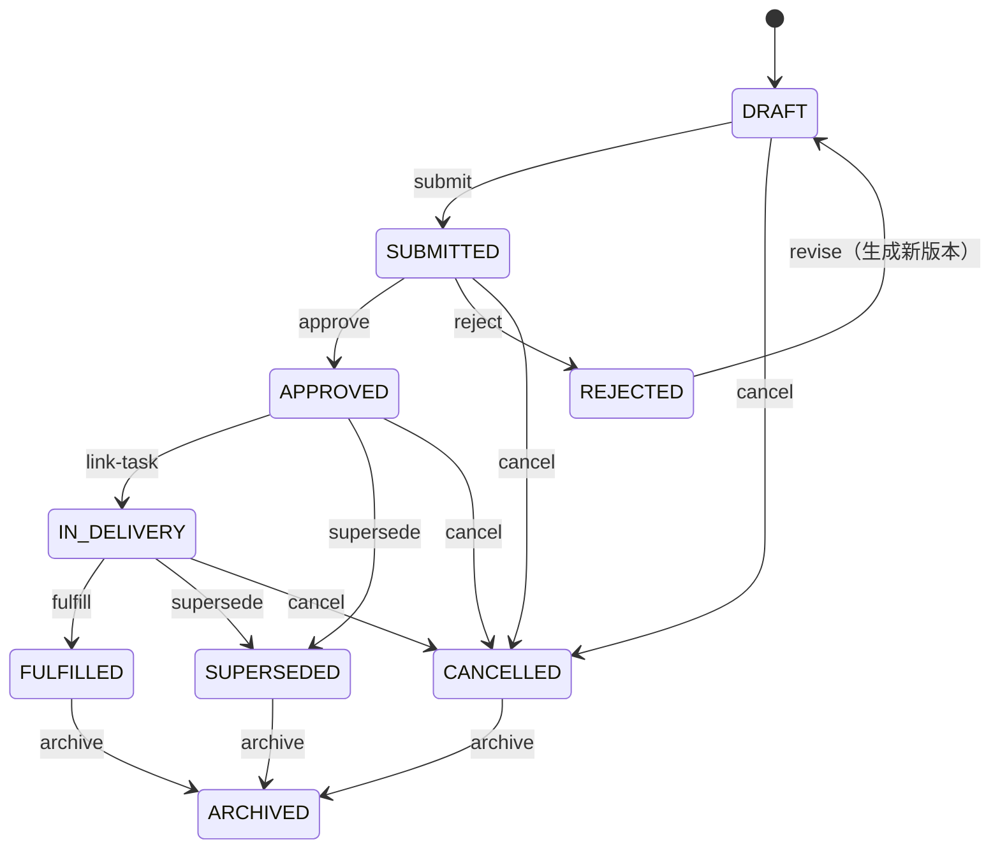
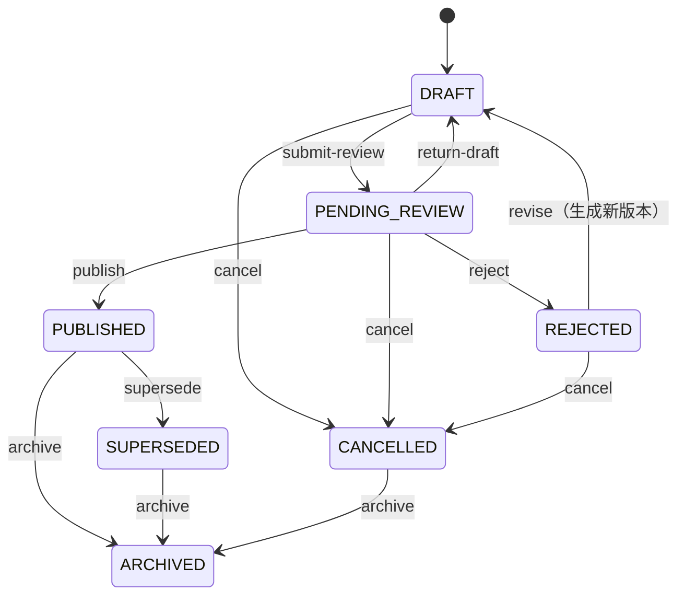
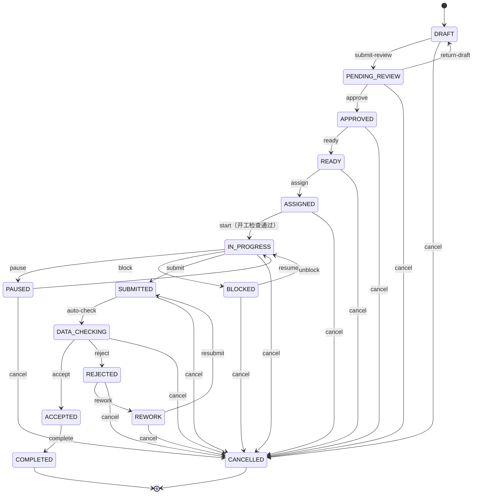
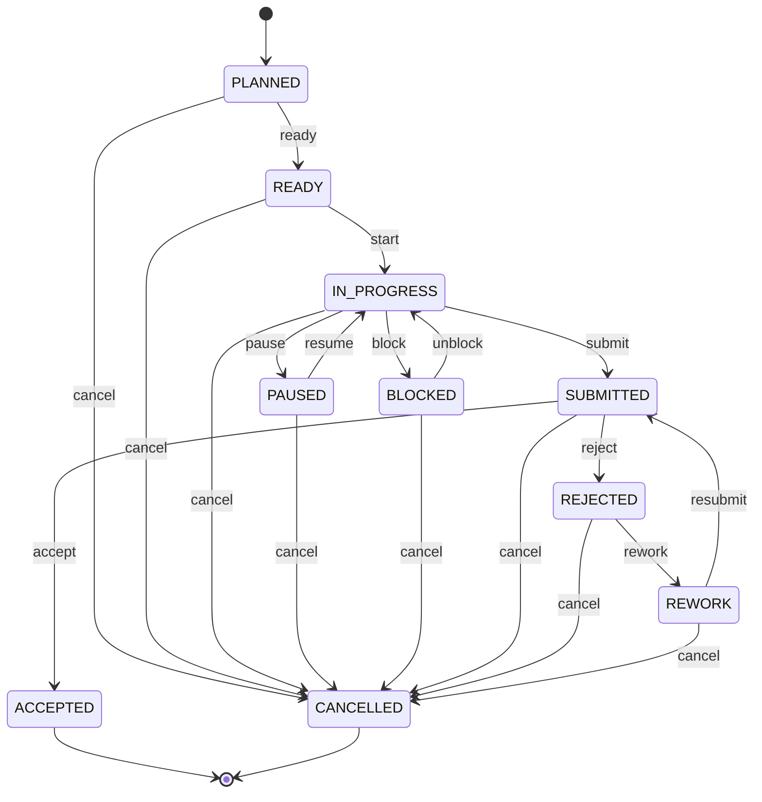
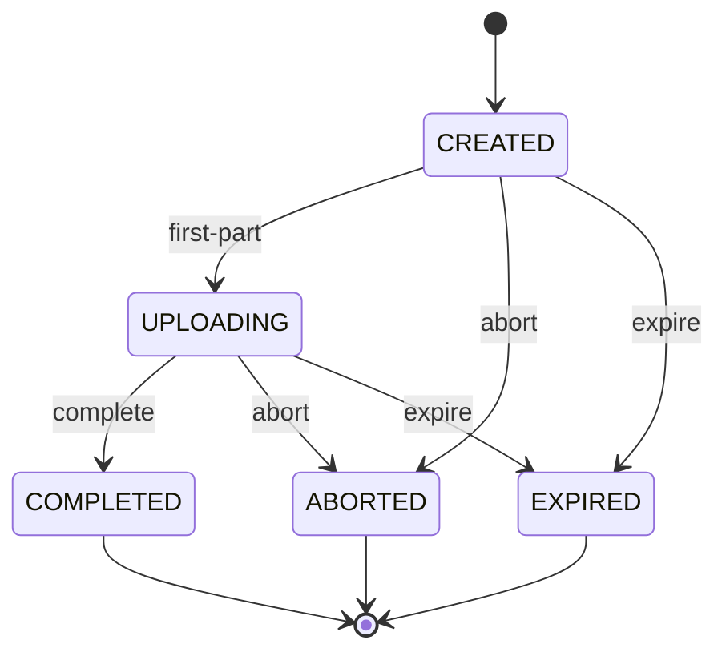
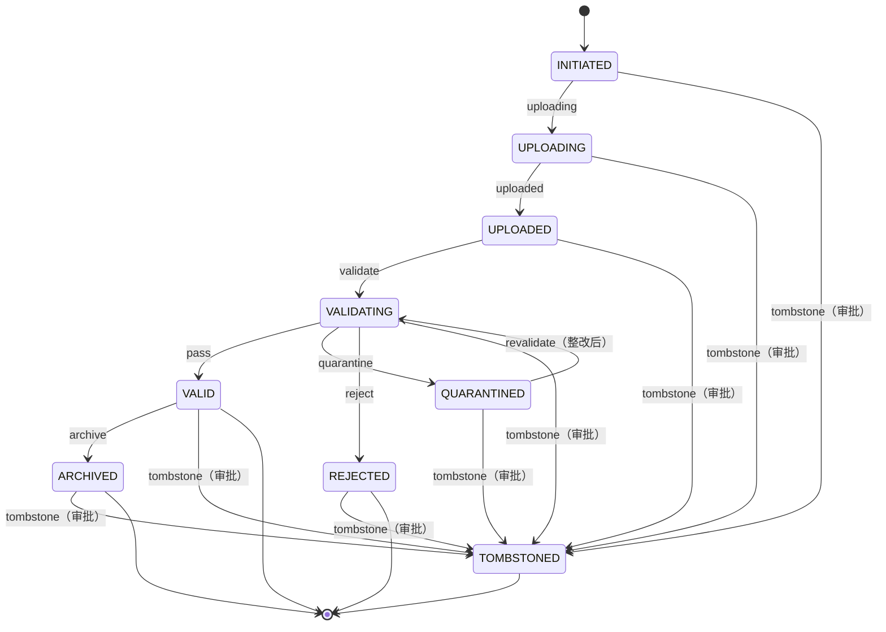
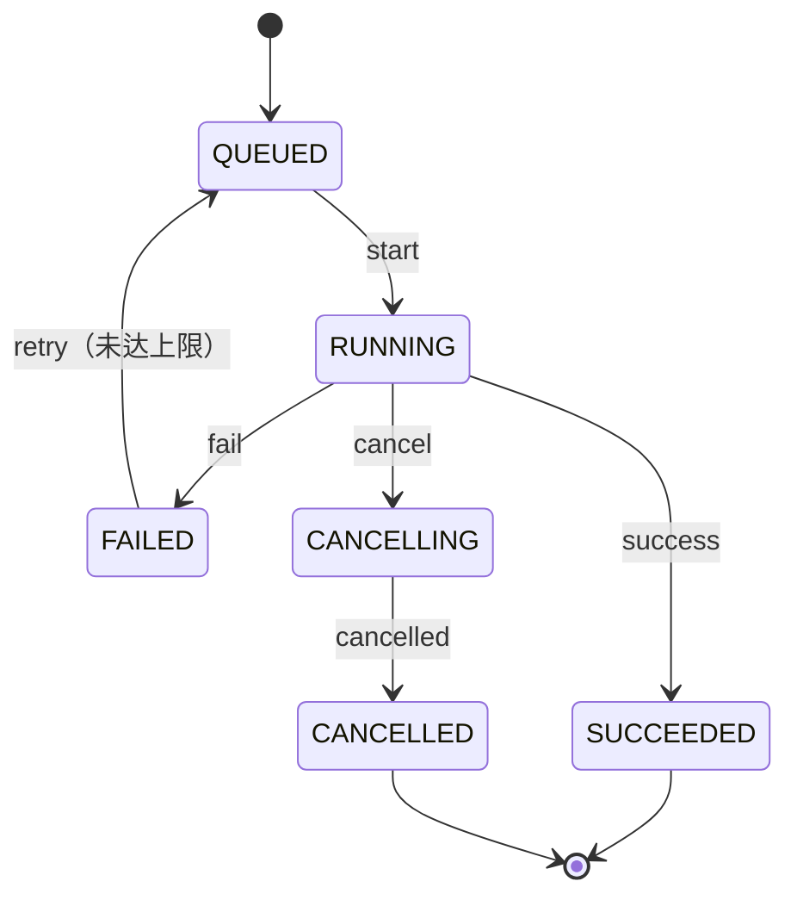
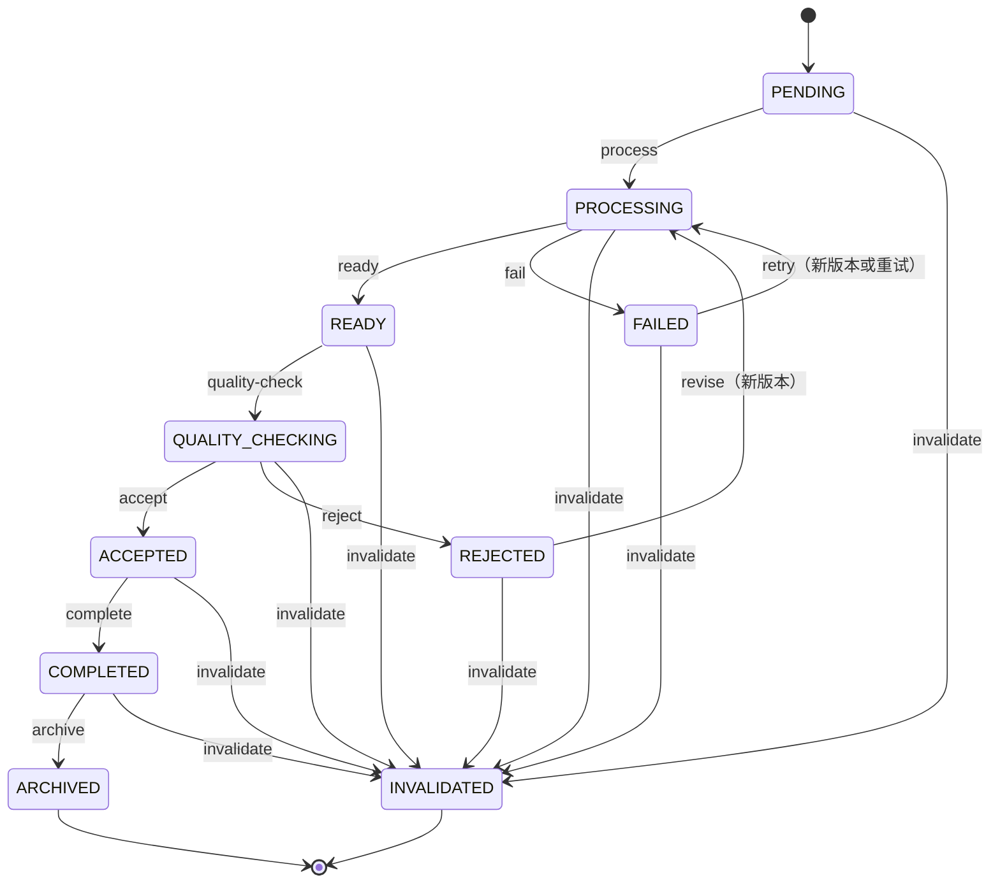

# DDP 阶段 2 状态机、异常返工、弱网与权限规则

> 文档编号：PRD-DDP-300-S1
> 任务：DDP-300（P0）
> 版本：V0.1（需求基线，待用户审阅）
> 日期：2026-11-08
> Owner：Product Manager
> 状态：待评审；所有验收项默认 `NOT RUN`
> 关联：`阶段2-采集与上传PRD.md`、`阶段2-验收标准.md`、`docs/architecture/阶段1-领域模型与契约草案.md`、`docs/DDP_具身智能数据闭环平台建设总规范_V1.0_FINAL.md` §2.3、§4.5、§6.6、§19
> 边界：本文定义业务状态机与规则，不定义数据库、API 与代码实现；最终状态名与转换以 System Architect 冻结契约为准。

---

## 0. 约定

1. 所有状态推进必须由**具名动作**触发，禁止通用 `PATCH status`。
2. 每次推进必须记录：操作人、时间、原状态、新状态、原因、关联对象、`request_id`、结果。
3. 非法转换返回稳定错误码（建议 `state_transition_invalid`，HTTP 409），不得静默忽略或默认成功。
4. 终态对象不可回退；需要修改时创建新版本或新任务。
5. 前端不得本地推断权威状态；只展示服务端返回的状态与 `allowed_actions`。
6. 乐观锁冲突返回 `version_conflict`（409），不得覆盖他人修改。
7. 任何「未知状态」必须拒绝并记录，不得按成功处理。

---

## 1. 对象关系与权威边界

```text
Project
 ├── DataRequirement（版本）
 │     └── CollectionPlan（版本） ── Scenario/ActionSpec/SOP（版本）
 │           └── CollectionTask（版本快照）
 │                 ├── CollectionBatch
 │                 ├── UploadSession ── RawAsset
 │                 └── Episode
 ├── RawAsset ── IngestionJob ── Episode
 └── AuditLog
```

| 规则 | 说明 |
|---|---|
| 项目一致 | 需求、方案、任务、批次、上传会话、RawAsset、Episode 必须同项目；跨项目引用拒绝 |
| 版本快照 | 任务创建时固化需求、方案、SOP、动作、设备/传感器配置快照；上游升版不自动改在途任务 |
| 状态权威 | 服务端领域状态为唯一权威；前端不得写状态字段 |
| 计数一致性 | 批次已提交/已验收数量与任务汇总必须在同一事务或可对账机制中更新 |
| 资产不可变 | RawAsset 与已验收 Episode 不可覆盖；修订产生新版本 |
| 取消不删除 | 任务/批次取消不删除 RawAsset、Episode 与审计 |

---

## 2. 数据需求状态机

### 2.1 状态图



### 2.2 迁移表

| 迁移 | 动作 | 前置条件 | 执行角色 | 失败/审计 |
|---|---|---|---|---|
| `DRAFT → SUBMITTED` | submit | 必填完整；场景/动作引用已发布版本；目标量单位明确；质量阈值可检查；验收标准可检查 | PM、CM | 缺项 `validation_failed`；写审计 |
| `SUBMITTED → APPROVED` | approve | 审批人 ≠ 创建人；无未解决驳回项 | PO | 自批 `forbidden`；写审计 |
| `SUBMITTED → REJECTED` | reject | 填写驳回原因 | PO | 原因必填；写审计 |
| `REJECTED → DRAFT` | revise | 生成新版本；旧版本只读 | PM、CM | 版本冲突 `version_conflict` |
| `APPROVED → IN_DELIVERY` | link-task | 至少一个关联任务；任务引用该需求版本 | PM、CM、系统 | 未关联 `state_transition_invalid` |
| `IN_DELIVERY → FULFILLED` | fulfill | 关联任务已完成；验收 Episode 达标；QI 质量结论通过；未达标需 PO 特批并审计 | PM 提交，PO/QI 确认 | 不达标 `validation_failed` |
| `APPROVED/IN_DELIVERY → SUPERSEDED` | supersede | 新版本已批准；旧版本只读；在途任务保留旧快照 | 系统、PM | 写版本关系与审计 |
| 非终态 → `CANCELLED` | cancel | 原因必填；无在途任务或已与 CM 确认处理 | PO | 有在途任务需先取消/完成；写审计 |
| `FULFILLED/CANCELLED/SUPERSEDED → ARCHIVED` | archive | 保留策略满足；无活跃引用 | PO | 写审计 |

### 2.3 规则

1. 已批准需求**不得原地修改**；变更必须创建新版本，版本号递增，记录变更原因与上一版本。
2. 任务创建时记录需求版本；需求升版后，在途任务仍使用旧快照，不自动切换。
3. 需求目标量变更不得追溯修改历史任务的目标与达成度。
4. `FULFILLED` 不是手工「点完成」；必须有 Episode 验收与质量结论证据。
5. 取消需求不等于删除关联任务/资产/Episode；历史保留。

---

## 3. 采集方案、场景/动作与 SOP

### 3.1 采集方案状态机


| 迁移 | 前置条件 | 执行角色 | 说明 |
|---|---|---|---|
| `DRAFT → PENDING_REVIEW` | 方案要素完整；引用已发布场景/动作/SOP；质量阈值不低于需求；安全要求完整 | CM | 缺项逐项提示 |
| `PENDING_REVIEW → APPROVED` | 审批人 ≠ 创建人；设备/传感器能力可满足；标定要求可执行 | PO | 自批拒绝 |
| `PENDING_REVIEW → REJECTED` | 填写原因 | PO | 记录原因 |
| `PENDING_REVIEW → DRAFT` | 退回修改并填原因 | PO、QI | 不改变版本；内容变更后升版 |
| `REJECTED → DRAFT` | 修订内容 | CM | 生成新版本 |
| `APPROVED → SUPERSEDED` | 新方案版本批准；在途任务保留旧快照 | 系统/PO | 旧版本只读 |
| `APPROVED → ARCHIVED` | 无活跃任务引用 | PO | 写审计 |
| 非终态 → `CANCELLED` | 原因必填；无在途任务引用 | CM/PO | 有引用需先处理 |

### 3.2 方案发布门禁

发布前必须齐备，缺一不可：

1. 关联需求版本
2. 场景定义与场景布置
3. 动作脚本、动作阶段、前置条件、成功/失败条件
4. 视角清单（名称、位置、覆盖范围、必需/可选）
5. 设备/机器人/传感器要求（类型、能力、采样频率、分辨率、同步方式）
6. 采集参数（格式、帧率、曝光、分辨率、压缩、文件切分、时间源）
7. 标定要求（类型、版本、有效期、最大时间偏差、坐标系/单位）
8. 已发布 SOP 版本与自检清单
9. 质量阈值与检查项
10. 安全等级、人员防护、设备安全、场景风险、应急预案

以下情况阻断发布：
- 引用未发布/不存在的场景、动作或 SOP；
- 设备能力或传感器类型与方案要求不匹配；
- 质量阈值低于需求；
- 缺少成功/失败条件或安全要求。

### 3.3 SOP 状态机与升版规则



- 必需章节缺失不可提交/发布（章节清单见主 PRD §4.4）。
- 发布记录版本、批准人、批准时间、适用范围。
- 任务执行记录 `sop_version`；历史任务永远显示执行时版本。
- 在途任务 SOP 升版：
  1. 非安全章节变化：默认**下一批次生效**，当前批次继续使用旧版本；
  2. 安全要求、前置条件、标定要求变化：**强制暂停**当前任务，要求采集员重新确认；不兼容时转 BLOCKED/返工；
  3. 任何情况下不得静默替换现场正在查看的 SOP。
- 方案/SOP 版本切换必须写审计，并在任务详情显示「执行版本」与「当前最新版本」。

### 3.4 场景/动作库规则

- 只有 `PUBLISHED` 版本可被方案/任务引用。
- 动作版本升级不自动切换在途任务。
- 未发布版本被引用返回 `validation_failed`。
- 场景/动作停用不影响历史任务快照。

---

## 4. 采集任务状态机

### 4.1 状态图



> `ACCEPTED` 默认视为不可取消；仅在没有已验收 Episode、存在合规/安全原因且 PO 特批时，才允许例外取消。该例外必须单独评审；默认实现不提供该转换。

### 4.2 迁移表

| 迁移 | 动作 | 前置条件 | 执行角色 | 失败/审计 |
|---|---|---|---|---|
| `DRAFT → PENDING_REVIEW` | submit-review | 需求版本、方案版本、SOP 版本、动作版本、场景、目标量、批次计划完整 | CM | `validation_failed`；写审计 |
| `PENDING_REVIEW → DRAFT` | return-draft | 填写退回原因 | PM、PO | 原因必填 |
| `PENDING_REVIEW → APPROVED` | approve | 审批人 ≠ 创建人；方案已批准；SOP 已发布 | PO、PM | 自批 `forbidden` |
| `APPROVED → READY` | ready | 方案/SOP 仍有效；资源要求明确；无阻断冲突；批次计划合法 | CM | 方案失效 `state_transition_invalid` |
| `READY → ASSIGNED` | assign | 执行人、机器人/设备、传感器、场地、计划时间齐全；设备 ACTIVE；标定在计划时段有效；同一时段无人员/设备/场地冲突 | CM、PM | 冲突 `conflict` 并提示对象/时段；部分写入禁止 |
| `ASSIGNED → IN_PROGRESS` | start | 仅被分配采集员；开工检查全部阻塞项 PASS；任务未过期；无重复启动 | CL（本人）、CM | 检查未过 `precondition_failed`；写审计 |
| `IN_PROGRESS → PAUSED` | pause | 原因明确；当前批次同步暂停 | CL（本人）、CM | 原因必填 |
| `PAUSED → IN_PROGRESS` | resume | 原因解除；设备/标定/时间仍有效；必要时重新检查 | CL（本人）、CM | 失效需重新检查/转 BLOCKED |
| `IN_PROGRESS → BLOCKED` | block | 原因明确；生成异常记录；严重级别 | CL、CM | 原因必填；写审计 |
| `BLOCKED → IN_PROGRESS` | unblock | 阻塞异常已解决/关闭；CM 确认；必要时重新开工检查 | CM | 未关闭 `state_transition_invalid` |
| `IN_PROGRESS → SUBMITTED` | submit | 所有非取消批次已 SUBMITTED/ACCEPTED；上传校验通过；自检完成；无未关闭 BLOCKER | CL（本人） | 逐项列出未完成项 |
| `SUBMITTED → DATA_CHECKING` | auto-check | 系统创建检查任务；至少一个可检查 Episode/资产 | 系统 | 创建失败保持 SUBMITTED 并告警 |
| `DATA_CHECKING → ACCEPTED` | accept | QI 结论通过；质量阈值满足；Episode 达标；QI 未参与该批次采集 | QI | 职责分离违规 `forbidden` |
| `DATA_CHECKING → REJECTED` | reject | 问题项、严重级别、返工范围、责任人、截止时间完整 | QI | 缺项 `validation_failed` |
| `REJECTED → REWORK` | rework | 返工包已确认；至少一个问题项；原数据保留 | QI、CM | 无问题项拒绝 |
| `REWORK → SUBMITTED` | resubmit | 返工完成；重新自检；新上传校验通过；返工次数记录 | CL（本人） | 未完成项逐项提示 |
| `ACCEPTED → COMPLETED` | complete | Episode 验收达标；异常全部关闭；目标达成或 PO 特批；无在途上传 | CM | 未达标 `validation_failed`；特批写审计 |
| 非终态 → `CANCELLED` | cancel | 原因必填；无在途上传；无未关闭安全事件；PO/PM 权限；`ACCEPTED` 例外需 PO 特批且默认不开放 | PO、PM | 有在途上传需先处理；批次级联取消；资产保留 |

### 4.3 领取（Claim）规则

「领取」不是独立状态，避免状态膨胀：

- 任务 `ASSIGNED` 后，被分配采集员可执行 `claim`，记录 `acknowledged_at`、`acknowledged_by`。
- 领取后状态仍为 `ASSIGNED`；开始采集仍以开工检查通过为前置。
- 未领取不阻止开工，但任务详情显示「未确认」；是否强制确认为方案配置项，默认建议强制。
- 非被分配人领取返回 `forbidden`；跨项目返回 404。

### 4.4 任务规则

1. 仅 `DRAFT` 可编辑核心内容；`PENDING_REVIEW` 之后修改必须退回或创建新版本。
2. 任务必须记录需求、方案、SOP、动作版本快照；上游升版不自动改任务。
3. `READY → ASSIGNED` 必须在同一事务内完成资源占用；任一资源冲突则全部回滚。
4. `IN_PROGRESS` 前必须完成开工检查；检查记录必须可追溯（时间、执行人、结果、来源）。
5. `PAUSED` 可恢复；`BLOCKED` 必须有关联异常；`CANCELLED` 必须原因与审计。
6. `SUBMITTED` 后进入数据检查；`REJECTED` 必须给出问题类型与返工要求。
7. 任务超时/超过计划结束时间只标记 `Stale` 并提醒，不自动取消、不自动完成。
8. 任务完成不删除任何资产；取消不删除任何资产。
9. 任务状态与批次状态不一致时，以任务状态约束批次；见 §5.3。

---

## 5. 采集批次状态机

### 5.1 状态图



### 5.2 迁移表

| 迁移 | 前置条件 | 执行角色 | 说明 |
|---|---|---|---|
| `PLANNED → READY` | 所属任务 READY/ASSIGNED；批次执行人、设备、计划时间完整 | CM | 任务未就绪拒绝 |
| `READY → IN_PROGRESS` | 所属任务 IN_PROGRESS；采集员开始批次；开工检查有效 | CL（本人）、CM | 任务未开始拒绝 |
| `IN_PROGRESS → PAUSED/BLOCKED` | 原因明确；BLOCKED 生成异常 | CL、CM | 与任务状态协调 |
| `PAUSED/BLOCKED → IN_PROGRESS` | 原因解除；必要时重新检查 | CM | 未解除拒绝 |
| `IN_PROGRESS → SUBMITTED` | 本批次数据上传并校验通过；自检完成 | CL（本人） | 未完成项逐项提示 |
| `SUBMITTED → ACCEPTED` | QI 检查通过；批次范围内 Episode 达标 | QI | 职责分离 |
| `SUBMITTED → REJECTED` | 问题项、范围、责任人、截止时间完整 | QI | 缺项拒绝 |
| `REJECTED → REWORK` | 返工包确认；原数据保留 | QI、CM | — |
| `REWORK → SUBMITTED` | 返工完成并重新自检 | CL（本人） | — |
| 非终态 → `CANCELLED` | 原因必填；无在途上传 | CM/PO | 任务取消时级联取消 |

### 5.3 任务与批次兼容矩阵

| 任务状态 | 允许的批次状态 | 说明 |
|---|---|---|
| `DRAFT` / `PENDING_REVIEW` | `PLANNED` | 仅规划，不可执行 |
| `APPROVED` | `PLANNED` | 等待资源与就绪 |
| `READY` | `PLANNED`、`READY` | 批次可准备 |
| `ASSIGNED` | `READY` | 等待开始 |
| `IN_PROGRESS` | `IN_PROGRESS`、`PAUSED`、`BLOCKED`、`READY` | 至少一个批次执行中；未开始批次保持 READY |
| `SUBMITTED` / `DATA_CHECKING` | `SUBMITTED`、`ACCEPTED`、`CANCELLED` | 不允许仍有 IN_PROGRESS/PAUSED/BLOCKED |
| `REJECTED` / `REWORK` | `REJECTED`、`REWORK`、`SUBMITTED`、`ACCEPTED` | 至少一个批次需返工 |
| `ACCEPTED` | `ACCEPTED`、`CANCELLED` | 等待完成 |
| `COMPLETED` | `ACCEPTED`、`CANCELLED` | 终态 |
| `CANCELLED` | `CANCELLED` | 级联取消 |

### 5.4 批次规则

1. 一个任务可拆多个批次；批次不得跨任务、跨项目。
2. 批次预计数量/时长之和不得超过任务目标；超采必须显式标记并审批，不得静默超量。
3. 批次 `SUBMITTED` 前必须有本批次上传校验通过与自检记录。
4. 任务 `SUBMITTED` 前，所有非取消批次必须 `SUBMITTED` 或 `ACCEPTED`。
5. 任务取消时，所有非终态批次级联取消并写审计；已提交资产保留。
6. 批次验收数量变化必须同步更新任务汇总；汇总失败时任务不得进入 `COMPLETED`。

---

## 6. 上传会话状态机

### 6.1 状态图



### 6.2 规则

| 规则 | 说明 |
|---|---|
| 创建 | 必须绑定任务/批次（如适用）、文件类型/大小声明、幂等键；返回分片大小与对象前缀 |
| 上传 | 分片可乱序、可重试；重复分片幂等；记录已上传分片 |
| 完成 | 所有分片齐全、大小一致后允许 `complete`；`complete` 幂等 |
| 校验 | 会话完成不等于资产有效；RawAsset 进入 `VALIDATING` 后由服务端校验 |
| 过期 | 超过 `expires_at` 转 `EXPIRED`；已传分片按保留策略处理，不静默承诺可恢复 |
| 中止 | 用户取消转 `ABORTED`；不删除本地文件；不登记可用资产 |
| 不可复用 | `COMPLETED/ABORTED/EXPIRED` 不可继续上传；新文件新建会话 |
| 幂等 | `(project_id, user_id, idempotency_key)` 作用域；同键不同请求体返回 `idempotency_key_reused` |
| 安全 | 不信任客户端文件名；对象 Key 不含用户可控路径；禁止路径穿越 |

---

## 7. RawAsset 状态机

### 7.1 状态图



### 7.2 规则

| 规则 | 说明 |
|---|---|
| 不可覆盖 | 原始文件只读；解析/转码/清洗产物独立存放 |
| 幂等去重 | `(project_id, sha256)` 唯一；重复上传不新建资产，返回既有资产或明确冲突 |
| VALID | 大小、Hash、类型、内容签名、格式、可解析性通过；才可进入接入 |
| QUARANTINED | 可疑/损坏/元数据冲突；不得进入 Episode/数据集；放行需双人审批 + 审计 |
| REJECTED | 类型伪造、Hash 不符、严重损坏；元数据保留，原始文件按策略处理 |
| TOMBSTONED | 法务/保留策略审批；元数据保留，对象按保留策略处理；普通用户不可触发 |
| 下载 | 短期签名 URL；必须审计；跨项目拒绝 |
| 计数 | 看板原始数据量只统计 VALID/ARCHIVED，排除隔离/拒绝/样例 |

---

## 8. IngestionJob 状态机

### 8.1 状态图



### 8.2 规则

1. 每次 Job 记录 Pipeline、Parser、配置版本与输入资产清单。
2. 幂等键相同且输入未变时返回既有 Job，不重复产生产物。
3. 失败必须记录错误码、摘要、尝试次数、日志引用与已产生产物。
4. 只允许可重试错误重试；达到 `max_attempts` 后保持 `FAILED`。
5. 超时视为失败并记录；取消必须记录取消人与原因。
6. Job 失败不得删除原始资产；隔离是校验结论，不是执行失败。
7. 成功不等于 Episode 合格；Episode 质量状态另行判定。

---

## 9. Episode 状态机

### 9.1 状态图



### 9.2 规则

| 规则 | 说明 |
|---|---|
| PENDING | 已创建，等待处理；至少一个 VALID RawAsset 才能进入 PROCESSING |
| PROCESSING | 生成 Canonical 产物、Manifest；失败保留错误与已产生产物 |
| READY | 产物与 Manifest 生成、Hash 校验通过；**不等于已验收** |
| QUALITY_CHECKING | 基础质量门禁执行中；未跑质检时质量状态为 `UNKNOWN` |
| ACCEPTED | 质量门禁通过；可进入后续标注/数据集（阶段 3/4） |
| COMPLETED | Manifest 冻结、血缘完整、标签/交付要求满足；阶段 2 可 P1 实现 |
| INVALIDATED | 原始资产失效、标定撤销、数据污染等；不删除，保留审计与血缘 |
| 版本 | 修订生成新 `episode_version` 与 `supersedes_id`，不覆盖旧版本 |
| 时间/标定 | 必须记录原始时间语义、标准化时间、时区/时间域、同步偏差、标定快照 |
| 切片 | 规则版本化、可配置、可复现；边界用例必须可解释 |
| 下游 | 只有 `ACCEPTED` 且未 `INVALIDATED` 的 Episode 可进入标注/数据集；阶段 2 只保证到 `READY/ACCEPTED` |

### 9.3 阶段 2 实现边界

- P0：`PENDING → PROCESSING → READY`、基础质量状态、`QUALITY_CHECKING → ACCEPTED/REJECTED` 的最小闭环。
- P1：`COMPLETED`、`ARCHIVED`、更完整的质量规则。
- 阶段 2 不实现标注与数据集，只保证 Episode 可作为阶段 3 输入。

---

## 10. 跨对象一致性规则

| 场景 | 规则 |
|---|---|
| 任务提交 | 至少一个批次 `SUBMITTED/ACCEPTED`；所有非取消批次已提交；上传校验通过；无未关闭 BLOCKER |
| 任务验收 | 至少一个 Episode `ACCEPTED`；批次验收数量与任务汇总一致；QI 未参与该批次采集 |
| 任务完成 | 所有非取消批次 `ACCEPTED`；Episode 达标；异常关闭；目标达成或 PO 特批 |
| 批次验收 | 批次范围内 Episode/资产通过质检；数量更新到任务汇总 |
| 需求达成 | 只在关联任务完成后计算；验收 Episode 达标；样例数据不计入真实达成 |
| Episode 失效 | 已验收 Episode 失效不静默回滚任务；生成质量事件，更新任务质量摘要并标记；影响交付时由 PO 决策新需求/新任务 |
| 取消 | 任务/批次取消不删除资产/Episode/审计；未完成上传需先处理或明确保留策略 |
| 项目一致性 | 所有关联对象必须同项目；跨项目写入拒绝 |
| 样例隔离 | `data_source=SYNTHETIC` 的任务/资产/Episode 不计入真实看板分母 |

---

## 11. 异常分类与处理

### 11.1 异常类型

| 类型 | 代码建议 | 默认严重级别 | 是否阻塞采集 | 典型处理 |
|---|---|---|---|---|
| 设备离线/故障 | `DEVICE_OFFLINE` / `DEVICE_FAULT` | BLOCKER | 是 | 停止、报修、换设备、CM 确认 |
| 传感器缺失/离线 | `SENSOR_MISSING` | BLOCKER | 是 | 检查连接、换传感器、重新检查 |
| 标定无效/过期 | `CALIBRATION_INVALID` | BLOCKER | 是 | 重新标定、换设备、等待生效 |
| 时间同步超阈值 | `TIME_SYNC_EXCEEDED` | BLOCKER | 是 | 同步时间、重新检查、隔离数据 |
| 存储不足 | `STORAGE_INSUFFICIENT` | BLOCKER | 是 | 上传/清理后重试 |
| 电量不足 | `BATTERY_LOW` | WARNING（可按方案升级） | 视方案 | 充电/换电池 |
| 场景不符 | `SCENE_MISMATCH` | MAJOR | 视方案 | 恢复场景、记录证据、返工 |
| 安全事件 | `SAFETY_EVENT` | BLOCKER | 是 | 立即停止、上报 PO/CM、未批准不得恢复 |
| 数据损坏 | `DATA_CORRUPTED` | BLOCKER | 是 | 重采、隔离、返工 |
| 上传失败 | `UPLOAD_FAILED` | MAJOR | 否（可继续采集） | 重试分片、检查网络、人工处理 |
| SOP 违反 | `SOP_VIOLATION` | MAJOR/BLOCKER | 视情况 | 暂停、培训/重采、返工 |
| 其他 | `OTHER` | 由上报人选择 | 视情况 | 描述 + 证据 + 责任人 |

### 11.2 异常生命周期

```text
OPEN → ACKNOWLEDGED → RESOLVED → CLOSED
                 └→ REOPENED → ACKNOWLEDGED
```

| 状态 | 规则 |
|---|---|
| `OPEN` | 上报成功；BLOCKER 立即触发任务暂停/阻塞 |
| `ACKNOWLEDGED` | CM/QI 已受理，记录受理人与时间 |
| `RESOLVED` | 已采取措施，填写解决说明与证据 |
| `CLOSED` | CM/QI 确认关闭；BLOCKER 关闭需 CM/QI，不能仅由上报人关闭 |
| `REOPENED` | 问题复现；重新进入处理；保留历史 |

### 11.3 异常处理规则

1. 异常必须关联任务、批次（可选）、Episode/资产（可选）、设备/传感器（可选）。
2. 安全事件立即停止当前采集，通知 CM/PO，未获批准不得恢复；必须写审计。
3. BLOCKER 未关闭时，任务不能开始/恢复/提交/完成；页面必须显示阻塞原因与处理建议。
4. MAJOR 允许继续时，必须记录影响范围，提交时保留确认记录；质量问题可能触发返工。
5. 异常不得自动消失；关闭必须有解决说明与关闭人。
6. 异常记录不可删除；只能关闭/重开。
7. 异常数量与状态进入看板「异常任务数」，口径见指标文档。

---

## 12. 返工规则

### 12.1 返工触发

| 触发 | 责任角色 | 返工范围 |
|---|---|---|
| 数据检查驳回 | QI | 任务或批次；涉及文件/Episode |
| 质量门禁不合格 | QI | 不合格 Episode 或批次 |
| 传感器通道缺失/时间不连续 | QI/DE | 受影响片段或整批 |
| 标定过期/撤销 | QI/DE | 受影响 Episode/批次 |
| SOP 违反 | QI/CM | 违反步骤对应的数据 |
| 目标数量/时长不足 | QI/CM | 补采 |
| 文件损坏/不可解析 | QI/DE | 对应文件 |

### 12.2 返工包（必须包含）

1. 返工编号与关联任务/批次。
2. 问题项列表：类型、严重级别、证据、影响对象。
3. 返工范围：整任务/指定批次/指定文件或 Episode。
4. 返工要求：需要重采、补采、重传、修复元数据还是重新切片。
5. 责任人（采集员/CM/DE）与复检人（QI）。
6. 截止时间。
7. 返工次数与历史。
8. 安全/合规注意事项。

### 12.3 返工规则

1. 原数据不得覆盖；返工产生新上传、新 RawAsset 或新 Episode 版本。
2. 返工提交后进入复检；复检通过才更新验收计数。
3. 默认最多 3 次返工（可配置）；超限升级 PO/CM，选择新任务、延期、特批或取消。
4. 返工记录不可删除；返工次数进入看板返工率。
5. 返工责任人与质检人不得为同一人；复检人未参与该批次采集。
6. 二次返工建议由不同 QI 复检（P1，防止惯性判断）。
7. 返工期间任务保持 `REWORK`；批次保持 `REWORK`；不得显示为 `SUBMITTED`。
8. 因设备/场地不可用无法返工时，CM/PO 必须记录决策：延期、换资源、取消或新任务。

---

## 13. 弱网与离线规则

### 13.1 范围澄清

阶段 2 的 Web 工作台**不承担多路原始视频录制**；现场录制由机器人/采集设备完成。弱网规则针对：

1. 任务、方案摘要与 SOP 缓存；
2. 开工检查与自检草稿；
3. 上传队列、分片进度与断点续传；
4. 状态提示、冲突处理与恢复。

### 13.2 在线/弱网/离线能力矩阵

| 能力 | 在线 | 弱网 | 离线 |
|---|---|---|---|
| 查看当前任务与 SOP（缓存） | 允许 | 允许（标 Stale） | 允许（标 Stale/离线缓存） |
| 开工检查 | 允许（服务端校验） | 允许（结果待同步） | **禁止开始新任务** |
| 继续已开始任务 | 允许 | 允许（本地记录） | 允许（本地记录） |
| 上报异常 | 允许 | 允许（排队） | 允许（排队，标待同步） |
| 上传队列 | 允许 | 允许（退避重试） | 排队等待网络 |
| 自检草稿 | 允许 | 允许 | 允许（本地保存） |
| 提交任务 | 允许 | 允许（幂等） | **禁止**（仅待联网提交） |
| 审批/取消/删除 | 允许 | 禁止或二次确认 | **禁止** |
| 新建任务/分配 | 允许 | 允许（谨慎） | **禁止** |

### 13.3 本地持久化要求

- 至少持久化：当前任务步骤、自检草稿、异常草稿、上传队列、已上传分片信息、SOP 版本与最后同步时间。
- 页面刷新、关闭标签、重新打开后必须恢复；恢复前先向服务端确认会话与已传分片。
- 本地存储配额接近上限时提前警告；不足时阻止新增队列项，保留已有数据。
- 清除浏览器数据会丢失本地队列，必须在帮助与离开提示中明确。
- 不承诺跨设备同步；换设备需重新开始或通过已上传资产恢复。

### 13.4 恢复顺序

1. 认证与网络恢复。
2. 重新拉取任务状态、方案/SOP 版本与权限。
3. 校验上传会话与已传分片。
4. 恢复自检/异常草稿。
5. 处理冲突（任务已变更、SOP 已升版、会话过期）。
6. 续传失败分片，最后提交待提交内容。

### 13.5 弱网重试与幂等

- 上传失败按指数退避 + 抖动重试；最大次数由服务端配置，前端不得无限重试。
- 达到上限后停止自动重试，显示人工处理入口与错误码。
- 每个上传会话/文件带幂等键；重复提交不产生重复 RawAsset。
- Hash 不一致才要求整体重传；单分片失败只重试失败分片。
- 离线排队内容恢复后按服务端状态决定自动续传或提示确认，不得静默覆盖。

### 13.6 冲突处理

| 冲突 | 处理 |
|---|---|
| 任务已被 CM 暂停/取消 | 立即停止本地操作，显示最新状态，保留本地草稿；不得继续提交 |
| SOP 已升版 | 显示新旧版本；安全章节变化要求重新确认；不静默替换 |
| 上传会话过期 | 优先恢复；无法恢复则新建会话，说明已传分片处理策略 |
| 自检草稿与服务器版本冲突 | 保留本地草稿，提示差异，要求人工选择；不得静默覆盖 |
| 重复文件 | 明确提示已有资产，按业务规则复用或取消 |

### 13.7 标记与验收

- 弱网/离线方案未实测前，AC-WKB-12、AC-E2E-04 标记 `BLOCKED` 或 `未验证`。
- 使用网络注入测试时必须记录工具、参数、时间与结果，标 `[MOCK]`。
- 不得把「浏览器缓存可用」当作「离线可采集多路原始数据」。

---

## 14. 权限规则

### 14.1 权限原则

1. 服务端强制 RBAC / Policy；前端隐藏按钮不构成权限。
2. 平台角色 + 项目角色 + 资源授权；默认拒绝、最小权限。
3. 所有查询、详情、搜索、下载、导出、缓存均校验项目范围；不信任客户端 `project_id`。
4. 采集员只访问本人被分配任务及其必要快照；不暴露全量设备档案。
5. 高风险操作必须二次确认、原因与审计。
6. 审计只追加，业务角色不可删除。

### 14.2 资源动作矩阵

图例：✔ 允许；△ 需资源授权/审批/职责分离；✕ 默认拒绝。

| 资源/动作 | PO | PM | CM | CL | QI | DE | DO | AU | RO |
|---|---|---|---|---|---|---|---|---|---|
| 需求查看 | ✔ | ✔ | ✔ | △（任务摘要） | ✔ | ✔ | ✕ | ✔ | ✔ |
| 需求创建/编辑 | ✕ | ✔ | ✔ | ✕ | ✕ | ✕ | ✕ | ✕ | ✕ |
| 需求审批/驳回 | ✔（非创建人） | ✕ | ✕ | ✕ | △（质量意见） | ✕ | ✕ | ✕ | ✕ |
| 需求取消 | ✔ | △ | △ | ✕ | ✕ | ✕ | ✕ | ✕ | ✕ |
| 方案查看 | ✔ | ✔ | ✔ | △（任务快照） | ✔ | ✔ | △ | ✔ | ✔ |
| 方案创建/编辑 | ✕ | △ | ✔ | ✕ | ✕ | ✕ | ✕ | ✕ | ✕ |
| 方案审批 | ✔（非创建人） | ✕ | ✕ | ✕ | △（技术意见） | ✕ | ✕ | ✕ | ✕ |
| SOP 创建/发布 | △ | ✕ | ✔ | ✕ | △（审核） | ✕ | ✕ | ✕ | ✕ |
| 场景/动作库维护 | ✕ | △ | ✔ | ✕ | ✕ | ✕ | ✕ | ✕ | ✕ |
| 任务查看 | ✔ | ✔ | ✔ | △（仅本人） | ✔ | ✔（接入需要） | △ | ✔ | ✔ |
| 任务创建/编辑 | ✕ | ✔ | ✔ | ✕ | ✕ | ✕ | ✕ | ✕ | ✕ |
| 任务审批 | ✔（非创建人） | ✔（非创建人） | ✕ | ✕ | ✕ | ✕ | ✕ | ✕ | ✕ |
| 分配人员/设备/场地 | ✔ | ✔ | ✔ | ✕ | ✕ | ✕ | △（设备可用性意见） | ✕ | ✕ |
| 开始/暂停/恢复/异常上报 | ✔ | ✔ | ✔ | △（仅本人任务） | ✕ | ✕ | ✕ | ✕ | ✕ |
| 提交采集数据 | ✔ | ✔ | ✔ | △（仅本人任务） | ✕ | ✕ | ✕ | ✕ | ✕ |
| 数据检查/接受/驳回 | ✔ | △ | △（返工） | ✕ | ✔（非本人采集） | △（技术意见） | ✕ | ✕ | ✕ |
| 返工/取消/完成 | ✔ | ✔ | △（返工/完成） | ✕ | △（返工） | ✕ | ✕ | ✕ | ✕ |
| 上传 | ✔ | ✔ | ✔ | △（仅本人任务） | ✕ | ✔（支撑） | ✕ | ✕ | ✕ |
| RawAsset 查看 | ✔ | ✔ | ✔ | △（本人任务） | ✔ | ✔ | ✕ | ✔ | ✔ |
| RawAsset 下载 | ✔ | ✔ | △ | △（本人任务） | △ | ✔ | △ | △（审计用途） | ✕ |
| 隔离区放行 | △（第二审批） | ✕ | ✕ | ✕ | △（技术评估） | ✔（发起） | ✕ | ✕ | ✕ |
| 墓碑 | ✔（双人） | ✕ | ✕ | ✕ | ✕ | △（发起） | ✕ | △（审计意见） | ✕ |
| Episode 查看 | ✔ | ✔ | ✔ | △（本人任务） | ✔ | ✔ | ✕ | ✔ | ✔ |
| Episode 质检/验收/失效 | ✔（失效） | △ | ✕ | ✕ | ✔ | △（技术评估） | ✕ | ✕ | ✕ |
| 上传/接入 Job 重试/取消 | ✕ | ✕ | ✕ | ✕ | ✕ | ✔ | ✕ | ✕ | ✕ |
| 看板查看 | ✔ | ✔ | ✔ | △（本人/小组） | ✔ | ✔ | △ | ✔ | ✔ |
| 审计查看 | ✔ | △（本人相关） | △（本人相关） | ✕ | △（本人相关） | △（本人相关） | ✕ | ✔ | ✕ |
| 权限变更 | ✔（项目） | ✕ | ✕ | ✕ | ✕ | ✕ | ✕ | ✕ | ✕ |

### 14.3 字段级与任务级规则

1. 采集员看设备：只显示任务所需设备名称、类型、能力快照、检查结果；默认不显示完整序列号、精确位置、标定参数全文。
2. 质检员可看标定有效性与质量证据，不默认看设备密钥/固件包。
3. 数据工程师可看 RawAsset 元数据、Hash、对象引用与 Job 日志，不默认看其他项目数据。
4. 审计员只读，可看审计与必要元数据；下载仍需单独授权。
5. 采集员访问非本人任务、批次、上传会话、资产、Episode：返回 403/404，不泄漏标题、状态、文件名或存在性。
6. 跨项目访问统一按不可见处理；不得通过搜索、分页总数、错误文案泄漏对象存在。

### 14.4 职责分离

| 场景 | 规则 |
|---|---|
| 需求审批 | 创建人不得审批自己的需求 |
| 方案审批 | 创建人不得审批自己的方案 |
| 任务审批 | 创建人不得审批自己的任务 |
| 数据检查 | QI 不得检查自己参与采集的批次 |
| 隔离区放行 | 至少 DE + QI/PO 两人；上传者不得单独放行 |
| 墓碑 | 需双人审批 + 审计 |
| 平台管理员 | 默认不参与项目业务；break-glass 需显式授权与强审计 |

### 14.5 高风险操作

以下操作必须二次确认、填写原因（如适用）、显示影响范围并写审计：

1. 取消任务/批次/需求。
2. 隔离区放行、墓碑。
3. 原始数据/Episode 下载。
4. 权限变更、成员移除。
5. 方案/SOP 发布、需求审批。
6. Episode 失效、标定撤销（阶段 1 能力）。
7. 任何批量操作（本期默认不提供批量危险操作）。

---

## 15. 审计要求

### 15.1 必须审计的事件

| 域 | 事件 |
|---|---|
| 需求 | 创建、版本变更、提交、批准、驳回、取消、达成 |
| 方案/SOP | 创建、版本变更、提交、批准、驳回、发布、替代、归档 |
| 任务/批次 | 创建、审批、分配、领取、开始、暂停、恢复、阻塞、解除、提交、接受、驳回、返工、取消、完成 |
| 上传 | 会话创建、完成、中止、过期、重试、重复文件处理 |
| 资产 | 校验通过、隔离、拒绝、放行、墓碑、下载 |
| 接入 | Job 创建、开始、成功、失败、重试、取消、超时 |
| Episode | 创建、READY、质检、接受、拒绝、完成、失效、版本修订 |
| 权限 | 角色变更、成员变更、break-glass、跨项目拒绝 |
| 安全 | 安全事件、越权尝试、高风险操作失败 |

### 15.2 审计字段

至少包含：`audit_id`、`project_id`、`actor_user_id`、`actor_role`、`resource_type`、`resource_id`、`action`、`from_status`、`to_status`、`reason`、`request_id`、`occurred_at`、`result`、`source_ip/客户端信息`（按合规要求脱敏）、`correlation_id`。

### 15.3 审计规则

1. 只追加；业务角色不可修改/删除。
2. 审计写入失败时，高风险动作必须失败（fail-closed）。
3. 下载、导出、放行、墓碑必须记录对象、范围、原因与结果。
4. 跨项目拒绝也写审计，但不得记录敏感对象详情。
5. 审计查询本身受权限控制；审计员只读。

---

## 16. 验收映射

| 规则域 | 验收项 |
|---|---|
| 需求状态机 | AC-REQ-01～08 |
| 方案/SOP 状态与版本 | AC-PLN-01～10 |
| 任务/批次状态机 | AC-TSK-01～15 |
| 工作台与异常 | AC-WKB-01～15 |
| 上传状态与幂等 | AC-UPL-01～13 |
| 接入/Episode 状态 | AC-ING-01～12 |
| 跨对象一致性 | AC-TSK-11～14、AC-ING-07～08、AC-E2E-01 |
| 异常/返工 | AC-WKB-07、AC-WKB-11、AC-TSK-12 |
| 弱网/离线 | AC-WKB-12、AC-UPL-13、AC-E2E-04 |
| 权限/职责分离/审计 | AC-GOV-01～08 |

---

## 17. 未验证项与开放问题

| ID | 项 | 状态 | 说明 |
|---|---|---|---|
| U2-01 | 任务/批次最终状态名与转换 | 未验证 | 待 Architect 冻结 |
| U2-02 | `ACCEPTED → CANCELLED` 是否允许 | 未验证 | 默认不允许；例外需单独评审与 PO 特批 |
| U2-03 | SOP 升版在途规则 | 未验证 | 本文为建议基线 |
| U2-04 | 返工次数上限/时限 | 未验证 | 默认 3 次，可配置 |
| U2-05 | 弱网/离线真实能力 | BLOCKED | 需 UX/Architect 方案与实测 |
| U2-06 | 重复文件复用策略 | 未验证 | 默认不重复登记 |
| U2-07 | 场地实体与冲突口径 | 未验证 | 最小 location_id |
| U2-08 | Episode「有效」质量门禁 | 未验证 | 依赖阶段 2/3 质量规则 |
| U2-09 | 审计保留期限与合规要求 | 未验证 | 需合规评审 |
| U2-10 | 任务超时提醒阈值 | 未验证 | 不自动取消 |

---

## 18. 变更记录

| 版本 | 日期 | 变更 | 作者 |
|---|---|---|---|
| V0.1 | 2026-11-08 | 初稿：需求/方案/SOP/任务/批次/上传/资产/Job/Episode 状态机、异常与返工、弱网、权限与审计规则 | Product Manager |
