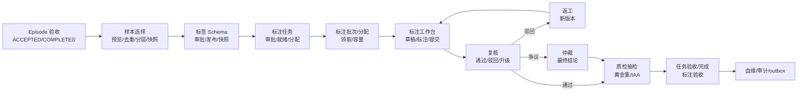

# DDP 阶段 3 标注中心 PRD

> 文档编号：PRD-DDP-315｜任务：DDP-315（P1）｜版本：V0.1（待审阅）｜日期：2026-11-08｜Owner：Product Manager
> 状态：**DRAFT，未冻结**；所有验收项默认 `NOT RUN`
> 基线：`docs/DDP_具身智能数据闭环平台建设总规范_V1.0_FINAL.md`
> 关联：阶段 2 PRD/契约、`docs/architecture/阶段3-标注契约索引.md`、`docs/architecture/contract-draft/annotation/*`、`docs/adr/0011-stage3-annotation-contract.md`；配套产品文档：`阶段3-标注验收标准.md`、`阶段3-标注流程与页面状态.md`、`阶段3-标注指标口径.md`
> **边界**：只定义业务需求、流程、角色、页面状态、指标口径与验收基线；不定义技术实现，不修改代码、配置、数据库、正式契约与测试。契约草案是 **DRAFT**，不是已冻结契约。

## 0. 文档说明

1. 本文是阶段 3「标注中心与标注质量」的需求与验收基线，不代表功能已实现；验收默认 `NOT RUN`。
2. 字段是页面与业务需要的字段清单，不是数据库设计，也不是已冻结 API 契约。
3. 阶段 3 以阶段 2 的 RawAsset/Episode 为输入，不得绕开 Episode 直接标注 RawAsset。
4. `标注样本集` 与阶段 4 的 `DatasetVersion` 不是同一对象；阶段 3 不做正式数据集冻结、划分、导出与训练交付。
5. 合成数据、模拟标注员、模拟 AI、未实测性能必须标注，不得冒充真实业务验收。

| 标记 | 含义 |
|---|---|
| `DRAFT` | 草案，未冻结，不得作为实现完成依据 |
| `NOT RUN` | 验收项未执行 |
| `未验证` | 缺少真实证据或方案未定 |
| `BLOCKED` | 环境、人员、决策或依赖阻塞 |
| `N/A` | 本期不适用 |
| `P0/P1/P2` | 阻断项 / 可用性增强 / 后续阶段 |
| `[MOCK]` | 模拟、注入或替代实现 |
| `[SYNTHETIC]` | 合成 Episode/标注数据，不是真实标注生产 |

**任务卡**：目标是把「Episode 验收后 → Schema → 样本选择 → 任务/批次/分配 → 标注与提交 → 复核/退回/仲裁 → 黄金集/IAA/抽检 → 验收与血缘」转成可验收需求。范围含 Schema/标签体系、样本集、任务/批次、分配与工作量、工作台、提交/复核/仲裁、黄金集/IAA、质检抽检、权限隔离、审计/outbox、Episode/RawAsset 血缘。非目标含 DatasetVersion 冻结/划分/导出、训练交付、模型评测、自动接受 AI 标签、完整 3D/像素级分割、原生离线 App、生产部署、跨项目共享、未批准微服务/CQRS/Event Sourcing。回滚为文档级回滚，不涉及代码、数据与配置。

## 1. 背景、目标与范围

阶段 2 已形成可追溯的 RawAsset、IngestionJob 与 Episode，但 Episode 只有 `annotation_status` 基础字段，没有标签体系、标注任务、结果、复核与仲裁。阶段 4 的数据集与训练交付必须建立在经过标注和质量验收的 Episode 上。阶段 3 的核心不是「做一个标注表单」，而是建立**标签可版本化、样本可复现、人员可分配、结果可审核、争议可仲裁、质量可量化、数据可追溯**的标注生产链路。

### 1.1 目标

1. Schema 可版本化、可审批、发布后不可原地修改；提交记录 Schema 版本与快照 Hash。
2. 样本选择可预览、快照、去重、分层；任务引用后不可静默变化。
3. 任务、批次、分配、领取有明确状态机、前置条件、容量校验与审计。
4. 工作台支持草稿、Schema 表单、时间/动作片段、语言/场景标签、证据与提交完整性校验。
5. 提交、复核、退回、返工、仲裁职责分离；不得复核或仲裁自己的提交。
6. 黄金集隐藏注入、IAA 重叠标注、质检抽检可配置、可计算、可解释；缺失数据不显示 0。
7. 项目隔离、黄金集答案、他人草稿与工作量默认不可见；审计与 outbox 同事务。
8. 标注结果、复核、仲裁、黄金集与 IAA 进入血缘；事件可重放且消费幂等。
9. 真实标注、合成样例、模拟 AI、Mock 分开记录；无真实标注时标 `BLOCKED`。

成功定义：一份 Episode 可追溯到任务、批次、分配、提交、复核/仲裁、标注版本与 Schema 版本；Schema 发布后不可变；样本集有快照与理由；提交完整且版本化；职责分离有效；黄金集不泄漏；IAA 只在真实重叠上计算；抽检有策略与闭环；权限、隔离、审计、血缘通过独立测试；指标口径与明细可核对；真实标注验收有真实人员与数据。

### 1.2 范围与非目标

| 子域 | P0 | P1 | 本期不做 |
|---|---|---|---|
| 标签 Schema | 定义、类型、必填、层级、枚举/范围、版本、审批、发布、废弃、快照 Hash | Schema 对比、模板库、依赖可视化 | 运行时改 Schema、前端硬编码标签 |
| 样本选择 | Episode 状态/质量/场景/动作/机器人/设备/时间筛选、预览、去重、分层、快照、理由 | 配额优化、样本推荐 | 正式 DatasetVersion、训练/测试划分 |
| 任务/批次 | 创建、绑定、审批、就绪、分配、开始、暂停、阻塞、提交、验收、返工、完成、取消；批次拆分与兼容 | 批量排期、任务复制 | 自动排班、成本核算 |
| 分配/工作量 | 分配、领取、容量校验、释放、撤销、过期、工作量汇总 | 技能匹配、产能预测 | 绩效排名 |
| 工作台 | 草稿、自动保存、Schema 表单、时间/动作片段、语言/场景、证据、提交校验 | 快捷键、批量标注、抽帧增强 | 完整 3D/视频分割编辑器、原生 App |
| 提交/复核/仲裁 | 提交版本、完整性、Schema 快照、通过/驳回、返工、升级仲裁、仲裁结论 | 多轮/双人复核 | 无理由驳回、自审、自仲裁 |
| 黄金集 | 黄金集、隐藏注入、答案访问控制、准确率、轮换 | 难度分层、自动选题 | 向标注员展示答案 |
| IAA | 重叠策略、一致率、Cohen/Fleiss Kappa、Krippendorff Alpha、Span F1、边界 MAE、样本不足语义 | 置信区间、趋势 | 用黄金集冒充 IAA |
| 质检抽检 | 随机/分层/风险抽样、复核、通过/不通过、转仲裁、返工 | 自动质检规则接入 | 全自动验收所有标注 |
| AI 辅助 | 记录模型/版本/Prompt/置信度；低置信度人工复核；不得自动验收 | 视频摘要、动作建议、标签建议 | 自动接受 AI 标签 |
| 权限/审计/血缘 | 服务端 RBAC、项目隔离、职责分离、审计不可删除、outbox、血缘扩展 | 权限申请流、临时授权 | 跨项目共享、删除审计 |
| 看板/指标 | 完成率、一次通过率、退回率、返工率、仲裁率、黄金集准确率、IAA、抽检通过率、人均产出、平均时长 | 趋势、分场景/动作对比 | 经营成本、供应商绩效 |

非目标：N3-01 DatasetVersion 冻结/划分/LeRobot 导出（阶段 4）；N3-02 训练/模型评测/推理（阶段 4/5）；N3-03 自动接受 AI 标签；N3-04 完整 3D 点云/像素级分割/复杂追踪编辑器；N3-05 原生离线标注 App；N3-06 自动排班/绩效排名/成本核算；N3-07 跨项目共享与 IAA 聚合；N3-08 删除审计/历史标注/覆盖已批准结果；N3-09 生产部署/真实人员强排/生产数据变更；N3-10 未批准微服务/CQRS/Event Sourcing；N3-11 用 Mock/合成标注冒充真实验收。

### 1.3 术语

标签 Schema：版本化的标注结构定义。标注样本集：从 Episode 筛选并快照的样本清单，不是 DatasetVersion。标注任务/批次：可审批、分配、提交、复核的工作单元及子单元。标注分配/工作量：任务与标注员/复核员的工作关系及周期汇总。标注提交/记录：一次完整结果版本及其中结构化标签。复核/仲裁：通过/驳回/升级判断与最终裁决。黄金集：带已知答案的隐藏样本集，不向标注员泄漏。IAA：标注员间一致性，只在真实重叠标注上计算。质检抽检：按策略从提交中抽样复核。标注血缘：Episode → 样本集 → 任务/批次 → 分配 → 提交 → 标注/复核/仲裁 → IAA/数据集。

## 2. 依赖、假设与约束

| ID | 依赖 | 影响 | 状态 |
|---|---|---|---|
| DEP3-01 | 阶段 2 Episode 状态/质量/Manifest/标定快照/血缘 | 样本选择、标注输入、血缘 | 契约 DRAFT；实现未验证 |
| DEP3-02 | 阶段 2 项目隔离与权限 | 全部标注对象 | 契约 DRAFT；实现未验证 |
| DEP3-03 | 阶段 1 项目、成员、服务端 RBAC | 角色、职责分离、隔离 | 部分已实现；待验证 |
| DEP3-04 | 审计/outbox/幂等基础设施 | 状态迁移与事件 | 阶段 2 建议 `0006`；未执行 |
| DEP3-05 | 对象存储（证据、黄金集、IAA 产物） | 附件、快照、报告 | 未验证 |
| DEP3-06 | 真实标注员、复核员、仲裁人与规范 | 真实标注验收 | 未提供 |
| DEP3-07 | 业务标签体系与 Schema 评审 | 标签定义、IAA 指标 | 未冻结 |
| DEP3-08 | AI 辅助模型/Prompt/置信度 | P1 AI 辅助 | 未验证，可 `BLOCKED` |
| DEP3-09 | 外部标注工具集成评估 | 可选 Adapter；DDP 权威 | 未评估 |
| DEP3-10 | 前端工作台/视频预览/表单渲染 | 标注工作台 | 未实现 |

假设：只有 Episode `status in (ACCEPTED, COMPLETED)` 且 `quality_status in (PASS, WARN)` 可进入样本集；`WARN` 需 AM 确认并记录原因。`REJECTED/INVALIDATED/FAILED/ARCHIVED` 默认不可标注，例外须 PO/QI 审批并审计。标注结果以 DDP 为权威；外部工具只作 Adapter。所有对象强制 `project_id`。Schema 发布后不可变；提交后不可原地编辑，修订创建新版本。IAA 只在至少两名标注员独立标注同一批样本时计算，黄金集准确率 ≠ IAA。所有阈值配置化并版本化，不得写死。阶段 3 不执行部署、不修改生产数据、不迁移数据库；迁移编号只是建议。

约束：只写 `docs/**`；不改代码、配置、数据库、正式契约、迁移与测试；不跳过用户确认扩大范围；不把「代码存在」当「功能可用」；不把 Mock 当真实标注；不承诺未测量指标；页面状态、错误提示、状态徽标统一；权限由服务端权威判定；黄金集答案、他人草稿、他人工作量、跨项目 ID 不得出现在普通响应中。

## 3. 角色、职责与职责分离

| 角色 | 代码 | 职责 |
|---|---|---|
| Platform Admin | PA | 平台配置、用户与角色、全局审计；访问项目数据需 break-glass |
| Project Owner | PO | 标注目标、重大例外、黄金集/仲裁策略批准、任务取消与高风险操作 |
| Project Manager | PM | 标注计划、任务审批、项目进度、成员与交付管理 |
| Annotation Manager | AM | Schema、样本集、任务/批次、分配、工作量、抽检策略、返工与进度 |
| Annotator | AN | 领取本人分配、标注、草稿、提交、返工、申诉 |
| Quality Inspector / Reviewer | QI | 复核、通过/驳回、抽检、质量结论、升级仲裁 |
| Arbiter | AR | 对升级项仲裁并给出最终结论 |
| Data Engineer | DE | Episode 可标注性、血缘、IAA 管道、导出/快照技术支撑 |
| Algorithm Engineer | AE | 只读标注结果与 IAA；提交 AI 辅助建议与模型版本；不参与人工复核 |
| Auditor | AU | 只读审计、职责分离检查、黄金集访问审计、下载/导出追溯 |
| Read-only Viewer | RO | 只读查看授权范围数据 |

RACI（R 执行、A 最终负责/审批、C 协作、I 知会）：

| 活动 | PO | PM | AM | AN | QI | AR | DE | AE | AU |
|---|---|---|---|---|---|---|---|---|---|
| Schema 编写/审批 | A | C | R | C | C | C | C | C | I |
| 样本选择/样本集 | A | C | R | I | C | I | C | C | I |
| 任务创建/审批 | A | R | R | I | C | I | C | C | I |
| 批次/分配/工作量 | A | C | R | I | C | I | I | I | I |
| 标注执行/提交 | I | I | C | R | I | I | I | I | I |
| 复核/驳回 | A | C | C | I | R | C | I | I | I |
| 仲裁 | A | C | C | C | C | R | I | I | I |
| 黄金集 | A | C | R | I | C | C | C | C | I |
| IAA 计算与解释 | C | C | R | I | R | C | R | C | I |
| 质检抽检 | A | C | R | I | R | C | C | I | I |
| 审计/血缘 | C | I | C | I | I | I | R | I | R |

职责分离硬规则：Schema 创建人不得批准自己的 Schema，已发布 Schema 不得原地修改；标注员不得复核自己的提交；复核人不得仲裁自己作出的复核结论；仲裁人不得是同一提交的标注员或首轮复核人，法定人数不足不得出结论；黄金集答案仅 AM、QI、AR、AU 与授权 PO 可见，AN、AE、RO 默认不可见；抽检复核不得由被抽检提交的标注员执行；标注员只能查看本人分配、本人草稿与授权结果；PA 默认不参与项目业务，需要时 break-glass 并强审计；删除、墓碑、覆盖已批准标注、修改黄金集答案必须二次确认并审计。

## 4. 核心对象与业务规则

> 字段用于需求、页面与验收；最终类型、必填、枚举与 API 以 System Architect 冻结契约为准。所有对象强制 `project_id`，所有写动作支持乐观锁与幂等。

### 4.1 标签 Schema（AnnotationSchema）

关键字段：`schema_id`、`schema_lineage_id`、`schema_version`、`project_id`、`code`、`name`、`status`、`annotation_levels[]`、`labels[]`、`compatibility`、`schema_sha256`、`supersedes_id`、`published_at/deprecated_at/revoked_at`、`version`、审计字段。状态：`DRAFT → PENDING_REVIEW → PUBLISHED → DEPRECATED`，安全原因可 `REVOKED`。标签类型：`ENUM/MULTI_ENUM/BOOLEAN/NUMBER/STRING/FREE_TEXT/TIME_RANGE/ACTION_SEGMENT/OBJECT_TRACK/JSON`；层级：`TASK/EPISODE/TIME_RANGE/ACTION_SEGMENT/FRAME/OBJECT_TRACK`；可见性：`ANNOTATOR/REVIEWER_ONLY/GOLD_ONLY/SYSTEM_ONLY`。规则：只有 `PUBLISHED` 可被新任务引用；任务批准时冻结 `schema_id + schema_version + schema_sha256`；提交快照不一致返回 `annotation_schema_snapshot_mismatch`；标签键唯一；删除标签、改类型、改枚举语义、必填化属破坏性变更；Schema 不得含 SQL/脚本/可执行表达式。

### 4.2 标注样本集与选择（AnnotationSampleSet）

关键字段：`sample_set_id`、`project_id`、`code`、`status`、`selection_rule_version`、`filters`、`strategy`、`strata[]`、`episode_refs[]`、`dedup_key`、`snapshot_sha256`、`snapshot_at`、`candidate_count/selected_count/excluded_count/deduplicated_count`、`version`。状态：`DRAFT → PREVIEW → SNAPSHOTTED → CONSUMED`，可 `CANCELLED`。每个 `episode_ref` 含 `episode_id`、`episode_lineage_id`、`episode_version`、`time_range?`、`stratum`、`sample_role`（`NORMAL/GOLD/IAA/QUALITY`）、`selected_reason`。输入门禁：只接受 Episode `ACCEPTED/COMPLETED` 且 `PASS/WARN`；`WARN` 需 AM 确认；`REJECTED/INVALIDATED/FAILED/ARCHIVED` 默认拒绝；Episode 必须有 Manifest Hash、标定快照与完整血缘；样本选择不得修改 Episode。默认按 `episode_lineage_id` 去重；同一 Episode 不同时间片段需显式允许。快照后样本清单不可静默变化，变更创建新样本集。

### 4.3 标注任务与批次（AnnotationTask / AnnotationBatch）

任务关键字段：`task_id`、`project_id`、`code`、`name`、`status`、`sample_set_id`、`schema_id`、`schema_version`、`schema_sha256`、`gold_set_id?`、`iaa_policy`、`quality_policy`、`assignment_mode`、`target_item_count`、`target_episode_count`、`due_at`、`priority`、进度计数、`quality_summary`、`iaa_report_id?`、`version`、审计字段。状态基线：`DRAFT → PENDING_REVIEW → APPROVED → READY → ASSIGNED → IN_PROGRESS → SUBMITTED → REVIEWING → ACCEPTED → COMPLETED`；分支 `REJECTED → REWORK → IN_PROGRESS`、`ARBITRATION`、`PAUSED/BLOCKED`、`CANCELLED`、`ARCHIVED`。任务批准时冻结样本集与 Schema 快照；核心字段仅 `DRAFT` 可编辑；`APPROVED` 后策略与绑定不可变。批次关键字段：`batch_id`、`task_id`、`code`、`sequence_no`、`status`、`stratum`、`item_refs[]`、`planned_item_count`、`assignee_ids[]`、`reviewer_pool_ids[]`、`due_at`、进度计数、`version`。批次不得跨项目/任务，不得引用未快照 Episode；状态不得领先任务；任务取消时级联取消。

### 4.4 分配与工作量（AnnotationAssignment / Workload）

分配关键字段：`assignment_id`、`project_id`、`task_id`、`batch_id`、`assignee_id`、`assignment_role`、`status`、`planned_item_count`、`claimed_item_count`、`submitted_item_count`、`approved_item_count`、`planned_minutes`、`actual_minutes`、`lease_expires_at`、`version`。状态：`ASSIGNED → CLAIMED → IN_PROGRESS → SUBMITTED → COMPLETED`；可 `REVOKED/EXPIRED`；驳回后 `SUBMITTED → IN_PROGRESS`（返工）。规则：一个分配只属于一个任务/批次；同一人同批次不得重复分配；领取校验本人、项目成员、任务状态、容量与未过期；超容量需 AM 审批并审计。工作量按周期汇总分配/领取/提交/通过/返工数与时长；超容量需审批；个人明细仅本人/AM/PM/AU 可见；缺失区分 `0/N/A/Unknown/Stale/Partial`；不得用于未批准的绩效排名。

### 4.5 提交与标注记录（AnnotationSubmission / AnnotationRecord）

提交关键字段：`submission_id`、`project_id`、`task_id`、`batch_id`、`assignment_id`、`annotator_id`、`submission_version`、`status`、`schema_id`、`schema_version`、`schema_sha256`、`item_count`、`records_digest`、`review_id?`、`arbitration_id?`、`data_source`、`supersedes_id`、`version`。状态：`DRAFT → SUBMITTED → IN_REVIEW → APPROVED/REJECTED/ESCALATED`；`ESCALATED → ARBITRATING → RESOLVED_APPROVED/RESOLVED_REJECTED/RESOLVED_REWORK`；`REJECTED/RESOLVED_REJECTED/RESOLVED_REWORK → REWORK_REQUIRED`；旧版本可 `WITHDRAWN/SUPERSEDED`。记录关键字段：`annotation_id`、`annotation_lineage_id`、`annotation_version`、`project_id`、`submission_id`、`episode_id`、`episode_version`、`task_id`、`schema_id`、`schema_version`、`status`、`time_range?`、`labels[]`、`evidence_refs[]`、`record_sha256`、`supersedes_id?`。标签值含 `label_key`、`value`、`confidence?`、`source`（`HUMAN/AI_ASSISTED/IMPORTED`）、`label_status`、`comment?`。规则：提交后不可原地编辑，修订创建新 `submission_version`；必填齐全、类型合法、枚举/范围/时间片段合法；提交引用的 Schema 快照必须与任务冻结快照一致；同一 Episode 必填层级覆盖完整；服务端计算并校验 `records_digest`；AI 辅助必须记录模型、版本、Prompt、置信度，低置信度人工确认。

### 4.6 复核与仲裁（AnnotationReview / AnnotationArbitration）

复核关键字段：`review_id`、`project_id`、`submission_id`、`reviewer_id`、`review_round`、`status`、`decision`、`issues[]`、`review_duration_sec`、`reason`、`decided_at`、`version`。状态：`PENDING → IN_REVIEW → APPROVED/REJECTED/ESCALATED`，可 `CANCELLED`。驳回必须有问题码、严重级别、定位与原因；通过必须记录检查项。仲裁关键字段：`arbitration_id`、`project_id`、`task_id`、`submission_id`、`review_id`、`arbiter_ids[]`、`quorum`、`status`、`trigger`、`votes[]`、`final_decision`、`reason`、`resolved_at`、`version`。状态：`PENDING → IN_ARBITRATION → RESOLVED_APPROVED/RESOLVED_REJECTED/RESOLVED_REWORK`，可 `CANCELLED`。触发：`REVIEWER_DISAGREEMENT/ANNOTATOR_DISPUTE/GOLD_SET_CONFLICT/IAA_CONFLICT/HIGH_RISK/POLICY`。规则：复核人不得是标注人；仲裁人不得是标注人或首轮复核人；法定人数不足不得出结论；结论必须明确。

### 4.7 黄金集、质检抽检与 IAA

黄金集关键字段：`gold_set_id`、`project_id`、`code`、`status`、`schema_id`、`schema_version`、`schema_sha256`、`items[]`、`blind`、`exposure_policy`、`max_exposure_per_annotator`、`rotation_policy`、`usage_policy`、`published_at/retired_at`、`version`。状态：`DRAFT → PENDING_REVIEW → ACTIVE → RETIRED`，可 `REVOKED`。条目含 `gold_item_id`、`episode_id`、`time_range?`、`expected_labels`、`difficulty`、`weight`、`active`。答案仅 AM/QI/AR/AU 与授权 PO 可见；标注员响应、日志、导出、缓存均不得包含答案；黄金集注入应隐藏；黄金集结果用于准确率，不用于 IAA。

质检抽检关键字段：`quality_sample_id`、`project_id`、`task_id`、`submission_id`、`status`、`sampling_policy_version`、`sample_type`、`stratum`、`sample_reason`、`reviewer_id`、`review_id`、`arbitration_id?`、`due_at`、`outcome`、`reason`、`closed_at`、`version`。状态：`PLANNED → SAMPLED → ASSIGNED → IN_REVIEW → PASSED/FAILED/ESCALATED → CLOSED`；可 `CANCELLED`。抽样类型：`RANDOM/STRATIFIED/RISK_BASED/GOLD_SET/IAA_OVERLAP`；抽检率、分层比例、风险规则配置化并记录版本；抽检样本不得由标注员自选；抽检通过不等于所有提交通过。

IAA 报告关键字段：`iaa_report_id`、`project_id`、`task_id`、`schema_id`、`schema_version`、`metric_definitions_version`、`sample_item_count`、`overlap_item_count`、`annotator_count`、`excluded_items[]`、`metrics[]`、`status`、`computed_at`、`job_id`、`version`。指标：`PERCENT_AGREEMENT/COHEN_KAPPA/FLEISS_KAPPA/KRIPPENDORFF_ALPHA/SPAN_F1/BOUNDARY_MAE/GOLD_ACCURACY`；每项含 `label_key`、`value`、`numerator`、`denominator`、`sample_size`、`status`。状态：`QUEUED/RUNNING/SUCCEEDED/FAILED/INSUFFICIENT_DATA`。规则：只在同任务、同 Schema 版本、至少两名标注员独立标注的重叠样本上计算；标注员之间不得看到彼此结果；重叠分配不得在同一批次内暴露；`overlap_item_count < 2` 或分母为 0 时状态 `INSUFFICIENT_DATA`，值显示 `N/A`；IAA 不得用于惩罚性个人排名。

### 4.8 审计、Outbox 与血缘

所有状态迁移、分配/领取/撤销、提交、复核、仲裁、黄金集读取、抽检、Schema 发布、IAA 计算、导出与跨项目拒绝必须写审计。审计只追加，不更新、不删除；至少含 `audit_id`、`project_id`、`actor_id`、`action`、`object_type`、`object_id`、`before/after`、`reason`、`request_id`、`correlation_id`、`occurred_at`。业务事务与 outbox 同事务；消费按 `event_id` 幂等；失败重试/死信，不得静默丢弃。事件至少覆盖 Schema 发布/废弃、样本集快照、任务创建/审批/完成、批次分配、分配领取/撤销、提交、复核结论、仲裁结论、黄金集发布、抽检、IAA 完成、任务取消。

血缘节点（阶段 3 扩展）：`ANNOTATION_SCHEMA`、`ANNOTATION_SAMPLE_SET`、`ANNOTATION_TASK`、`ANNOTATION_BATCH`、`ANNOTATION_ASSIGNMENT`、`ANNOTATION_SUBMISSION`、`ANNOTATION`、`ANNOTATION_REVIEW`、`ANNOTATION_ARBITRATION`、`GOLD_SET`、`QUALITY_SAMPLE`、`IAA_REPORT`，并兼容阶段 2 的 `RAW_ASSET/EPISODE/QUALITY_RUN/DATASET_VERSION/TRAINING_RUN` 等。关系：`SAMPLED_FROM`（TASK→EPISODE）、`SPLIT_INTO`（TASK→BATCH）、`ASSIGNED_TO`（BATCH→ASSIGNMENT）、`SUBMITTED_AS`（ASSIGNMENT→SUBMISSION）、`CONTAINS`（SUBMISSION→ANNOTATION）、`REVIEWED_BY`（SUBMISSION→REVIEW）、`ESCALATED_TO`（REVIEW→ARBITRATION）、`RESOLVED_BY`（ARBITRATION→ANNOTATION）、`SUPERSEDES`（ANNOTATION→ANNOTATION）、`USES_SCHEMA`（TASK/SUBMISSION/ANNOTATION→SCHEMA）、`EVALUATED_AGAINST`（SUBMISSION→GOLD_SET）、`QUALITY_SAMPLED`（SUBMISSION→QUALITY_SAMPLE）、`USED_FOR_IAA`（ANNOTATION→IAA_REPORT）、`INCLUDED_IN`（ANNOTATION→DATASET_VERSION，阶段 4）。边只追加；跨项目节点禁止；终态不可回退；失效通过追加边表达。

「标注数据集」边界：阶段 3 可称「标注样本集/标注结果集」，用于标注生产与质量评估；阶段 4 的 `Dataset/DatasetVersion` 负责正式清单、划分、去重、冻结、Manifest、Hash、导出与训练交付；阶段 3 不得以「导出训练集」为名绕过阶段 4。

## 5. 端到端流程与门禁

| 步骤 | 输入 | 输出 | 门禁 | 责任角色 | 失败处理 |
|---|---|---|---|---|---|
| S1 样本选择 | Episode 状态/质量/场景/动作/设备/时间 | 样本集快照 | G3-01：Episode 可标注、去重、分层、理由完整 | AM/DE | 不合格排除并记录；空样本拒绝 |
| S2 Schema | 业务标签体系 | 已发布 Schema | G3-02：标签定义完整、类型/范围合法、非创建人审批、快照 Hash | AM 编写，PO 审批 | 驳回回 DRAFT；发布后不可改 |
| S3 任务/批次 | 样本集、Schema、目标、策略 | 已批准任务与批次 | G3-03：绑定快照、目标明确、批次不超样本集、非创建人审批 | AM 创建，PM/PO 审批 | 缺项/超量拒绝；批次兼容校验 |
| S4 分配/领取 | 任务/批次、人员、容量 | 分配记录、工作量 | G3-04：同项目、容量、职责分离、未过期 | AM 分配，AN 领取 | 容量/冲突/越权拒绝 |
| S5 标注/提交 | 分配、Schema、Episode | 提交版本、记录 | G3-05：必填完整、Schema 快照一致、digest 校验、AI 来源完整 | AN | 缺项阻止提交；草稿保留 |
| S6 复核 | 提交、Schema、检查项 | 复核结论 | G3-06：非本人、问题定位完整、通过有检查项 | QI | 驳回生成返工；升级仲裁 |
| S7 返工 | 驳回问题、原提交 | 新提交版本 | G3-07：返工范围明确、旧版本保留、次数未超限 | AN/AM | 超限升级 PO；不得覆盖旧版 |
| S8 仲裁 | 升级项、证据、投票 | 仲裁结论 | G3-08：仲裁人独立、法定人数、结论明确 | AR | 不足人数/利益冲突拒绝 |
| S9 黄金集/IAA/抽检 | 提交、重叠样本、策略 | 准确率、IAA、抽检结论 | G3-09：黄金集不泄漏、IAA 有重叠、抽检有策略 | QI/AM/DE | 样本不足 `INSUFFICIENT_DATA`；抽检失败返工 |
| S10 任务验收/完成 | 提交/复核/抽检/IAA | ACCEPTED/COMPLETED | G3-10：批次终态、质量门禁、目标达成或有 PO 例外 | AM/PM/PO | 未达标拒绝；例外审计 |
| S11 审计/血缘 | 全链路对象 | 审计、outbox、血缘边 | G3-11：同事务、事件幂等、跨项目拒绝、边只追加 | DE/AU | 事务回滚；失败告警 |

全链路追溯：`Episode → 样本集 → 任务 → 批次 → 分配 → 提交 → 标注记录 → 复核 → 仲裁 → 抽检/黄金集/IAA → 任务验收`；反向必须能回到 Episode、RawAsset、采集任务、方案/SOP 与人员。任一环缺失不得判定「全链路可追溯」。

## 6. 用户故事（摘要）

> 优先级 P0/P1；验收映射见 `阶段3-标注验收标准.md`。

| 模块 | 用户故事 |
|---|---|
| Schema | SCH-01 AM 定义标签键/类型/层级/必填/范围；SCH-02 AM 提交 Schema 审批；SCH-03 PO 审批/驳回且不能自批；SCH-04 发布后不可改，变更生成新版本；SCH-05 任务冻结 Schema 快照；SCH-06 AN 只看到可见标签；SCH-07 QI 校验 Schema 兼容性；SCH-08 AU 追溯 Schema 发布与使用 |
| 样本 | SMP-01 AM 按 Episode 状态/质量/场景/动作/设备/时间筛选；SMP-02 预览候选数与排除理由；SMP-03 去重与分层；SMP-04 快照样本集；SMP-05 任务不能引用未快照样本；SMP-06 DE 追溯样本到 Episode/RawAsset |
| 任务 | TSK-01 AM 创建任务并绑定样本集/Schema；TSK-02 拆分批次；TSK-03 PM/PO 审批且不能自批；TSK-04 就绪前校验策略/容量；TSK-05 开始/暂停/阻塞/恢复；TSK-06 提交任务并进入复核；TSK-07 接受/驳回/返工/完成；TSK-08 取消需原因且保留数据；TSK-09 任务时间线与审计；TSK-10 按状态/人/场景/时间检索 |
| 分配 | ASN-01 AM 分配标注员/复核员；ASN-02 系统校验容量与职责分离；ASN-03 AN 领取本人分配；ASN-04 释放/撤销/过期有原因；ASN-05 工作量按周期汇总；ASN-06 超容量需审批；ASN-07 AN 只看本人明细；ASN-08 AM 查看团队负荷 |
| 工作台 | WKB-01 首屏任务/分配/截止时间/主操作；WKB-02 Schema 表单与必填提示；WKB-03 草稿自动保存与恢复；WKB-04 时间片段/动作片段/语言/场景标注；WKB-05 证据附件；WKB-06 提交前完整性校验；WKB-07 错误提示含原因/建议/错误码；WKB-08 重复提交幂等；WKB-09 返工要求置顶；WKB-10 刷新/断网后恢复草稿 |
| 提交/复核 | SUB-01 AN 提交版本并冻结；SUB-02 提交后不可编辑，修订新版本；SUB-03 QI 复核通过/驳回；SUB-04 驳回给问题项/范围/原因；SUB-05 AN 返工并重新提交；SUB-06 复核人不能是标注人；SUB-07 升级仲裁；SUB-08 旧版本与历史可查 |
| 仲裁 | ARB-01 触发条件明确；ARB-02 仲裁人独立且人数达标；ARB-03 投票与结论留痕；ARB-04 结论为通过/驳回/返工；ARB-05 利益冲突可回避；ARB-06 结论可追溯到原提交/复核 |
| 黄金集/IAA | GLD-01 AM 管理黄金集；GLD-02 隐藏注入；GLD-03 标注员不可见答案；GLD-04 计算准确率；GLD-05 轮换与暴露上限；GLD-06 AU 审计访问。IAA-01 配置重叠策略；IAA-02 计算一致率/Kappa/Alpha；IAA-03 片段 Span F1/边界 MAE；IAA-04 样本不足显示 N/A；IAA-05 按标签/场景解释；IAA-06 不用于惩罚性排名 |
| 抽检/治理 | QC-01 配置抽样策略；QC-02 随机/分层/风险抽样；QC-03 抽检复核通过/不通过；QC-04 不通过返工/转仲裁；QC-05 抽检结论留痕；QC-06 抽检率与明细可核对。GOV-01 服务端权限与项目隔离；GOV-02 职责分离；GOV-03 审计不可删除；GOV-04 outbox 同事务；GOV-05 血缘正反向；GOV-06 页面覆盖十种状态 |

## 7. 页面与页面状态

| 编号 | 页面 | 主要角色 | 路由建议 |
|---|---|---|---|
| P-30 | 标注总览/看板 | PM、AM、PO、QI、AU | `/annotations` |
| P-31 | 标签 Schema 管理 | AM、PO、QI、AE（只读） | `/annotations/schemas`、`/annotations/schemas/:id` |
| P-32 | 样本选择与任务创建 | AM、PM | `/annotations/sample-sets`、`/annotations/tasks/new` |
| P-33 | 标注任务列表/详情 | AM、PM、PO、QI、AU | `/annotations/tasks`、`/annotations/tasks/:id` |
| P-34 | 批次与分配/工作量 | AM、PM、QI | `/annotations/tasks/:id/batches`、`/annotations/workloads` |
| P-35 | 标注工作台 | AN、AM（只读） | `/annotations/workbench/:assignmentId` |
| P-36 | 复核工作台 | QI、AM（只读） | `/annotations/reviews/:reviewId` |
| P-37 | 仲裁工作台 | AR、PO（只读） | `/annotations/arbitrations/:id` |
| P-38 | 黄金集管理 | AM、QI、AR、AU | `/annotations/gold-sets`、`/annotations/gold-sets/:id` |
| P-39 | IAA/一致性报告 | AM、QI、DE、AE | `/annotations/iaa`、`/annotations/iaa/:id` |
| P-40 | 质检抽检 | QI、AM、AU | `/annotations/quality-samples` |
| P-41 | 审计与血缘 | AU、PO、AM、DE | `/annotations/tasks/:id/audit`、`/annotations/tasks/:id/lineage` |

十种页面状态：

| 状态 | 定义 | 必须展示 | 禁止 |
|---|---|---|---|
| Loading | 首次加载或关键区域刷新 | 骨架/加载指示、超时提示 | 旧数据冒充新数据 |
| Empty | 请求成功但无数据 | 空态说明、清除筛选、创建入口（有权限） | 显示 0 或错误 |
| Error | 请求失败且非权限原因 | 错误摘要、错误码、request_id、重试 | 空白页、静默失败 |
| Forbidden | 无权限或跨项目访问 | 无权限说明、返回/申请路径 | 泄漏对象名称或存在性 |
| Partial | 部分数据/模块缺失 | 已完成部分、缺失范围、影响 | 用完整态掩盖缺失 |
| Stale | 数据超过更新周期 | 最后更新时间、刷新、陈旧标识 | 当实时数据展示 |
| Disabled | 操作暂不可用 | 禁用原因（悬浮/说明） | 隐藏原因或点击无反馈 |
| Pending | 异步任务排队/执行中 | 进度、阶段、预计时间、取消（如支持） | 阻塞整页或重复提交 |
| Success | 操作成功 | 成功反馈、对象链接、下一步 | 仅弹窗无结果定位 |
| Failed | 异步任务失败或操作失败 | 错误码、摘要、重试、联系入口 | 丢失失败记录 |

页面 × 状态矩阵（● 必测 P0；○ 应覆盖 P1；— 不适用）：

| 页面 | Loading | Empty | Error | Forbidden | Partial | Stale | Disabled | Pending | Success | Failed | 额外 |
|---|---|---|---|---|---|---|---|---|---|---|---|
| P-30 总览 | ● | ● | ● | ● | ● | ● | — | ○ | — | ○ | — |
| P-31 Schema | ● | ● | ● | ● | ○ | ● | ● | ○ | ● | ● | Conflict |
| P-32 样本/任务 | ● | ● | ● | ● | ● | ○ | ● | ○ | ● | ● | — |
| P-33 任务详情 | ● | ● | ● | ● | ● | ● | ● | ● | ● | ● | Conflict |
| P-34 批次/工作量 | ● | ● | ● | ● | ● | ● | ● | ○ | ● | ● | Conflict |
| P-35 标注工作台 | ● | ● | ● | ● | ● | ● | ● | ● | ● | ● | Offline / Conflict |
| P-36 复核工作台 | ● | ● | ● | ● | ● | ● | ● | ● | ● | ● | Conflict |
| P-37 仲裁工作台 | ● | ● | ● | ● | ● | ● | ● | ● | ● | ● | Conflict |
| P-38 黄金集 | ● | ● | ● | ● | ○ | ● | ● | ○ | ● | ● | 答案脱敏 |
| P-39 IAA | ● | ● | ● | ● | ● | ● | — | ● | ○ | ● | INSUFFICIENT_DATA |
| P-40 抽检 | ● | ● | ● | ● | ● | ● | ● | ○ | ● | ● | — |
| P-41 审计/血缘 | ● | ● | ● | ● | ● | ● | — | ○ | — | ● | — |

页面专项要求：

- P-31：Schema 发布前逐项校验；发布后只读；版本对比至少展示变更标签；`GOLD_ONLY/SYSTEM_ONLY` 不向 AN 展示。
- P-32：样本预览显示候选/入选/排除/去重数量与理由；空样本禁止创建任务；筛选条件写入 URL；快照后提示不可变。
- P-33/P-34：动作按钮基于服务端 `allowed_actions`；禁用必须说明原因；分配冲突显示对象/时段/容量；状态过期显示 Conflict 并保留输入。
- P-35：首屏显示任务、分配、Schema 版本、截止时间、主操作；草稿自动保存并显示保存状态；提交前逐项校验；返工要求置顶；错误提示四要素；不得显示黄金集答案或他人结果。
- P-36：复核显示提交版本、Schema 快照、问题定位、历史；驳回必须填写问题项与原因；通过需勾选检查项；不得显示标注人身份之外的敏感信息（按项目策略脱敏）。
- P-37：显示触发原因、原复核、投票、法定人数；仲裁人回避；结论必须选择通过/驳回/返工并给理由。
- P-38：黄金集答案默认脱敏/折叠；AN/AE/RO 访问 Forbidden；访问写审计；轮换与暴露上限可配。
- P-39：IAA 显示指标、分子/分母、样本量、状态；`INSUFFICIENT_DATA` 不显示 0；按标签/场景下钻；不显示个人惩罚性排名。
- P-40：抽检显示策略版本、抽样理由、复核结论、返工状态；不得由标注员自选样本。
- P-41：审计只读、不可删除；血缘支持正反向、深度 1–5、分页、项目隔离；跨项目不可见。

## 8. 指标口径（摘要）

> 完整定义见 `阶段3-标注指标口径.md`。缺失数据必须区分 `0 / N/A / Unknown / Stale / Partial`；分母为 0 显示 `N/A`，来源不可达显示 `Unknown`，部分缺失显示 `Partial`，过期显示 `Stale`。

| 指标 | 定义/公式 | 分子 | 分母 | 周期/来源 | Owner |
|---|---|---|---|---|---|
| 样本入选率 | 入选样本 / 候选样本 | `selected_count` | `candidate_count` | 日/样本集快照 | AM |
| 任务完成率 | 已通过项 / 目标项 | `approved_items` | `target_item_count` | 日/任务汇总 | AM |
| 一次通过率 | 首轮通过提交 / 首轮复核提交 | 首轮 APPROVED 数 | 首轮复核数 | 周/提交与复核 | QI |
| 退回率 | 驳回提交 / 已复核提交 | REJECTED 数 | 已复核数 | 周/复核 | QI |
| 返工率 | 返工提交 / 已提交提交 | REWORK_REQUIRED 数 | SUBMITTED 数 | 周/提交 | AM |
| 仲裁率 | 升级仲裁提交 / 已复核提交 | ESCALATED 数 | 已复核数 | 周/复核与仲裁 | QI/AR |
| 抽检通过率 | 抽检通过 / 抽检完成 | PASSED 数 | PASSED+FAILED 数 | 周/抽检 | QI |
| 黄金集准确率 | 黄金项通过 / 黄金项评估 | 通过黄金项 | 已评估黄金项 | 周/黄金集评估 | AM |
| IAA 一致率 | 一致标签对 / 可比标签对 | 一致对数 | 可比对数 | 周/重叠标注 | QI/DE |
| Cohen's Kappa | `(Po-Pe)/(1-Pe)` | — | — | 周/两名标注员 | QI |
| Krippendorff's Alpha | 基于距离与缺失的 Alpha | — | — | 周/多标注员 | QI/DE |
| Span F1 | `2PR/(P+R)`，IoU 阈值可配 | TP | TP+FP / TP+FN | 周/片段标注 | QI |
| 边界 MAE | `mean(abs(pred_start-gold_start), abs(pred_end-gold_end))` | 绝对误差和 | 样本数 | 周/片段标注 | QI |
| 人均产出 | 通过项 / 有效工时或人日 | `approved_items` | `actual_minutes` 或人日 | 日/工作量 | AM |
| 平均处理时长 | 提交/通过时长均值 | 总处理时长 | 完成项数 | 周/分配与提交 | AM |
| SLA 超期率 | 超期分配 / 有效分配 | 超期数 | 有效分配数 | 日/分配 | AM |

指标规则：真实、估算、待验证分开；合成/Mock 数据不得进入真实分母；指标快照必须带口径版本、统计范围、更新时间、来源、Owner；看板与明细可核对；IAA 不得用于惩罚性个人排名。

## 9. 权限、项目隔离、审计与 Outbox

权限矩阵（✔ 允许；△ 需资源授权/职责分离/仅本人；✕ 默认拒绝）：

| 动作 | PO | PM | AM | AN | QI | AR | DE | AE | AU | RO |
|---|---|---|---|---|---|---|---|---|---|---|
| 查看 Schema | ✔ | ✔ | ✔ | △（可见标签） | ✔ | ✔ | ✔ | ✔ | ✔ | ✔ |
| 创建/编辑 Schema | ✔ | ✕ | ✔ | ✕ | ✕ | ✕ | ✕ | ✕ | ✕ | ✕ |
| 审批/发布/废弃 Schema | ✔ | ✕ | △（提案） | ✕ | ✕ | ✕ | ✕ | ✕ | ✕ | ✕ |
| 创建/编辑样本集 | ✔ | ✔ | ✔ | ✕ | ✕ | ✕ | △（技术） | ✕ | ✕ | ✕ |
| 创建/编辑任务/批次 | ✔ | ✔ | ✔ | ✕ | ✕ | ✕ | ✕ | ✕ | ✕ | ✕ |
| 审批任务 | ✔ | ✔ | ✕ | ✕ | ✕ | ✕ | ✕ | ✕ | ✕ | ✕ |
| 分配/撤销/工作量 | ✔ | ✔ | ✔ | ✕ | ✕ | ✕ | ✕ | ✕ | △（审计） | ✕ |
| 领取/标注/提交 | ✔ | ✕ | △ | △（本人） | ✕ | ✕ | ✕ | ✕ | ✕ | ✕ |
| 复核/驳回/抽检 | ✔ | △ | △ | ✕ | ✔ | ✕ | ✕ | ✕ | ✕ | ✕ |
| 仲裁 | ✔ | △ | △ | ✕ | △ | ✔ | ✕ | ✕ | ✕ | ✕ |
| 黄金集查看答案 | △（授权） | ✕ | ✔ | ✕ | ✔ | ✔ | ✕ | ✕ | ✔（审计） | ✕ |
| 黄金集创建/编辑 | ✔ | ✕ | ✔ | ✕ | △ | ✕ | ✕ | ✕ | ✕ | ✕ |
| IAA 计算/查看 | ✔ | ✔ | ✔ | △（本人相关） | ✔ | ✔ | ✔ | △（授权） | ✔ | △（授权） |
| 审计日志 | ✔ | ✕ | △ | ✕ | ✕ | ✕ | △ | ✕ | ✔ | ✕ |

项目隔离：所有路由 `/api/v1/projects/{project_id}/...`；服务端校验成员资格与项目角色；列表、详情、下载、导出、搜索、缓存 Key 均含项目上下文；跨项目统一 404/403，不泄漏对象存在性；父引用使用 `(project_id, id)` 复合约束；跨项目共享必须显式授权与审计。前端隐藏按钮不构成权限控制。

审计与 outbox：状态迁移、分配/领取/撤销、提交、复核、仲裁、黄金集读取、抽检、Schema 发布、IAA、导出、跨项目拒绝、权限拒绝必须审计；审计只追加、不可删除；审计含 actor/request_id/correlation_id；业务事务与 outbox 同事务，outbox 事件含 `event_id/event_type/event_version/occurred_at/producer/aggregate_type/aggregate_id/project_id/correlation_id/causation_id/payload/schema_version`；消费按 `event_id` 幂等；失败重试/死信；DB 兜底触发器要求 `ddp.actor_id`/`ddp.request_id`/`ddp.project_id`，缺失拒绝。建议迁移编号 `0011`–`0016`，仅建议，不执行；实际以当前分支最新 revision 为准。

## 10. Mock、合成与真实标注边界

允许的模拟：

| 场景 | 允许方式 | 必须标注 | 可证明 | 不能证明 |
|---|---|---|---|---|
| Episode 输入 | 阶段 2 合成样例包 | `[SYNTHETIC]`；`data_source=SYNTHETIC` | 样本选择、任务、提交、复核、血缘路径 | 真实采集/真实场景覆盖 |
| 标注员 | 测试账号/模拟领取 | `[MOCK]`；记录替代范围 | 分配、容量、状态机、权限 | 真实人员产出与质量 |
| AI 辅助 | Mock 模型或固定置信度 | `[MOCK]`；记录模型/版本/Prompt | AI 来源记录、低置信度复核 | 真实模型效果 |
| 黄金集 | 合成 Episode + 人工构造答案 | `[SYNTHETIC]`；答案脱敏 | 防泄漏、准确率计算路径 | 真实业务标签正确性 |
| 网络/弱网 | DevTools/代理/限速 | `[MOCK]`；记录参数 | 草稿恢复、错误提示 | 现场网络真实表现 |

禁止用 Mock 替代：权限、项目隔离、职责分离、黄金集防泄漏、Schema 不可变、提交版本化、审计/outbox、血缘、真实标注验收。真实标注定义：真实标注员、真实 Episode、真实标注规范、可追溯到分配/提交/复核/仲裁、有真实时间与对象 ID、通过抽检与验收；不满足时只能结论「样例链路通过，真实标注验收 `NOT RUN`/`BLOCKED`」。

## 11. 风险、未验证项与开放问题

| ID | 风险/未验证 | 等级 | 影响 | 缓解 | Owner |
|---|---|---|---|---|---|
| R3-01 | 无真实标注员/真实数据 | P0 | 真实标注验收无法完成 | 合成样例 + 测试账号；真实验收另记并标 BLOCKED | AM/QA |
| R3-02 | 标签体系未冻结 | P0 | Schema 反复、IAA 不可比 | 业务评审后冻结；版本化 | PM/AM |
| R3-03 | 黄金集答案泄漏 | P0 | 质量指标失真、合规风险 | 字段级脱敏、访问审计、前端缓存禁用、测试 | Architect/QA |
| R3-04 | 自审/自仲裁 | P0 | 质量与审计失效 | 服务端职责分离、DB 兜底、负向测试 | Architect/QA |
| R3-05 | IAA 指标误用/样本不足 | P1 | 决策错误 | 指标定义文档、INSUFFICIENT_DATA、按标签解释 | QI/DE |
| R3-06 | 标注工作台性能/视频预览 | P1 | 标注效率低 | 代理/抽帧/分页；实测后承诺 | FE/Architect |
| R3-07 | Schema 升版导致历史不可比 | P0 | 质量趋势断裂 | 记录快照 Hash；跨版本比较需显式映射 | Architect/AM |
| R3-08 | 返工无限循环 | P1 | 交付延期 | 返工上限可配，超限升级 PO | AM |
| R3-09 | 工作量隐私/绩效误用 | P1 | 人员风险 | 最小必要、访问控制、禁止排名 | PO/AM |
| R3-10 | 外部标注工具绕过 DDP | P1 | 权威记录/审计缺失 | Adapter 只回传，DDP 复核与审计 | Architect |
| R3-11 | AI 低置信度被直接接受 | P0 | 标签噪声 | 人工确认、来源记录、抽检 | QI/AM |
| R3-12 | 跨项目泄漏/IDOR | P0 | 数据安全事故 | 服务端强隔离、复合外键、越权测试 | Architect/QA |
| R3-13 | 审计/outbox 与业务不同事务 | P0 | 状态与审计不一致 | 同事务、回滚测试、死信告警 | Architect/DE |
| R3-14 | 迁移编号/现有审计表冲突 | P1 | 迁移失败 | 执行前核对最新 revision；幂等合并 | Architect/DE |
| R3-15 | 指标口径不一致 | P1 | 决策错误 | 统一口径文档、明细核对、缺失语义 | PM/AM |

开放问题（需用户/General Owner 决策）：Q3-01 Schema 首版标签范围与主版本策略；Q3-02 IAA 指标按标签类型的默认选择与阈值；Q3-03 黄金集注入比例、轮换与暴露上限；Q3-04 抽检率/分层/风险规则；Q3-05 返工上限与超限升级规则；Q3-06 仲裁法定人数与回避规则；Q3-07 工作量容量与隐私边界；Q3-08 是否接入 Label Studio 及集成边界；Q3-09 AI 辅助模型/置信度阈值与人工复核比例；Q3-10 业务日时区与指标周期；Q3-11 真实标注团队与验收时间；Q3-12 数据保留、合规与删除策略。

## 12. 验收基线（摘要）

> 完整 Given/When/Then、证据要求与缺陷等级见 `阶段3-标注验收标准.md`；以下全部 `NOT RUN`。

| ID | 验收点 | 优先级 |
|---|---|---|
| AC-ANN-01 | Schema 必填/类型/层级/范围校验；缺项字段级拒绝 | P0 |
| AC-ANN-02 | Schema 非创建人审批；自批 403；发布后只读；变更新版本 | P0 |
| AC-ANN-03 | 任务冻结 Schema 快照；提交快照不一致被拒 | P0 |
| AC-ANN-04 | 样本只接受 ACCEPTED/COMPLETED 且 PASS/WARN；不合格 Episode 被排除并记录理由 | P0 |
| AC-ANN-05 | 样本去重、分层、预览、快照；任务不能引用未快照/作废样本集 | P0 |
| AC-ANN-06 | 任务创建绑定样本集/Schema；缺项拒绝；批次不超样本集 | P0 |
| AC-ANN-07 | 任务非创建人审批；非法状态迁移 409；终态不回退 | P0 |
| AC-ANN-08 | 分配校验项目成员、容量、职责分离；冲突/超容拒绝 | P0 |
| AC-ANN-09 | 领取仅本人；过期/撤销/越权拒绝；重复领取幂等 | P0 |
| AC-ANN-10 | 工作量按周期汇总；缺失区分 0/N/A/Unknown/Stale/Partial | P1 |
| AC-ANN-11 | 草稿保存/恢复；刷新/断网不丢草稿；重复提交幂等 | P0 |
| AC-ANN-12 | 提交完整性校验：必填/类型/范围/时间片段/Schema 快照 | P0 |
| AC-ANN-13 | 提交后不可编辑；修订生成新版本；旧版本保留 | P0 |
| AC-ANN-14 | 复核人不得是标注人；自审 403；通过需检查项；驳回需问题项/原因 | P0 |
| AC-ANN-15 | 返工闭环：驳回→返工→新提交→复检；旧版本不覆盖；返工次数可查 | P0 |
| AC-ANN-16 | 仲裁：触发条件、独立仲裁人、法定人数、投票、结论、回避 | P0 |
| AC-ANN-17 | 黄金集隐藏注入；AN/AE/RO 不可见答案；访问写审计 | P0 |
| AC-ANN-18 | 黄金集准确率按评估项计算；样本不足 N/A；轮换/暴露上限生效 | P0 |
| AC-ANN-19 | IAA 只在真实重叠上计算；一致率/Kappa/Alpha/Span F1/边界 MAE 可复算 | P0 |
| AC-ANN-20 | IAA 样本不足显示 INSUFFICIENT_DATA/N/A，不显示 0 | P0 |
| AC-ANN-21 | 抽检策略版本化；随机/分层/风险抽样；通过/不通过/转仲裁/返工闭环 | P0 |
| AC-ANN-22 | 项目隔离：跨项目列表不泄漏，详情/下载/导出 404/403，审计拒绝 | P0 |
| AC-ANN-23 | 权限矩阵：AN 仅本人；QI 复核；AR 仲裁；AU 只读；PA break-glass | P0 |
| AC-ANN-24 | 审计只追加、不可删除；状态/分配/提交/复核/仲裁/黄金集访问均留痕 | P0 |
| AC-ANN-25 | outbox 与业务同事务；事件幂等；失败不静默；回滚业务状态 | P0 |
| AC-ANN-26 | 血缘正反向：Episode→样本→任务→批次→分配→提交→标注→复核/仲裁→IAA | P0 |
| AC-ANN-27 | 跨项目血缘边/非法成环/终态回退被拒；错误码可区分 | P0 |
| AC-ANN-28 | 指标口径、分子/分母、周期、来源、Owner、缺失语义齐全；与明细核对 | P1 |
| AC-ANN-29 | 页面覆盖 Loading/Empty/Error/Forbidden/Partial/Stale/Disabled/Pending/Success/Failed | P1 |
| AC-ANN-30 | 真实标注验收：真实人员/Episode/规范/分配/提交/复核/抽检；无真实数据标 BLOCKED | P0 |

## 13. 追踪矩阵与变更记录

| 规范章节 | 本文位置 | 契约/ADtR | 验收 |
|---|---|---|---|
| §8 标注中心/AI 辅助 | 1、4、5、10 | annotation contract / ADR-0011 | AC-ANN-01～30 |
| §9 质量管理 | 4.7、5、8 | state-machines/error-codes | AC-ANN-14～21 |
| §10 数据资产/血缘 | 4.8、5 | annotation-lineage schema | AC-ANN-26～27 |
| §13 指标治理 | 8 | 指标口径文档 | AC-ANN-28 |
| §16.4 项目隔离 | 9 | 权限矩阵/契约 | AC-ANN-22～23 |
| §18 UI/UX | 7 | 页面状态规范 | AC-ANN-29 |
| §19 权限安全 | 3、9 | 权限矩阵/审计 | AC-ANN-22～25 |
| §22 测试门禁 | 12 | 验收标准 | 全部 |

变更记录：V0.1（2026-11-08）初稿：阶段 3 范围/非目标、角色与职责分离、核心对象、流程门禁、用户故事、页面状态、指标口径、权限隔离、审计/outbox、血缘、Mock 边界、风险与 30 条验收基线。

> 本文件为需求基线，待用户审阅。范围、优先级、验收口径变更必须更新版本，并同步 General Owner、Architect、UX、QA 与相关工程角色。