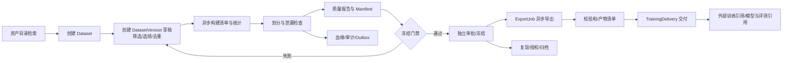
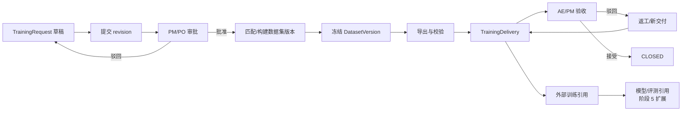

# DDP 阶段 4 数据集与训练支撑 PRD

> 文档编号：PRD-DDP-324｜任务：DDP-324｜阶段：4｜版本：V0.1（待审阅）｜日期：2026-11-09｜Owner：Product Manager
> 状态：**DRAFT，未冻结**；所有验收项默认 `NOT RUN`
> 基线：`docs/DDP_具身智能数据闭环平台建设总规范_V1.0_FINAL.md`（下称“总规范”）
> 关联：`docs/product/阶段4-数据集与训练支撑验收标准.md`、`docs/product/阶段3-标注PRD.md`、`docs/architecture/阶段3-契约冻结-v1.0.md`、`docs/architecture/阶段2-采集上传RawAsset-Episode契约-v1.md`、`docs/architecture/阶段2-Episode血缘与API摘要-v1.md`、`docs/data-standards/Canonical草案.md`
> **实现基线核查（2026-11-09，`main@388a136`）**：后端迁移最新为 `0016_stage3_reinstall_annotation_guards.py`；未发现阶段 4 的 Dataset、DatasetVersion、TrainingRequest、ExportJob 领域模块、API 路由或迁移；仅 `backend/app/domain/episodes/enums.py` 在阶段 2 血缘枚举中预留 `DATASET_VERSION`、`TRAINING_RUN`。**阶段 4 尚未实现，本文不代表任何功能可用。**
> **边界**：只定义业务需求、流程、状态机、角色、权限、指标口径与验收基线；不定义技术实现，不修改 `backend/**`、`apps/web/**`、`packages/contracts/**`、迁移、配置、数据库与测试。文中字段、错误码、接口与状态机均为**需求建议**，最终以 System Architect 冻结契约和 ADR 为准。

## 0. 文档说明

1. 本文是阶段 4「数据资产、数据集与训练支撑」的需求与验收基线，不代表功能已实现；所有验收默认 `NOT RUN`。
2. 字段是页面与业务需要的字段清单，不是数据库设计，也不是已冻结 API 契约；错误码为建议值，未在代码中实现。
3. 阶段 4 以阶段 2 的 `Episode`/`RawAsset`/Manifest/血缘和阶段 3 的**已批准标注结果**为输入；不得绕开 Episode 直接导出 RawAsset，不得把未批准标注写入训练集。
4. `AnnotationSampleSet`（阶段 3 标注样本集）与阶段 4 的 `Dataset`/`DatasetVersion` 不是同一对象。阶段 3 只做标注生产与质量评估；阶段 4 才做正式清单、去重、划分、质量报告、冻结、Manifest、导出与训练交付。
5. 训练平台、训练集群、调度、GPU 资源和模型训练执行不由 DDP 建设；DDP 只通过 Adapter 管理需求、数据集版本、导出、交付、外部任务引用、模型与评测引用。
6. 合成数据、Mock Adapter、故障注入、规模模拟和未实测性能必须显式标注，不得冒充真实数据、真实训练平台或真实业务验收。
7. 与总规范冲突时以总规范为准；本文已按总规范 §10、§11、§6、§7、§9、§12.4、§13、§16、§17、§19、§22 对齐，差异与未决项在 §12 记录。

| 标记 | 含义 |
|---|---|
| `DRAFT` | 草案，未冻结，不得作为实现完成依据 |
| `NOT RUN` | 验收项未执行 |
| `未验证` | 缺少真实证据或方案未定 |
| `BLOCKED` | 环境、人员、决策或依赖阻塞 |
| `N/A` | 本期不适用 |
| `P0/P1/P2` | 阻断项 / 可用性增强 / 后续阶段 |
| `[MOCK]` | 模拟、注入或替代实现 |
| `[SYNTHETIC]` | 合成 Episode、数据集、导出产物或训练记录，不是真实生产 |
| `REAL` | 真实数据、真实人员、真实外部平台 |

## 1. 背景、目标与范围

阶段 2 已形成 RawAsset、IngestionJob、Episode、Manifest 与基础血缘；阶段 3 已形成可版本化的标签 Schema、标注样本集、任务、提交、复核、仲裁、黄金集、IAA 与抽检能力。阶段 4 要解决的核心问题是：**把经过质量与标注验收的 Episode 变成算法团队可稳定获取、可复现、可追溯、可授权、可交付的数据集版本**，并把训练需求、导出、交付和外部训练引用纳入同一条血缘链。

### 1.1 目标

1. 建立资产目录与元数据检索：按项目、机器人、设备、场景、动作、Episode、标签、质量、时间、格式检索，并明确索引新鲜度。
2. 建立 `Dataset` 与不可变 `DatasetVersion`：支持筛选、Episode 选择、去重、训练/验证/测试划分、质量报告、Manifest、冻结、导出、复现、授权与归档。
3. 冻结版本必须记录样本清单、样本版本、标注版本、Schema、质量规则、处理 Pipeline、划分策略、Manifest、Hash、创建人/时间；冻结后不得静默修改，变化创建新版本。
4. 训练集构建必须防止同一连续 Episode、同一 Episode 血缘、同一场景、重复内容或高度相似样本造成训练/测试泄漏；泄漏检查结果必须可见、可复算、失败关闭。
5. 导出必须异步、幂等、可重试、可取消、可校验，产物存对象存储，提供交付清单与逐文件/汇总校验和；LeRobot 是交换格式之一，不是 DDP 内部唯一模型。
6. `TrainingRequest` 必须可版本化：算法团队提交训练目标、模型类型、数据类型、场景/动作、数据量、质量阈值、标签、格式、交付时间和验收方式；批准后变更创建新版本并重新审批。
7. 训练平台通过 Adapter 集成：DDP 只管理需求、数据集版本、导出、交付、外部训练任务引用、模型与评测引用，不建设训练集群、不调度 GPU、不执行训练。
8. 建立阶段 2/3/4 的完整血缘：`TrainingRequest → Delivery → ExportJob → DatasetVersion → Episode → Annotation → RawAsset → CollectionTask/Plan/SOP → Project/Robot/Device/Worker`，支持正反向追溯。
9. 所有对象强制项目隔离；权限由服务端权威判定；冻结、导出、下载、授权、归档、Adapter 调用和跨项目拒绝均写审计；业务事务与 outbox 同事务，消费幂等。
10. 指标口径可核对：需求完成率、交付周期、复用率、覆盖度、泄漏检查结果必须区分 `0 / N/A / Unknown / Stale / Partial`，合成与 Mock 数据不得进入真实分母。

### 1.2 成功定义

一份训练交付必须能回答：谁在什么时间提出了哪个版本的训练需求；使用了哪个冻结数据集版本；该版本包含哪些 Episode 和标注版本；如何划分训练/验证/测试；泄漏检查是否通过；导出了什么格式、哪些文件、校验和是多少；交付给谁、是否验收；外部训练任务和模型/评测引用是什么。任一环缺失，不得判定“可复现、可追溯、可交付”。

### 1.3 范围与非目标

| 子域 | P0 | P1 | 本期不做 |
|---|---|---|---|
| 资产目录 | 项目/机器人/设备/场景/动作/Episode/标签/质量/时间/格式检索；元数据详情；项目隔离；索引新鲜度 | 组合检索、保存筛选、导出检索结果 | 全文检索引擎选型、跨项目资产聚合、数据市场 |
| Dataset | 创建、编辑、状态、项目内唯一编码、用途与保留策略 | 数据集模板、批量复制 | 数据交易、跨租户数据市场 |
| DatasetVersion | 草稿、构建、校验、就绪、冻结、取代、归档；不可变；版本化 | 版本对比、变更摘要 | 物理删除、覆盖式重冻结 |
| 选择与去重 | Episode 门禁、显式版本、精确去重、排除理由、统计 | 近似重复/相似样本识别 | 自动数据增强、生成式补数 |
| 划分与泄漏 | 训练/验证/测试划分、确定性种子、Episode/血缘/内容 Hash 硬规则、失败关闭 | 场景组、相似组、批次组、时间重叠软规则 | 自动学习划分模型 |
| 质量报告/Manifest | 计数、分布、覆盖、去重、泄漏、版本、Hash、可复算 | 趋势对比、差异报告 | 未测量性能承诺 |
| 冻结/复现/授权/归档 | 独立审批、不可变、Manifest 复现、项目内授权、归档不删除 | 跨项目显式授权、授权到期/撤销 | 物理删除、绕过授权的共享 |
| 导出 | 异步 Job、幂等、重试、取消、超时、对象存储、逐文件 SHA256、汇总清单、LeRobot Adapter | 更多格式、并发限流、成本统计 | 训练集群、在线推理、模型权重托管 |
| TrainingRequest | 创建、提交、审批、驳回、版本化变更、取消、阻塞 | 需求模板、需求优先级排序 | 自动承诺训练效果 |
| 训练交付 | 交付单、版本/导出/校验和、交付、验收、驳回返工 | 多接收方、分批交付 | 训练执行结果质量担保 |
| 训练平台 Adapter | 能力声明、提交引用、状态查询、回调、幂等、超时、失败记录 | 多平台路由、熔断、配额 | 训练集群、调度器、GPU 管理、分布式训练 |
| 血缘/审计 | 正反向追溯、只追加、跨项目拒绝、outbox 幂等 | 血缘图可视化、影响分析 | 删除审计、改写历史 |
| 指标/页面 | 需求完成率、交付周期、复用率、覆盖度、泄漏结果；核心页面十种状态 | 趋势、分场景/动作对比 | 未批准的绩效排名 |

非目标：N4-01 建设或托管训练集群、GPU 调度、分布式训练、超参搜索；N4-02 执行模型训练、推理服务、完整模型评测（阶段 5）；N4-03 直接读取/改写标注工作台或绕过阶段 3 审核；N4-04 绕过 Episode 直接从 RawAsset 生成训练集；N4-05 物理删除数据或覆盖已冻结版本；N4-06 默认跨项目共享；N4-07 未批准的微服务、CQRS、Event Sourcing；N4-08 自动接受未人工确认的 AI 标签；N4-09 用 Mock/合成数据冒充真实导出兼容性或真实训练交付；N4-10 生产部署、生产数据变更、未批准迁移。

### 1.4 术语

- **Dataset**：项目内的数据集容器，拥有稳定 `dataset_id` 与业务编码；自身不直接承载样本，样本在 `DatasetVersion` 中冻结。
- **DatasetVersion**：一次可复现的样本清单与划分快照；冻结后不可变，变化创建新版本。
- **DatasetItem**：DatasetVersion 中一个 Episode（可带时间片段）的引用，含 Episode 版本、Manifest Hash、标注版本、Schema 版本、划分、分层、角色、权重与入选理由。
- **去重**：按 Episode 血缘、Manifest/内容 Hash、RawAsset 内容 Hash 或配置的相似签名消除重复样本；保留与排除均需记录。
- **划分**：将入选样本分配到 `TRAIN`、`VALIDATION`、`TEST`；以血缘组/相似组/场景组为最小不可拆分单元。
- **泄漏**：同一 Episode/血缘、同一内容、同一场景组或高度相似样本同时出现在训练与测试等不同划分中，导致评估失真。
- **Manifest**：DatasetVersion 的规范化样本清单与元数据，服务端计算 SHA256，存对象存储，数据库只存引用与 Hash。
- **冻结**：在质量门禁、泄漏检查、Manifest 与审批完成后，将 DatasetVersion 固化为不可变版本。
- **导出**：将冻结版本转换为指定交换格式（P0 为 LeRobot）并写入对象存储的异步任务，不是数据集冻结本身。
- **交付**：把导出产物、交付清单、质量报告、Manifest 与校验和交给训练需求方并完成验收的记录。
- **TrainingRequest**：算法团队提出的训练数据需求；批准后的内容不可原地修改，变更创建新 revision。
- **TrainingDelivery**：一次针对特定需求 revision 和 DatasetVersion 的交付记录，可被接受、驳回或返工。
- **外部训练引用**：外部训练平台的任务 ID、状态摘要、模型版本引用与评测结果引用；DDP 不拥有训练执行。
- **Adapter**：DDP 与外部训练平台之间的 Port/Adapter 边界；不支持的能力必须显式返回 Unsupported。

## 2. 依赖、假设与约束

### 2.1 依赖

| ID | 依赖 | 影响 | 当前状态（2026-11-09，`main@388a136`） |
|---|---|---|---|
| DEP4-01 | 阶段 2 Episode、Manifest、标定快照、血缘、RawAsset 状态 | 数据集输入、冻结、复现、血缘 | 契约已冻结；代码与迁移 `0009`/`0010` 存在；阶段 4 未复验，标 `未验证` |
| DEP4-02 | 阶段 3 已批准标注、Schema 版本、提交/复核/仲裁、Episode `annotation_status=APPROVED` | 训练集标签、Schema 快照、血缘 | 契约 `ddp.stage3/1.0.0` 已冻结；迁移 `0012`–`0016` 存在；阶段 4 未复验 |
| DEP4-03 | 阶段 1 项目、成员、服务端 RBAC、项目隔离 | 全部阶段 4 对象与接口 | 部分实现；待验证 |
| DEP4-04 | 审计、outbox、幂等、乐观锁基础设施 | 状态迁移、事件、导出与交付 | 迁移 `0006` 存在；阶段 4 未验证 |
| DEP4-05 | 对象存储、短期签名 URL、下载审计 | Manifest、质量报告、导出产物、交付清单 | 代码路径存在；阶段 4 导出未验证 |
| DEP4-06 | LeRobot 格式版本、字段映射、Loader 兼容性验证 | 导出格式与验收 | 未冻结；`未验证` |
| DEP4-07 | 外部训练平台 API、回调签名、身份与配额 | Adapter、外部训练引用 | 未提供；P0 仅允许 `[MOCK]` Adapter |
| DEP4-08 | 真实算法团队、真实训练平台、真实数据集 | 真实训练交付验收 | 未提供；预期 `BLOCKED` |
| DEP4-09 | 资产目录检索索引与新鲜度机制 | 资产检索、Stale/Partial 语义 | MISSING；阶段 4 需定义 |
| DEP4-10 | 前端数据集构建、质量报告、导出、训练需求与交付页面 | 页面与状态验收 | 未实现 |

### 2.2 假设

1. 只有 `Episode.status in (ACCEPTED, COMPLETED)`、`quality_status in (PASS, WARN)`、`annotation_status=APPROVED`、Manifest Hash 可校验、标定快照有效、`time_base.sync_status` 不为 `UNVERIFIED/FAILED` 的 Episode 才能进入 DatasetVersion；`WARN` 需 QA/PM 显式确认并记录原因。
2. `REJECTED/INVALIDATED/FAILED/ARCHIVED` Episode 默认不可进入数据集；例外必须 PO 审批、记录理由并审计。
3. 数据集引用必须使用显式 `episode_version`、`annotation_version`、`schema_version`、`manifest_sha256`；禁止“最新版本”隐式解析。
4. DatasetVersion 一旦 `FROZEN`，样本清单、划分、Manifest、质量报告与 Hash 不可原地修改；任何变化创建新版本并保留旧版本。
5. 导出在 Worker 中异步执行，不占用 HTTP 请求线程；导出产物不可变，重试不得产生无记录的重复交付。
6. DDP 是训练需求、数据集版本、导出、交付与血缘元数据的权威系统；外部训练平台是训练执行、运行日志、模型权重与训练指标的权威系统。
7. 所有阈值、比率、超时、重试次数、最小样本量、相似度阈值均配置化并版本化，不得硬编码。
8. 阶段 4 不执行物理删除；归档只改变可用性与保留状态，保留元数据、Hash、审计与血缘。
9. 执行环境与真实数据未提供时，相关验收只能标 `NOT RUN`/`BLOCKED`，不得用合成数据替代。

### 2.3 约束

- 只写 `docs/**`；不改代码、配置、数据库、正式契约、迁移与测试；不执行部署、迁移或生产数据操作。
- 不把“代码存在”当“功能可用”；当前阶段 4 连代码都不存在，所有能力均为 `NOT RUN`。
- 不把 Mock Adapter 当真实训练平台；不把合成 Episode 当真实业务数据；不把 LeRobot 导出文件存在当“已被 LeRobot 生态兼容”。
- 权限、项目隔离、冻结不可变、泄漏硬规则、校验和、审计/outbox 与血缘必须在真实实现上验证，不能用 Mock 替代。
- 不承诺未测量的导出吞吐、数据集规模上限、训练时长或模型效果。
- 页面状态、错误码、状态徽标、缺失语义必须统一；前端隐藏按钮不构成权限控制。
- 数据集与训练元数据不得包含 Token、密码、客户敏感数据或无关个人信息；大文件只存对象存储，数据库只存引用、Hash、状态与血缘。

## 3. 角色、职责与职责分离

| 角色 | 代码 | 职责 |
|---|---|---|
| Platform Admin | PA | 平台配置、Adapter 凭据托管、全局审计；访问项目数据需 break-glass |
| Platform Owner | POwner | 平台级策略与高风险例外；不默认参与单项目数据集业务 |
| Project Owner | PO | 数据集策略、冻结/归档高风险审批、跨项目授权、重大例外与豁免 |
| Project Manager | PM | 训练需求计划、需求审批、交付协调、优先级与验收管理 |
| Data Engineer | DE | 数据集构建、去重/划分配置、质量报告、Manifest、导出 Job、血缘与复现技术支撑 |
| Algorithm Engineer | AE | 提交训练需求、查看候选数据集与覆盖、接收并验收交付、使用外部训练引用 |
| Quality Inspector / QA | QA | 独立核验质量报告、泄漏检查、导出校验和与交付一致性；不替代 DE 构建 |
| Auditor | AU | 只读审计、权限与隔离检查、下载/导出/授权追溯 |
| Read-only Viewer | RO | 只读查看授权范围内的数据集与交付 |

RACI（R 执行、A 最终负责/审批、C 协作、I 知会）：

| 活动 | PO | PM | DE | AE | QA | AU | RO |
|---|---|---|---|---|---|---|---|
| 资产目录检索与查看 | A | C | R | C | C | C | I |
| Dataset 创建/编辑 | A | C | R | I | I | I | I |
| DatasetVersion 构建/选择/去重/划分 | A | C | R | C | C | I | I |
| 质量报告与 Manifest | A | C | R | I | R（核验） | I | I |
| 冻结审批 | A | R | C | I | C（独立核验） | I | I |
| 导出 Job | A | C | R | C（提出需求） | C（校验） | I | I |
| Dataset 下载/使用 | A | C | C | R | C | I | I |
| 跨项目授权 | A | C | I | I | I | C | I |
| 归档 | A | C | R | I | I | C | I |
| TrainingRequest 提交 | I | C | I | R | I | I | I |
| TrainingRequest 审批 | A | R | C | I | C | I | I |
| TrainingDelivery 创建/交付 | A | R | R | C | C（校验） | I | I |
| TrainingDelivery 验收/驳回 | A | C | I | R | C | I | I |
| Adapter 配置/调用 | A | I | R | I | I | C | I |
| 审计/血缘 | A | C | R | I | C | R | I |

**职责分离硬规则**：

1. DatasetVersion 的创建/构建人不得是该版本冻结的**唯一**审批人；至少一名 PO/PM 审批，QA 独立核验质量与泄漏结果。单人项目例外必须 PO 书面批准并审计。
2. TrainingRequest 的提交人不得批准自己的需求；AE 提交时由 PM/PO 审批。
3. 交付创建人不得同时是唯一验收人；AE 验收时，DE/PM 负责交付准备；例外需 PO 批准并审计。
4. 跨项目 `DatasetGrant` 只能由 PO 批准；授权必须带范围、到期时间、原因，并可撤销。
5. 归档、撤销授权、解除冻结（仅通过新版本，不允许解冻）属于高风险动作，必须二次确认并审计。
6. 外部训练平台凭据只存在于 Secret 管理/Adapter 配置中，不得出现在 Dataset、ExportJob、Manifest、日志或前端响应中。
7. PA 默认不参与项目业务；break-glass 访问必须强审计并通知 PO。
8. 质量报告、泄漏检查、导出校验和不得由同一人既生成又独立签字；至少一名 QA 复核。

## 4. 核心对象与业务规则

> 字段用于需求、页面与验收；最终类型、必填、枚举与 API 以 System Architect 冻结契约为准。所有对象强制 `project_id`；所有写动作支持乐观锁与幂等；所有引用必须同项目。

### 4.1 资产目录（AssetCatalogEntry）

关键字段：`asset_ref_type`（`RAW_ASSET/EPISODE/ANNOTATION/DATASET_VERSION`）、`asset_ref_id`、`project_id`、`source_project_id`、`collection_task_id`、`collection_batch_id`、`sop_version`、`robot_id`、`device_ids[]`、`sensor_ids[]`、`captured_at`、`time_range`、`format`、`file_size`、`sha256`、`duration_ns`、`frame_count`、`sample_rate_hz`、`scene_labels[]`、`action_labels[]`、`annotation_status`、`quality_status`、`episode_version`、`annotation_version`、`schema_version`、`storage_ref`、`access_scope`、`retention_policy`、`indexed_at`、`index_version`、`freshness_status`、`source_updated_at`、`version`。

规则：

1. 资产目录是**派生检索视图**，不是权威数据源；权威数据仍在 RawAsset/Episode/Annotation/DatasetVersion。
2. 检索维度至少覆盖项目、机器人、设备、场景、动作、Episode、标签、质量、时间、格式；支持分页与稳定排序。
3. `freshness_status`：`FRESH/STALE/PARTIAL/UNKNOWN`；索引滞后或部分来源不可达时必须显示 `Stale`/`Partial`，不得显示 0 或假装完整。
4. 列表、详情、下载、搜索、缓存 Key 均强制项目上下文；跨项目统一 404，不泄漏对象存在性。
5. 下载/跳转必须校验权限并写审计；不得返回长期公开 URL；不得在目录中存放原始大文件二进制。
6. 目录不得把 `AnnotationSampleSet` 当作 DatasetVersion，也不得把未冻结的标注样本集标为“可训练”。

### 4.2 Dataset

关键字段：`dataset_id`、`dataset_lineage_id`、`project_id`、`code`、`name`、`description`、`purpose`（`TRAINING/EVALUATION/BENCHMARK/OTHER`）、`owner_id`、`status`、`current_version_id?`、`tags[]`、`usage_policy`（`TRAINING_ALLOWED/TRAINING_DENIED/UNKNOWN`）、`retention_policy`、`default_split_policy_id?`、`created_by`、`created_at`、`updated_at`、`version`、审计字段。

状态机：

```text
DRAFT → ACTIVE → ARCHIVED
DRAFT → ARCHIVED
```

- `DRAFT`：尚未有任何 `FROZEN` DatasetVersion；可编辑名称、描述、用途等非样本字段。
- `ACTIVE`：至少有一个 `FROZEN` 版本；可继续创建新版本；核心标识不可静默改变。
- `ARCHIVED`：不再创建新版本或新导出；已有冻结版本、交付、审计与血缘保留；默认不可解除归档，例外需 PO 审批并审计。
- `code` 项目内唯一；`dataset_lineage_id` 在 Dataset 创建时生成，跨版本稳定。
- 删除 Dataset 不在阶段 4 范围；只允许归档。

### 4.3 DatasetVersion

关键字段：`dataset_version_id`、`dataset_lineage_id`、`dataset_id`、`dataset_version`（单调递增整数）、`project_id`、`status`、`validity_status`、`selection_rule_version`、`selection_filters`、`selection_snapshot_at`、`dedup_policy_id/version`、`split_policy_id/version`、`leakage_policy_id/version`、`quality_policy_id/version`、`candidate_count`、`selected_count`、`excluded_count`、`duplicated_count`、`item_count`、`train_count`、`validation_count`、`test_count`、`total_duration_ns`、`total_bytes`、`episode_version_digest`、`annotation_schema_versions[]`、`annotation_submission_refs_digest`、`manifest_key`、`manifest_sha256`、`quality_report_id`、`quality_report_sha256`、`leakage_report_id`、`leakage_report_sha256`、`source_snapshot_at`、`build_attempt`、`freeze_approval_id?`、`frozen_by?`、`frozen_at?`、`supersedes_version_id?`、`superseded_by_version_id?`、`archived_at?`、`created_by`、`created_at`、`updated_at`、`version`、审计字段。

生命周期状态机：

```text
DRAFT → BUILDING → VALIDATING → READY → FROZEN → SUPERSEDED
                         └──────→ VALIDATION_FAILED → DRAFT（未冻结，可重建）
DRAFT/BUILDING/VALIDATING/READY/VALIDATION_FAILED → CANCELLED
FROZEN → ARCHIVED
```

- `DRAFT`：选择条件、去重策略、划分策略可编辑；尚未生成正式清单。
- `BUILDING`：异步生成候选清单、统计与 Manifest 草稿；不允许并行编辑。
- `VALIDATING`：执行质量门禁、泄漏检查、Manifest 与报告校验。
- `READY`：门禁通过，等待冻结审批；样本清单与报告已固定，任何更改需回到 `DRAFT` 并重新校验。
- `FROZEN`：审批完成，Manifest/质量报告/Hash/划分不可变；可导出。
- `SUPERSEDED`：同一 `dataset_lineage_id` 的更新版本已冻结；旧版本仍可查看、复现与按策略导出，但默认不再作为新交付首选。
- `VALIDATION_FAILED`：门禁或泄漏检查失败；可在未冻结前回到 `DRAFT` 重新构建，`build_attempt` 递增，所有尝试保留审计。
- `CANCELLED`：未冻结即放弃；不产生可导出产物；保留审计。
- `ARCHIVED`：保留历史与血缘，不再创建新导出；不物理删除。
- `validity_status`：`VALID/STALE/INVALIDATED/UNKNOWN`，与生命周期状态分离。上游 Episode/标注失效、Manifest Hash 变化、质量规则升级或来源不可达时，冻结版本可变为 `STALE/INVALIDATED`，但**不得静默改写**其内容；新导出默认阻断，例外需 PO 审批并审计。

规则：

1. 所有 `DatasetItem` 必须引用显式 Episode 版本、Manifest Hash、标注版本与 Schema 版本；禁止“最新”。
2. `FROZEN` 后任何样本、划分、Manifest、质量报告、策略版本变化必须创建新 `dataset_version`，`supersedes_version_id` 指向旧版本；旧版本不可变。
3. 冻结必须记录 `manifest_sha256`、`quality_report_sha256`、`leakage_report_sha256`、`freeze_approval_id`、`frozen_by`、`frozen_at`。
4. `READY → FROZEN` 必须有独立审批与质量门禁 PASS；泄漏硬规则失败、未知或数据不足时不得冻结。
5. 版本号单调递增且不可复用；`CANCELLED/VALIDATION_FAILED` 不占用可交付版本号，但保留审计与尝试记录，具体编号策略由契约冻结。
6. DatasetVersion 不得包含跨项目 Episode、已隔离/墓碑 RawAsset、未批准标注、`UNVERIFIED/FAILED` 时间同步或无法校验的 Manifest。

### 4.4 DatasetItem 与选择规则

关键字段：`dataset_item_id`、`project_id`、`dataset_version_id`、`episode_id`、`episode_version`、`episode_lineage_id`、`manifest_sha256`、`raw_asset_ids[]`、`annotation_submission_id`、`annotation_version`、`annotation_record_digest`、`schema_id`、`schema_version`、`schema_sha256`、`split`（`TRAIN/VALIDATION/TEST`）、`stratum`、`sample_role`（`NORMAL/HOLDOUT/HARD_CASE/EVALUATION`）、`weight`、`dedup_group_id?`、`similarity_group_id?`、`scene_group_id?`、`selected_reason`、`item_sha256`、`created_at`、`version`。

选择门禁（G4-01）：

1. Episode `status in (ACCEPTED, COMPLETED)`；`quality_status in (PASS, WARN)`；`WARN` 必须有 QA/PM 确认、理由与审计。
2. `annotation_status=APPROVED`，且存在至少一个 `APPROVED` 提交；引用其 `annotation_version`、`schema_id/version/sha256` 与记录 digest，不得引用草稿、驳回、返工中或未仲裁完成的标注。
3. Episode 必须有可校验的 `manifest_sha256`；Manifest 缺失、Hash 不一致或无法解析时排除。
4. 标定快照必须有效且未撤销/过期；`time_base.sync_status` 不得为 `UNVERIFIED/FAILED`；`DEGRADED` 只允许在 QI/PM 审批并记录原因后进入，默认拒绝。
5. Episode 及其 RawAsset 不得处于隔离、墓碑、失效或跨项目状态；上游失效传播必须使候选失效。
6. `usage_policy` 必须为 `TRAINING_ALLOWED`；`UNKNOWN/TRAINING_DENIED` 默认阻断冻结，例外需 PO 审批并审计。
7. 每个入选项必须记录 `selected_reason`；排除项必须记录排除码与理由，支持预览与统计。
8. 选择规则、筛选条件、候选快照时间与版本必须记录；样本选择不得修改 Episode/Annotation。

规则：一个 DatasetItem 只能属于一个 DatasetVersion 和一个划分；`item_sha256` 由服务端对规范化字段计算；冻结后不可变；不得跨项目；`sample_role=HOLDOUT` 的样本默认不进入训练划分，具体策略由划分策略版本定义。

### 4.5 去重与相似样本

去重策略（`DedupPolicy`）关键字段：`dedup_policy_id`、`project_id`、`version`、`exact_keys[]`、`near_duplicate_enabled`、`similarity_method`、`similarity_threshold`、`grouping_keys[]`、`retain_rule`、`created_by`、`created_at`、`policy_sha256`。

P0 精确去重规则：

1. 同一 `episode_lineage_id` 默认只保留一个版本；保留规则必须确定（例如最新 `ACCEPTED` 版本、质量优先、时间优先），不得随机。
2. 相同 `manifest_sha256` 视为内容重复；相同 RawAsset 内容 Hash 组视为来源重复。
3. 重复组记录 `dedup_group_id`、保留项、排除项、规则版本与原因；统计 `duplicated_count`。
4. 同一重复组不得跨 `TRAIN/VALIDATION/TEST`；跨划分出现即视为泄漏。

P1 近似重复/相似样本：

1. 相似方法、特征、阈值、最小簇大小必须配置化并版本化；不得在业务代码硬编码算法或阈值。
2. 相似簇分配 `similarity_group_id`，划分以簇为最小不可拆分单元；同一簇不得跨划分。
3. 相似检测不可用时，报告必须显示 `UNKNOWN`/`N/A`，不得默认“无泄漏”。
4. 相似检测结果与排除/保留决定必须可审计、可复算。

### 4.6 训练/验证/测试划分与泄漏控制

`SplitPolicy` 关键字段：`split_policy_id`、`project_id`、`version`、`strategy`（`RATIO/FIXED_COUNT`）、`train_ratio`、`validation_ratio`、`test_ratio`、`train_count`、`validation_count`、`test_count`、`seed`、`stratify_by[]`、`group_by[]`、`empty_split_policy`、`min_item_count`、`min_duration_ns`、`rounding_rule`、`created_by`、`created_at`、`policy_sha256`。

划分规则：

1. `RATIO` 三比例之和必须为 100%；`FIXED_COUNT` 三项之和必须等于入选数或由明确余数规则处理；舍入规则必须确定性并写入报告。
2. 同一 DatasetVersion 的划分必须由 `seed + split_policy_version + 规范化排序键` 确定；重复构建必须得到相同分配。
3. 最小不可拆分单元为：Episode 血缘组、Manifest/内容 Hash 组、相似簇（启用时）、场景组（启用时）；同一单元不得跨划分。
4. 分层键（场景、动作、机器人、设备、标签）必须来自显式元数据，不得推断；分层缺失时报告 `Partial`。
5. 空划分或样本不足：默认阻断构建/冻结；只有显式 `empty_split_policy=ALLOW_EMPTY_TEST` 且记录理由时允许空测试集，训练/验证不得为空。低于 `min_item_count/min_duration_ns` 返回数据不足错误，不得静默成功。
6. 划分结果、策略版本、种子、分层统计与每项分配必须写入 Manifest 与质量报告。

`LeakagePolicy` 关键字段：`leakage_policy_id`、`project_id`、`version`、`hard_rules[]`、`soft_rules[]`、`similarity_grouping_enabled`、`scene_grouping_enabled`、`batch_grouping_enabled`、`temporal_overlap_enabled`、`waiver_allowed_rules[]`、`policy_sha256`。

泄漏检查（G4-05）：

| 规则 | 级别 | 说明 |
|---|---|---|
| 同一 `episode_lineage_id` 跨划分 | 硬 | 同一 Episode 的任意版本/片段不得同时进入训练与测试 |
| 同一 `manifest_sha256` 跨划分 | 硬 | 内容完全相同的样本不得跨划分 |
| 同一 RawAsset 内容 Hash 组跨划分 | 硬 | 同一来源内容重复不得跨划分 |
| 同一相似簇跨划分（启用时） | 硬 | 簇内样本视为高度相似 |
| 同一场景组跨划分（启用时） | 软/可配置 | 默认警告；启用严格模式时按硬规则处理 |
| 同一采集批次/会话跨划分（启用时） | 软/可配置 | 防止同批次环境泄漏 |
| 同一来源时间重叠区间跨划分 | 软/可配置 | 防止连续片段泄漏 |
| 重复标注版本/重复记录 | 软 | 需人工确认是否构成泄漏 |

规则：

1. 硬规则失败 → `leakage_status=FAIL`，禁止冻结与导出，不提供普通豁免。
2. 软规则失败 → `WARN`；只有 `waiver_allowed_rules` 中的规则可由 PO 批准豁免，记录原因、影响与审计，导出前必须显式确认。
3. 检查无法完成或数据缺失 → `leakage_status=UNKNOWN`，按失败关闭处理，禁止冻结/导出，不得默认 PASS。
4. 泄漏报告必须包含 `leakage_report_id`、策略版本、检查项数、违规对数、涉及划分、涉及对象、证据、生成时间、Hash；支持复算。
5. 冻结前与每次导出前都必须校验泄漏报告与版本一致；上游或策略变化导致报告过期时重新检查或阻断。

### 4.7 质量报告与 Manifest

质量报告（`DatasetQualityReport`）关键字段：`quality_report_id`、`project_id`、`dataset_version_id`、`status`（`GENERATING/READY/FAILED/STALE`）、`quality_policy_id/version`、`candidate_count`、`selected_count`、`excluded_count`、`duplicated_count`、`split_counts`、`scene_distribution`、`action_distribution`、`robot_distribution`、`device_distribution`、`label_distribution`、`quality_status_distribution`、`duration_ns`、`total_bytes`、`coverage`、`dedup_summary`、`leakage_summary`、`warnings[]`、`blocking_issues[]`、`source_snapshot_at`、`generator_version`、`report_sha256`、`created_at`、`version`。

质量报告规则：

1. 必须覆盖数量、划分、场景/动作/机器人/设备/标签分布、时长/大小、质量状态、去重统计、覆盖度、泄漏结果、警告与阻断项。
2. 覆盖度必须按需求目标维度计算；缺失维度显示 `N/A`，部分数据缺失显示 `Partial`。
3. 报告必须可追溯到输入快照与策略版本；输入变化后报告标 `STALE`，不得继续用于冻结/导出。
4. 报告存对象存储，数据库存引用与 `report_sha256`；报告不可变，重新生成创建新报告版本。
5. 阻断项存在时状态不得为 `READY`；警告不自动阻断，但冻结审批必须可见。

Manifest 规则：

1. Manifest 至少包含 `schema_version`、`dataset_version_id`、`dataset_lineage_id`、`dataset_version`、`project_id`、`created_by/at`、`selection/dedup/split/leakage/quality_policy` 版本、`source_snapshot_at`、`items[]`、`split_counts`、`quality_report_sha256`、`leakage_report_sha256`、`annotation_schema_versions[]`、`episode_version_digest`、`manifest_sha256`。
2. `items[]` 每项必须含 Episode 版本/血缘、Manifest Hash、标注版本/Schema 版本、划分、分层、角色、权重、入选理由与 `item_sha256`。
3. Manifest 使用规范化 JSON（建议 RFC 8785 JCS）生成，服务端计算 SHA256；不得包含自身 Hash；客户端提交的 Hash 一律忽略。
4. Manifest 存对象存储；数据库只存 `manifest_key`/`manifest_sha256`/计数；内联返回超过 1 MiB 时使用短期签名 URL，并要求客户端校验 Hash。
5. `FROZEN` 后 Manifest 不可变；变化创建新 DatasetVersion 与新 Manifest。

### 4.8 冻结、复现、授权与归档

冻结门禁（G4-07）：

1. 版本处于 `READY`；质量报告 `READY` 且无阻断项；泄漏检查 `PASS` 或经批准的软规则 `WAIVED`；Manifest Hash 可校验。
2. 训练/验证划分非空；样本量/时长达到策略或需求阈值；所有项引用已批准标注与有效 Episode。
3. 冻结审批人不是唯一构建人；QA 独立核验；PO/PM 审批；审批记录、理由、时间与 `If-Match` 版本留痕。
4. 冻结事务内固定状态、Manifest/报告 Hash、审批 ID，写审计与 outbox；失败回滚，不得半冻结。
5. 冻结后任何内容变化创建新 `dataset_version`；旧版本 `SUPERSEDED` 或保持可导出，不原地修改。

复现（G4-08）：

1. 给定 DatasetVersion + Manifest + 策略版本 + 种子，重建的样本集合、划分、统计与 Hash 必须与冻结记录一致。
2. 复现只读取显式版本引用，不得使用“最新”Episode/标注；不得自动替换失效来源。
3. 上游 Episode/标注失效、Manifest 变化或策略不兼容时，复现结果标 `SOURCE_CHANGED/STALE`，阻止声称“完全复现”；需创建新版本或 PO 审批例外。
4. 导出复现要求相同 DatasetVersion + 导出格式/映射/Exporter 版本 + 配置 Hash → 相同产物清单与 Hash；时间戳、排序、压缩参数必须确定。

授权（G4-09）：

1. 项目内按角色与资源授权；`DatasetGrant` 用于跨项目/跨团队显式授权（P1），字段含 `grant_id`、`project_id`、`dataset_id/version_id`、`grantee_project_id`、`scope`（`VIEW/DOWNLOAD/EXPORT`）、`expires_at`、`approved_by`、`reason`、`status`、`revoked_at`、`version`。
2. 默认禁止跨项目；未授权访问统一 404，不泄漏存在性；授权访问仍写审计；到期自动失效；撤销立即生效。
3. `usage_policy`、客户合同/数据许可与保留策略必须可追溯；`TRAINING_DENIED/UNKNOWN` 不得导出训练集，例外需 PO 审批。
4. 下载/导出使用短期签名 URL，绑定项目/用户/对象与过期时间；不得在前端缓存长期凭据。

归档（G4-10）：

1. Dataset/DatasetVersion 归档只改变可用性，不删除文件、Manifest、质量报告、审计与血缘。
2. 归档后默认禁止新导出与新交付；已交付产物与外部训练引用仍可追溯；恢复需 PO 审批并审计。
3. 物理删除、保留期到期的清理不在阶段 4 范围；必须由独立数据保留策略与用户批准执行。

### 4.9 ExportJob 与导出产物

关键字段：`export_job_id`、`project_id`、`dataset_version_id`、`status`、`format`（P0 `LE_ROBOT`；P1 可扩展）、`format_version`、`exporter_id`、`exporter_version`、`mapping_version`、`config`、`config_sha256`、`idempotency_key`、`requested_by`、`output_prefix`、`artifact_count`、`total_bytes`、`artifact_manifest_key`、`artifact_manifest_sha256`、`aggregate_sha256`、`attempt`、`max_attempts`、`timeout_seconds`、`started_at`、`finished_at`、`cancel_requested_at?`、`error_code?`、`error_summary?`、`log_ref?`、`version`、审计字段。

状态机：

```text
QUEUED → RUNNING → SUCCEEDED
              ├──→ FAILED → QUEUED（重试，attempt+1）或 FAILED（终态）
              └──→ PARTIAL（终态，非成功）
QUEUED/RUNNING → CANCELLED
```

规则：

1. 只有 `FROZEN` 且 `validity_status` 不为 `STALE/INVALIDATED/UNKNOWN` 的 DatasetVersion 可导出；例外需 PO 审批并审计。
2. 导出异步执行；HTTP 只创建/查询 Job，不阻塞大文件处理；Job 含超时、重试、取消、错误码、日志与幂等键。
3. 同一 `(project_id, dataset_version_id, format, format_version, mapping_version, config_sha256)` + 同一幂等键必须返回同一 Job；并发重复请求不得产生重复产物或重复交付。
4. 产物写入对象存储独立前缀，路径含 `project_id`/`dataset_version_id`/`export_job_id`，不得包含用户原始文件名或路径穿越；对象不可变。
5. 每个产物计算 SHA256，生成 `artifact_manifest`（文件路径、大小、SHA256、内容类型、Episode/片段映射、格式版本、Exporter 版本、配置 Hash），并计算汇总 Hash。
6. 导出完成后回读校验：文件存在、大小一致、Hash 一致；任一失败 Job 不得 `SUCCEEDED`，不得生成可验收交付。
7. `FAILED` 可按退避策略重试；`PARTIAL` 不得当作成功；取消必须停止后续写入并记录已写产物；重试不得静默覆盖成功产物。
8. 不支持的格式/版本返回 `export_format_unsupported`/`export_format_version_unsupported`；不得降级为其他格式或伪造成功。
9. LeRobot 导出 P0 要求：明确 `format_version`、字段映射、Episode 分块、视频/观测/动作映射、帧对齐、标定与时间 sidecar；DDP sidecar 保留标定、时间、血缘和 Manifest。**在真实 LeRobot Loader 验证前，兼容性标 `未验证`，不得宣称已兼容。**
10. 导出 Job 与产物不得包含 Secret、Token、客户敏感信息或无关个人信息；跨项目产物禁止。

### 4.10 TrainingRequest 与版本化变更

TrainingRequest 关键字段：`training_request_id`、`project_id`、`code`、`title`、`business_goal`、`model_type`、`training_type`、`data_modalities[]`、`scene_targets[]`、`action_targets[]`、`robot_targets[]`、`device_targets[]`、`required_labels[]`、`required_schema_versions[]`、`target_episode_count`、`target_duration_ns`、`quality_thresholds`、`split_requirements`、`leakage_policy_id`、`format`、`format_version`、`delivery_due_at`、`acceptance_method`、`priority`、`status`、`current_revision_id`、`owner_id`、`created_by`、`created_at`、`updated_at`、`version`、审计字段。

TrainingRequestRevision 关键字段：`revision_id`、`training_request_id`、`revision_no`、`status`、`snapshot`（上述需求字段的不可变快照）、`change_reason`、`supersedes_revision_id?`、`submitted_by/at`、`reviewed_by/at`、`approved_by/at`、`rejected_by/at`、`rejection_reason?`、`revision_sha256`、审计字段。

状态机：

```text
DRAFT → SUBMITTED → PENDING_REVIEW → APPROVED → IN_DELIVERY → DELIVERED → ACCEPTED → CLOSED
                                   └→ REJECTED → DRAFT（新 revision）
DELIVERED → REVISION_REQUIRED → IN_DELIVERY（新交付）
APPROVED/IN_DELIVERY/DELIVERED/REVISION_REQUIRED → BLOCKED → 原状态
任意非终态 → CANCELLED
```

规则：

1. 创建与提交必须校验：业务目标、模型类型、数据类型、场景/动作、数据量或时长、质量阈值、标签/Schema、格式、交付时间、验收方式、优先级完整；缺项字段级拒绝。
2. 提交人不得审批自己的需求；审批人必须记录通过/驳回理由；驳回必须有原因与可修改项。
3. 批准后的 revision 内容不可原地修改；变更创建新 revision，`revision_no` 递增，`supersedes_revision_id` 指向旧 revision，并重新审批。
4. 新 revision 不得静默改变已交付内容的语义；已有 TrainingDelivery、ExportJob、DatasetVersion 与外部训练引用继续指向旧 revision，保留历史。
5. 需求可以引用尚未构建的数据集计划，但 `IN_DELIVERY` 前必须有可执行的匹配/构建计划；交付必须引用已冻结 DatasetVersion。
6. 需求完成定义：`DELIVERED` 后被验收为 `ACCEPTED`，交付清单/校验和/Manifest/质量报告/血缘齐全，需求 `CLOSED`；完成不等于模型效果达标。
7. `BLOCKED` 必须记录阻塞原因（数据不足、格式不支持、Adapter 不可用、权限/合规）；恢复必须记录依据；`CANCELLED` 必须记录原因与审批。
8. 所有 revision、状态迁移、审批、交付引用与取消写审计与 outbox。

### 4.11 TrainingDelivery

关键字段：`training_delivery_id`、`project_id`、`training_request_id`、`training_request_revision_id`、`dataset_version_id`、`export_job_id`、`delivery_note_no`、`recipient_id`、`recipient_team`、`artifact_manifest_key`、`artifact_manifest_sha256`、`aggregate_sha256`、`item_count`、`split_counts`、`quality_report_ref`、`status`、`delivered_at?`、`accepted_by?`、`accepted_at?`、`acceptance_opinion?`、`rejection_reason?`、`rework_ref?`、`created_by`、`created_at`、`version`、审计字段。

状态机：

```text
DRAFT → READY → DELIVERED → ACCEPTED
                    └→ REJECTED → REWORK → READY（新交付）
DRAFT/READY → CANCELLED
```

规则：

1. 交付必须引用一个已批准的 TrainingRequestRevision、一个 `FROZEN` DatasetVersion 和一个 `SUCCEEDED` ExportJob；校验和未通过、导出 `PARTIAL/FAILED/CANCELLED` 或版本失效时不得交付。
2. 交付单必须包含需求 revision、数据集版本、格式/版本、样本与划分计数、Manifest、质量报告、逐文件 SHA256、汇总 SHA256、接收方、交付时间与验收方式。
3. `DELIVERED` 后交付记录不可原地修改；驳回后通过新交付/返工记录修正，旧交付保留。
4. 验收人必须是接收方授权 AE/PM，不能是唯一交付创建人；接受/驳回必须记录意见与时间。
5. 接受交付不构成模型效果、训练成功或数据绝对无偏的保证；只证明交付内容、版本、校验和与验收流程符合要求。
6. 一个 DatasetVersion 可服务多个 TrainingRequest/Delivery（复用）；一次交付只对应一个需求 revision，避免验收歧义。

### 4.12 外部训练引用（ExternalTrainingReference）

关键字段：`external_ref_id`、`project_id`、`adapter_id`、`adapter_version`、`training_delivery_id`、`training_request_revision_id`、`dataset_version_id`、`external_run_id`、`external_run_url?`、`external_status`、`submitted_at`、`last_synced_at`、`model_ref?`、`evaluation_ref?`、`correlation_id`、`idempotency_key`、`error_code?`、`error_summary?`、`version`、审计字段。

规则：

1. DDP 只保存外部任务/模型/评测的**引用与状态摘要**，不复制模型权重、不托管训练日志大文件、不伪造训练结果。
2. 外部训练任务必须关联 TrainingDelivery 与 DatasetVersion；模型/评测引用必须可回溯到训练运行与数据集版本。
3. 外部状态未知/不可达显示 `Unknown/Stale`，不得显示成功；状态同步失败写审计并告警。
4. 外部 ID 冲突、重复提交、回调重放必须有明确错误/幂等语义；不得静默创建重复训练任务。
5. 模型与评测的完整登记、推理与评测管理属于阶段 5；阶段 4 只保留引用边界。

### 4.13 审计、Outbox 与血缘

审计：所有创建、提交、审批、驳回、构建、校验、冻结、取代、归档、授权/撤销、导出、下载、交付、验收/驳回、Adapter 调用、回调、外部引用变更、跨项目拒绝与权限拒绝必须写审计。审计只追加，不更新、不删除；至少含 `audit_id`、`project_id`、`actor_id`、`action`、`object_type`、`object_id`、`before/after`、`reason`、`request_id`、`correlation_id`、`occurred_at`。

Outbox：业务事务与 outbox 同事务；事件含 `event_id`、`event_type`、`event_version`、`occurred_at`、`producer`、`aggregate_type`、`aggregate_id`、`project_id`、`correlation_id`、`causation_id`、`payload`、`schema_version`。消费按 `event_id` 幂等；失败重试/死信，不静默丢弃。事件至少覆盖：Dataset 创建/归档、DatasetVersion 构建/校验/冻结/取代、DatasetGrant 创建/撤销、ExportJob 排队/开始/成功/失败/取消、TrainingRequest 提交/审批/驳回/修订/取消、TrainingDelivery 创建/交付/验收/驳回/返工、外部训练引用创建/状态更新/失败、下载/导出/跨项目拒绝。

血缘节点（阶段 4 建议，待契约冻结）：`DATASET`、`DATASET_VERSION`、`DATASET_ITEM`、`EXPORT_JOB`、`EXPORT_ARTIFACT`、`TRAINING_REQUEST`、`TRAINING_REQUEST_REVISION`、`TRAINING_DELIVERY`、`TRAINING_RUN`、`MODEL_VERSION_REF`、`EVALUATION_RESULT_REF`，兼容阶段 2/3 的 `RAW_ASSET`、`EPISODE`、`QUALITY_RUN`、`ANNOTATION`、`ANNOTATION_SUBMISSION`、`ANNOTATION_SCHEMA`、`IAA_REPORT` 等。

血缘边（沿用阶段 2 方向并扩展）：

- `INCLUDED_IN`：`EPISODE → DATASET_VERSION`；`ANNOTATION_SUBMISSION → DATASET_VERSION`。
- `SUPERSEDES`：`DATASET_VERSION(new) → DATASET_VERSION(old)`。
- `EXPORTED_AS`：`DATASET_VERSION → EXPORT_JOB`。
- `PRODUCED`：`EXPORT_JOB → EXPORT_ARTIFACT`。
- `DELIVERED_AS`：`EXPORT_JOB → TRAINING_DELIVERY`。
- `SATISFIES`：`TRAINING_DELIVERY → TRAINING_REQUEST_REVISION`。
- `TRAINED_AS`：`TRAINING_DELIVERY → TRAINING_RUN`。
- `EVALUATED_BY`：`TRAINING_RUN → EVALUATION_RESULT_REF`。
- `PRODUCED_MODEL`：`TRAINING_RUN → MODEL_VERSION_REF`。
- `INVALIDATES`：Episode/Annotation/RawAsset 失效 → DatasetVersion（失效传播，不删除历史）。

规则：边只追加；跨项目节点禁止；不得成环（`SUPERSEDES` 必须线性）；终态不可通过血缘改写；失效通过追加边表达；查询支持正向/反向、深度 1–5、分页，默认仅当前项目。

### 4.14 错误码建议（未实现，待契约冻结）

> 以下均为**需求建议**，阶段 4 当前未实现；HTTP 状态、错误码拼写与错误体以 `backend/app/api/errors.py` 和 System Architect 冻结契约为准。所有阶段 4 错误码在契约中应标记 `implemented=false`，不得据本文声称可用。

复用阶段 2/3 稳定通用码：

| HTTP | 错误码 | 用途 |
|---|---|---|
| 401 | `not_authenticated` | 未认证 |
| 403 | `forbidden` | 无权限/非项目成员 |
| 404 | `resource_not_found` | 资源不存在或跨项目统一隐藏 |
| 409 | `state_transition_invalid` | 非法状态迁移 |
| 409 | `version_conflict` | 乐观锁版本冲突 |
| 409 | `resource_immutable` | 资源不可变 |
| 409 | `duplicate_resource` | 唯一约束冲突 |
| 409 | `idempotency_key_reused` | 同幂等键不同请求体 |
| 428 | `precondition_required` | 缺少 `If-Match` |
| 422 | `validation_failed` | 参数/字段校验失败 |
| 429 | `rate_limited` | 限流 |
| 500 | `internal_error` | 未预期错误 |
| 503 | `dependency_unavailable` | 对象存储/外部依赖不可用 |

阶段 4 建议错误码：

| HTTP | 错误码 | 触发场景 |
|---|---|---|
| 403 | `dataset_access_denied` | 无数据集访问/下载/导出权限 |
| 403 | `dataset_freeze_approval_forbidden` | 构建人自批或审批人无权限 |
| 403 | `training_request_approval_forbidden` | 提交人自批或审批人无权限 |
| 403 | `training_delivery_acceptance_forbidden` | 非接收方/唯一交付人自验 |
| 409 | `dataset_not_ready` | 版本未到 READY/FROZEN 即冻结/导出 |
| 409 | `dataset_version_immutable` | 冻结后原地修改 |
| 409 | `dataset_version_not_frozen` | 未冻结即导出/交付 |
| 409 | `dataset_version_validation_failed` | 校验失败仍尝试冻结 |
| 422 | `dataset_empty` | 入选为空 |
| 422 | `dataset_insufficient_data` | 低于最小样本/时长或空划分 |
| 422 | `dataset_item_ineligible` | Episode/标注/Manifest/标定/时间同步不合格 |
| 422 | `dataset_split_invalid` | 比例/数量/分组/空划分非法 |
| 409 | `dataset_leakage_check_failed` | 硬规则泄漏 |
| 409 | `dataset_leakage_check_unknown` | 泄漏检查无法完成，失败关闭 |
| 409 | `dataset_quality_gate_failed` | 质量门禁未通过 |
| 409 | `dataset_annotation_not_approved` | 引用未批准标注 |
| 422 | `dataset_annotation_snapshot_mismatch` | 标注/Schema 版本快照与任务冻结不一致 |
| 409 | `dataset_upstream_invalidated` | 上游 Episode/标注失效导致版本 STALE/INVALIDATED |
| 409 | `dataset_manifest_mismatch` | Manifest Hash/内容不一致 |
| 409 | `dataset_freeze_requires_approval` | 缺少独立审批 |
| 409 | `dataset_archive_blocked` | 归档/恢复条件不满足 |
| 410 | `dataset_grant_expired` | 跨项目授权过期/撤销 |
| 422 | `export_format_unsupported` | 不支持的导出格式 |
| 422 | `export_format_version_unsupported` | 不支持的格式版本 |
| 422 | `export_config_invalid` | 映射/配置非法 |
| 409 | `export_job_not_retryable` | 不可重试错误触发重试 |
| 410 | `export_job_cancelled` | 已取消 Job 继续操作 |
| 409 | `export_incomplete` | 产物不完整仍尝试交付 |
| 422 | `export_checksum_mismatch` | 逐文件/汇总 Hash 不一致 |
| 409 | `export_output_conflict` | 输出路径/产物冲突 |
| 422 | `training_request_incomplete` | 需求必填/格式/阈值不完整 |
| 409 | `training_request_immutable` | 批准后原地修改 |
| 409 | `training_request_revision_conflict` | revision 冲突/重复 |
| 409 | `training_request_not_approved` | 未批准需求进入交付 |
| 409 | `training_delivery_not_ready` | 交付内容/校验和/状态未就绪 |
| 409 | `training_delivery_already_accepted` | 已验收交付被重复修改 |
| 422 | `training_delivery_mismatch` | 交付与需求 revision/数据集版本不匹配 |
| 503 | `training_adapter_unavailable` | 外部训练平台不可达 |
| 422 | `training_adapter_unsupported` | Adapter 不支持该能力 |
| 409 | `training_external_run_conflict` | 外部 run 重复/冲突 |
| 401/403 | `training_callback_invalid` | 回调签名/时间戳/nonce 非法 |
| 409 | `training_callback_replayed` | 回调重放 |
| 503 | `asset_index_unavailable` | 资产索引不可用/部分不可达 |

错误码规则：不得用 `internal_error` 掩盖可分类业务失败；不得吞异常或未知状态默认成功；跨项目错误不得泄漏对象存在性；错误体统一 `{"error": {"code", "message", "request_id", "details?"}}`。

## 5. 端到端流程与门禁

### 5.1 数据集主流程



### 5.2 训练需求主流程



### 5.3 门禁

| 门禁 | 输入 | 输出 | 通过条件 | 责任角色 | 失败处理 |
|---|---|---|---|---|---|
| G4-01 输入资格 | Episode/Annotation/RawAsset/Manifest | 候选集 | Episode 可训练、标注已批准、Manifest 可校验、标定/时间同步有效、用途允许 | DE/QA | 排除并记录；不合格返回 `dataset_item_ineligible` |
| G4-02 选择非空 | 候选集、筛选条件 | 入选清单 | 入选数 > 0；覆盖/数量达到最低要求 | DE/PM | 数据不足错误；不得创建空版本 |
| G4-03 去重 | 入选清单、去重策略 | 去重后清单 | 精确重复已分组；保留规则确定；统计完整 | DE | 策略缺失/冲突拒绝 |
| G4-04 划分 | 去重后清单、划分策略 | TRAIN/VALIDATION/TEST | 比例/数量合法、种子确定、组不跨划分、划分非空 | DE/QA | 划分非法/数据不足拒绝 |
| G4-05 泄漏检查 | 划分、泄漏策略 | 泄漏报告 | 硬规则 PASS；软规则 PASS/批准豁免；无 UNKNOWN | QA/DE | 失败或未知阻断冻结/导出 |
| G4-06 报告/Manifest | 清单、统计、策略 | 质量报告、Manifest、Hash | 报告完整、Hash 可校验、输入快照固定 | DE/QA | 报告不完整/Hash 不符拒绝 |
| G4-07 冻结 | READY 版本、报告、审批 | FROZEN 版本 | 独立审批、门禁通过、Manifest 固定、审计/outbox 成功 | PO/PM/QA | 回滚；不得半冻结 |
| G4-08 复现 | 冻结版本、Manifest、策略 | 复现结果 | 样本/划分/统计/Hash 一致；上游未失效 | DE/AU | 标 STALE/SOURCE_CHANGED；不静默替换 |
| G4-09 授权 | DatasetVersion、Grant | 访问/导出许可 | 项目/角色/用途/期限允许；跨项目显式授权 | PO | 拒绝并审计；不泄漏存在性 |
| G4-10 归档 | Dataset/Version | ARCHIVED | PO 审批；保留历史；禁止新导出 | PO/DE | 拒绝；不删除 |
| G4-11 导出 | FROZEN 版本、格式/映射 | ExportJob/产物 | 异步、幂等、超时/重试/取消、校验和通过 | DE/QA | FAILED/PARTIAL；不得交付 |
| G4-12 需求/交付 | 需求 revision、版本、导出 | 交付/验收 | 需求已批准、版本已冻结、导出成功、清单/校验和完整、验收人合法 | PM/AE/QA | 驳回/返工；不覆盖历史 |
| G4-13 Adapter | 交付、外部平台 | 外部引用 | 能力支持、认证/超时/重试/幂等/回调校验通过 | DE/PA | Unsupported/失败记录；不伪造成功 |
| G4-14 审计/血缘 | 全链路对象 | 审计、outbox、血缘 | 同事务、幂等、只追加、跨项目拒绝 | DE/AU | 回滚/告警 |

全链路追溯字符串：`TrainingRequestRevision → TrainingDelivery → ExportJob → DatasetVersion → DatasetItem → Episode → AnnotationSubmission/Annotation → RawAsset → CollectionTask/CollectionPlan/SOP → Project/Robot/Device/Worker`；反向必须能回到需求 revision、交付验收与外部训练引用。任一环缺失不得判定“可复现、可追溯、可交付”。

## 6. 用户故事（摘要）

> 优先级 P0/P1；验收映射见 `阶段4-数据集与训练支撑验收标准.md`。

| 模块 | 用户故事 |
|---|---|
| 资产目录 | US-DS-01 按项目/机器人/设备/场景/动作/时间/格式检索；US-DS-02 查看元数据、质量、版本与血缘；US-DS-03 索引滞后显示 Stale/Partial；US-DS-04 跨项目不可见 |
| Dataset | US-DS-05 创建/编辑数据集；US-DS-06 项目内编码唯一；US-DS-07 归档保留历史；US-DS-08 用途/保留策略可追溯 |
| DatasetVersion | US-DS-09 创建草稿并筛选 Episode；US-DS-10 显式版本引用；US-DS-11 预览候选/入选/排除/重复；US-DS-12 异步构建；US-DS-13 校验与就绪；US-DS-14 冻结不可变；US-DS-15 变更创建新版本 |
| 去重/划分 | US-DS-16 精确去重与保留规则；US-DS-17 近似重复（P1）；US-DS-18 比例/数量划分与种子；US-DS-19 分层；US-DS-20 数据不足拒绝 |
| 泄漏 | US-DS-21 Episode 血缘/内容 Hash 硬规则；US-DS-22 场景/相似/批次/时间重叠规则；US-DS-23 泄漏报告可复算；US-DS-24 失败/未知阻断；US-DS-25 豁免仅软规则且 PO 审批 |
| 报告/Manifest | US-DS-26 质量报告完整；US-DS-27 Manifest 规范化与 Hash；US-DS-28 报告过期标 Stale；US-DS-29 报告/Manifest 对象存储与下载审计 |
| 复现/授权/归档 | US-DS-30 冻结版本复现；US-DS-31 上游失效标 Stale；US-DS-32 项目内授权；US-DS-33 跨项目 Grant（P1）；US-DS-34 归档不删除 |
| 导出 | US-DS-35 创建异步 ExportJob；US-DS-36 幂等/重试/取消/超时；US-DS-37 LeRobot 导出与 sidecar；US-DS-38 不支持格式拒绝；US-DS-39 逐文件/汇总校验和；US-DS-40 产物清单与下载 |
| 训练需求 | US-TR-01 创建需求；US-TR-02 提交/审批/驳回；US-TR-03 批准后不可改；US-TR-04 变更新 revision；US-TR-05 需求匹配与覆盖；US-TR-06 取消/阻塞/恢复 |
| 交付 | US-TR-07 创建交付单；US-TR-08 交付校验；US-TR-09 验收/驳回/返工；US-TR-10 复用已有版本；US-TR-11 交付历史不可覆盖 |
| Adapter | US-TR-12 能力声明；US-TR-13 提交外部训练引用；US-TR-14 状态同步；US-TR-15 回调校验与防重放；US-TR-16 Unsupported 明确返回；US-TR-17 模型/评测引用 |
| 治理/指标 | US-TR-18 项目隔离；US-TR-19 权限矩阵；US-TR-20 审计/outbox；US-TR-21 血缘正反向；US-TR-22 需求完成率/交付周期/复用率/覆盖度/泄漏结果 |

## 7. 页面与页面状态

| 编号 | 页面 | 主要角色 | 路由建议 |
|---|---|---|---|
| P-50 | 数据资产目录 | DE、AE、PM、QA、AU、RO | `/assets`、`/assets/:type/:id` |
| P-51 | 数据集列表/详情 | PO、PM、DE、AE（只读）、QA、AU | `/datasets`、`/datasets/:id` |
| P-52 | 数据集构建器 | DE、PM、QA（核验） | `/datasets/:id/versions/new`、`/datasets/:id/versions/:versionId/build` |
| P-53 | DatasetVersion 详情/质量报告/泄漏检查 | DE、PM、QA、AE（只读）、AU | `/datasets/:id/versions/:versionId`、`/.../quality`、`/.../leakage` |
| P-54 | 冻结审批 | PO、PM、QA、DE（提交） | `/datasets/:id/versions/:versionId/freeze` |
| P-55 | 导出任务列表/详情 | DE、QA、PM、AE（只读） | `/exports`、`/exports/:jobId` |
| P-56 | 训练需求列表/详情/版本 | PM、AE、PO、QA（只读） | `/training-requests`、`/training-requests/:id` |
| P-57 | 训练交付与验收 | PM、AE、DE、QA | `/training-deliveries`、`/training-deliveries/:id` |
| P-58 | 外部训练引用/Adapter 状态 | DE、AE、PM、PA | `/training-runs`、`/training-runs/:refId` |
| P-59 | 授权与归档 | PO、PM、DE、AU | `/datasets/:id/grants`、`/datasets/:id/archive` |
| P-60 | 血缘与审计 | AU、PO、PM、DE、QA | `/datasets/:id/lineage`、`/training-requests/:id/lineage`、`/audit` |

十种基础页面状态：

| 状态 | 定义 | 必须展示 | 禁止 |
|---|---|---|---|
| Loading | 首次加载或关键区域刷新 | 骨架/加载指示、超时提示 | 旧数据冒充新数据 |
| Empty | 请求成功但无数据 | 空态说明、清除筛选、创建入口（有权限） | 显示 0 或错误 |
| Error | 请求失败且非权限原因 | 错误摘要、错误码、request_id、重试 | 空白页、静默失败 |
| Forbidden | 无权限或跨项目访问 | 无权限说明、返回/申请路径 | 泄漏对象名称或存在性 |
| Partial | 部分数据/模块缺失 | 已完成部分、缺失范围、影响 | 用完整态掩盖缺失 |
| Stale | 数据超过更新周期或上游失效 | 最后更新时间、刷新、陈旧标识 | 当实时数据展示 |
| Disabled | 操作暂不可用 | 禁用原因（悬浮/说明） | 隐藏原因或点击无反馈 |
| Pending | 异步构建/导出/校验进行中 | 进度、阶段、预计时间、取消（如支持） | 阻塞整页或重复提交 |
| Success | 操作成功 | 成功反馈、对象链接、下一步 | 仅弹窗无结果定位 |
| Failed | 异步任务失败或操作失败 | 错误码、摘要、重试、联系入口 | 丢失失败记录 |

专项状态：`InsufficientData`（数据不足）、`LeakageFailed`（泄漏硬规则失败）、`LeakageUnknown`（检查未知）、`Conflict`（版本冲突）、`PartialExport`（部分产物）、`SourceChanged`（复现来源变化）、`Unsupported`（Adapter/格式不支持）。

页面 × 状态矩阵（● 必测 P0；○ 应覆盖 P1；— 不适用）：

| 页面 | Loading | Empty | Error | Forbidden | Partial | Stale | Disabled | Pending | Success | Failed | 额外 |
|---|---|---|---|---|---|---|---|---|---|---|---|
| P-50 资产目录 | ● | ● | ● | ● | ● | ● | — | ○ | — | ○ | Stale 索引 |
| P-51 数据集 | ● | ● | ● | ● | ● | ● | ● | ○ | ● | ● | Conflict |
| P-52 构建器 | ● | ● | ● | ● | ● | ● | ● | ● | ● | ● | InsufficientData/Conflict |
| P-53 版本详情 | ● | ● | ● | ● | ● | ● | ● | ● | ● | ● | LeakageFailed/Unknown |
| P-54 冻结审批 | ● | ● | ● | ● | ● | ● | ● | ● | ● | ● | Conflict |
| P-55 导出 | ● | ● | ● | ● | ● | ● | ● | ● | ● | ● | PartialExport/Cancelled |
| P-56 训练需求 | ● | ● | ● | ● | ● | ● | ● | ○ | ● | ● | Conflict/Blocked |
| P-57 交付验收 | ● | ● | ● | ● | ● | ● | ● | ○ | ● | ● | Rejected/Rework |
| P-58 外部引用 | ● | ● | ● | ● | ● | ● | ● | ● | ○ | ● | Unknown/Unsupported |
| P-59 授权归档 | ● | ● | ● | ● | ● | ● | ● | ○ | ● | ● | 二次确认 |
| P-60 血缘审计 | ● | ● | ● | ● | ● | ● | — | ○ | — | ● | 只读/不可删除 |

页面专项要求：

- P-50：筛选条件写入 URL；显示索引版本/更新时间/新鲜度；跨项目对象不出现；下载/跳转有权限校验。
- P-51/P-52：候选/入选/排除/去重数量与理由可见；空样本禁止进入下一步；数据不足显示明确缺口；构建过程不阻塞页面。
- P-53：显示划分计数、场景/动作/机器人/设备/标签分布、覆盖度、去重、泄漏报告、警告/阻断项、Manifest Hash 与质量报告 Hash；泄漏失败/未知用醒目状态，不得只显示绿色通过。
- P-54：显示门禁逐项结果、审批人、冲突检测、不可变提示；构建人不能单独审批；审批后不可回退到编辑。
- P-55：显示 Job 状态、阶段、进度、重试次数、超时、日志入口、产物清单、逐文件/汇总 SHA256、重试/取消；`PARTIAL` 不得显示为成功。
- P-56：显示需求 revision、版本差异、审批状态、匹配覆盖、阻断原因、交付关联；批准后编辑入口禁用并提示“变更将创建新 revision”。
- P-57：显示交付单、数据集版本、格式/版本、样本/划分计数、校验和、质量报告、验收意见；驳回必须填原因；历史交付只读。
- P-58：显示 Adapter 能力、外部状态、最后同步时间、错误码/Unsupported；未知/过期不得显示成功；不展示 Secret。
- P-59：授权与归档必须二次确认；显示影响范围、到期时间、撤销入口、审计链接；跨项目授权默认拒绝。
- P-60：审计只读、不可删除；血缘支持正反向、深度 1–5、分页、项目隔离；跨项目节点不可见。

## 8. 指标口径

> 完整定义与验收见 `阶段4-数据集与训练支撑验收标准.md`。缺失数据必须区分 `0 / N/A / Unknown / Stale / Partial`；分母为 0 显示 `N/A`，来源不可达显示 `Unknown`，部分缺失显示 `Partial`，过期显示 `Stale`，真实为零显示 `0`。

| 指标 | 定义 | 公式 | 分子 | 分母 | 周期 | 来源 | Owner | 缺失语义 |
|---|---|---|---|---|---|---|---|---|
| 训练需求完成率 | 周期内完成验收的训练需求占已批准需求比例 | `accepted_or_closed_requests / approved_requests` | 验收/关闭的需求数 | 已批准需求数 | 周/月 | TrainingRequest/Delivery | PM | 分母 0 → `N/A`；部分交付未同步 → `Partial`；状态过期 → `Stale` |
| 训练需求按时完成率 | 在交付截止前完成验收的需求比例 | `on_time_completed / completed_with_due` | 按时完成数 | 有截止时间的已完成数 | 周/月 | Request/Delivery | PM | 无截止时间 → `N/A`；时间缺失 → `Unknown` |
| 交付周期（P50/P90） | 从需求批准到交付验收的时长 | `delivery_accepted_at - request_approved_at` 的 P50/P90 | — | 已完成交付数 | 周/月 | Request/Delivery | PM | 无完成交付 → `N/A`；时间缺失 → `Partial` |
| 数据集复用率 | 被多个需求复用的冻结版本占比 | `versions_used_by_2plus_requests / versions_delivered` | 被 ≥2 个需求引用的冻结版本数 | 被至少一次交付引用的冻结版本数 | 月 | DatasetVersion/Delivery | PO/PM | 分母 0 → `N/A`；引用未同步 → `Partial` |
| 需求复用率（辅助） | 复用已有冻结版本的交付占比 | `deliveries_reusing_existing_version / deliveries` | 复用交付数 | 交付总数 | 月 | Delivery | PM | 无交付 → `N/A` |
| 场景覆盖度 | 需求要求的场景维度被数据集覆盖的比例 | `covered_scene_cells / required_scene_cells` | 有 ≥1 合格样本的场景数 | 需求指定场景数 | 需求周期 | DatasetVersion/Request | DE/PM | 未指定 → `N/A`；部分统计 → `Partial` |
| 动作覆盖度 | 需求要求的动作维度覆盖比例 | `covered_action_cells / required_action_cells` | 已覆盖动作数 | 需求指定动作数 | 需求周期 | DatasetVersion/Request | DE/PM | 未指定 → `N/A`；部分统计 → `Partial` |
| 机器人/设备覆盖度 | 需求要求的机器人/设备维度覆盖比例 | `covered_robot_device_cells / required_cells` | 已覆盖数 | 需求指定数 | 需求周期 | DatasetVersion/Request | DE/PM | 未指定 → `N/A`；部分统计 → `Partial` |
| 数据量达成率 | 实际交付有效数据量与需求目标比例 | `delivered_eligible_units / requested_units` | 交付有效 Episode 数或时长 | 需求目标数/时长 | 需求周期 | Delivery/Request | PM | 目标缺失 → `N/A`；单位不一致 → `Unknown` |
| 泄漏检查通过率 | 明确 PASS 的版本占已检查版本比例 | `leakage_pass_versions / leakage_checked_versions` | `leakage_status=PASS` 版本数 | 已检查版本数 | 周/月 | DatasetVersion/LeakageReport | QA | 未检查 → `N/A`；`UNKNOWN/WAIVED` 不计入 PASS；部分检查 → `Partial` |
| 泄漏失败版本数 | 硬规则失败或未知的版本数量 | 计数 | `FAIL/UNKNOWN` 版本数 | — | 周/月 | LeakageReport | QA | 未检查 → `N/A`；来源不可达 → `Unknown` |
| 重复样本率 | 去重排除占候选比例 | `excluded_duplicate_items / candidate_items` | 去重排除数 | 候选数 | 版本构建 | DatasetVersion | DE | 无去重统计 → `Unknown`；候选 0 → `N/A` |
| 质量门禁通过率 | 首次校验通过版本占已校验版本比例 | `first_pass_versions / validated_versions` | 首次 PASS 版本数 | 已校验版本数 | 周/月 | DatasetVersion | QA | 未校验 → `N/A`；部分缺失 → `Partial` |
| 导出成功率 | 成功导出 Job 占终态 Job 比例 | `succeeded_jobs / terminal_jobs` | SUCCEEDED 数 | SUCCEEDED+FAILED+PARTIAL | 周/月 | ExportJob | DE | 无终态 → `N/A`；状态未同步 → `Stale` |
| 导出周期（P50/P90） | 导出 Job 从开始到结束时长 | `finished_at - started_at` 的 P50/P90 | — | 终态 Job 数 | 周/月 | ExportJob | DE | 无终态 → `N/A`；时间缺失 → `Partial` |
| 交付验收通过率 | 验收通过交付占已交付比例 | `accepted_deliveries / delivered_deliveries` | ACCEPTED 数 | DELIVERED+ACCEPTED+REJECTED | 周/月 | TrainingDelivery | PM | 无交付 → `N/A`；部分验收 → `Partial` |
| 训练需求变更率 | 批准后产生新 revision 的需求比例 | `requests_with_post_approval_revision / approved_requests` | 有新 revision 的需求数 | 已批准需求数 | 月 | TrainingRequest | PM | 分母 0 → `N/A`；部分记录 → `Partial` |

指标规则：

1. 每个指标显示名称、口径版本、统计范围、更新时间、来源、Owner、缺失语义；指标与明细可核对。
2. 合成/Mock 数据默认不计入真实分母；样例视图必须显式开启并标注 `[SYNTHETIC]`/`[MOCK]`。
3. 真实值、估算值、待验证值分开；不得把未测量值写成通过。
4. 泄漏检查通过率只统计明确 `PASS`；`UNKNOWN`、`WAIVED`、`WARN` 不得计入通过分子，必须单列。
5. 不支持跨项目聚合；项目内可按场景、动作、机器人、设备、格式、时间筛选。
6. 交付周期、导出周期、复用率等不得用于未批准的绩效排名；个人工作量/质量仅授权角色可见。
7. 时间周期默认按业务日/周/月，时区与边界需用户确认；未确认前标 `未验证`。

## 9. 权限、项目隔离、审计与 Outbox

权限矩阵（✔ 允许；△ 需资源授权/职责分离/仅本人；✕ 默认拒绝）：

| 动作 | PO | PM | DE | AE | QA | AU | RO | PA |
|---|---|---|---|---|---|---|---|---|
| 查看资产目录 | ✔ | ✔ | ✔ | ✔ | ✔ | ✔ | △（授权） | △（break-glass） |
| 创建/编辑 Dataset | ✔ | ✔ | ✔ | ✕ | ✕ | ✕ | ✕ | ✕ |
| 构建/编辑 DatasetVersion（未冻结） | ✔ | ✔ | ✔ | ✕ | △（核验） | ✕ | ✕ | ✕ |
| 运行质量/泄漏检查 | ✔ | ✔ | ✔ | ✕ | ✔ | ✕ | ✕ | ✕ |
| 冻结审批 | ✔ | ✔（非唯一构建人） | ✕（不可自批） | ✕ | △（独立核验） | ✕ | ✕ | ✕ |
| 创建导出 Job | ✔ | ✔ | ✔ | △（提出需求） | ✕ | ✕ | ✕ | ✕ |
| 查看/下载 DatasetVersion | ✔ | ✔ | ✔ | ✔ | ✔ | △（审计） | △（授权） | △（break-glass） |
| 跨项目授权/撤销 | ✔ | △（提案） | ✕ | ✕ | ✕ | ✕ | ✕ | ✕ |
| 归档 Dataset/Version | ✔ | △（提案） | △（执行） | ✕ | ✕ | ✕ | ✕ | ✕ |
| 提交 TrainingRequest | ✔ | ✔ | ✕ | ✔ | ✕ | ✕ | ✕ | ✕ |
| 审批/驳回 TrainingRequest | ✔ | ✔（非提交人） | ✕ | ✕（不可自批） | ✕ | ✕ | ✕ | ✕ |
| 创建/交付 TrainingDelivery | ✔ | ✔ | ✔ | △（接收） | ✕ | ✕ | ✕ | ✕ |
| 验收/驳回交付 | ✔ | ✔ | ✕（非唯一交付人） | ✔ | △（核验） | ✕ | ✕ | ✕ |
| 管理 Adapter 配置/凭据 | ✔ | ✕ | △（技术执行） | ✕ | ✕ | △（审计） | ✕ | ✔ |
| 查看审计/血缘 | ✔ | ✔ | ✔ | △（授权） | ✔ | ✔ | △（授权） | △（break-glass） |

项目隔离：

1. 所有阶段 4 路由建议为 `/api/v1/projects/{project_id}/...`；服务端校验成员资格与项目角色，不信任客户端 `project_id`。
2. 父引用使用 `(project_id, id)` 复合约束；DatasetVersion 的项目由 Dataset 与 Episode 共同校验；不得跨项目引用。
3. 列表、详情、下载、导出、搜索、血缘、缓存 Key 均含项目上下文；跨项目资源统一 404 `resource_not_found`，非成员 403 `forbidden`。
4. 跨项目共享只允许显式 `DatasetGrant`；授权范围、期限、接收方、用途与审批必须记录；授权到期/撤销后立即拒绝。
5. 错误响应、日志、前端缓存、签名 URL 不得泄漏跨项目对象名称、ID 或存在性。
6. 前端隐藏按钮不构成权限控制；所有动作以服务端 `allowed_actions` 与策略为准。

审计与 outbox：

1. 状态迁移、构建、校验、冻结、取代、归档、授权/撤销、下载、导出、交付、验收、驳回、Adapter 调用、回调、跨项目/权限拒绝必须审计。
2. 审计只追加，不可删除/修改；含 actor、request_id、correlation_id、before/after、reason、occurred_at。
3. 业务事务与 outbox 同事务；事件按 `event_id` 幂等消费；失败重试/死信；不得静默丢弃。
4. 下载/导出必须有审计与配额/限流（如适用）；异常批量下载应告警。
5. 外部回调必须验签、校验时间戳/nonce、防重放，并写审计；不得把回调当无约束远程调用。

## 10. 训练平台 Adapter 与外部边界

### 10.1 边界

| 领域 | DDP 负责 | 外部训练平台负责 | 备注 |
|---|---|---|---|
| 训练需求 | 创建、版本、审批、优先级、验收标准 | 不负责 | DDP 权威 |
| 数据集 | 选择、去重、划分、报告、冻结、Manifest | 不负责 | DDP 权威 |
| 导出 | 格式映射、异步导出、产物、校验和、交付清单 | 不负责 | DDP 权威 |
| 交付 | 交付单、接收方、验收/驳回/返工 | 不负责 | DDP 权威 |
| 训练执行 | 只保存外部任务引用与状态摘要 | 训练集群、调度、GPU、分布式训练、运行日志 | 外部权威 |
| 模型 | 只保存模型版本引用 | 模型权重、训练产物、模型仓库 | 阶段 5 完整管理 |
| 评测 | 只保存评测结果引用与关联 | 训练指标、评测执行、评测明细 | 阶段 5 完整管理 |
| 推理 | 不负责 | 推理服务/部署 | 阶段 5 |

DDP **不建设**：训练集群、GPU 资源池、训练调度器、分布式训练框架、超参搜索、模型权重存储、推理服务、完整模型评测平台。除非已有平台确实缺失，否则不重复建设。

### 10.2 Adapter Port 建议

建议接口（名称待 System Architect 冻结）：

- `get_capabilities() -> AdapterCapabilities`：声明支持的训练提交、状态查询、取消、回调、模型/评测引用等能力。
- `submit_training(request_ref, delivery_ref, dataset_refs, config) -> ExternalRunRef`：提交训练任务引用；必须幂等。
- `get_run_status(external_run_ref) -> ExternalRunStatus`：查询状态；未知/超时返回明确 `Unknown/Unavailable`。
- `cancel_run(external_run_ref) -> Result`：若支持；不支持返回 `Unsupported`。
- `register_model_reference(external_run_ref, model_ref) -> Reference`：只登记引用。
- `register_evaluation_reference(external_run_ref, evaluation_ref) -> Reference`：只登记引用。
- `verify_callback(headers, body) -> CallbackValidation`：验签、时间戳、nonce、重放校验。

### 10.3 Adapter 规则

1. Adapter 必须版本化；能力不支持时显式返回 `Unsupported`，不得伪造成功或静默降级。
2. 所有外部调用必须有超时、可重试/不可重试错误区分、退避、幂等键、`correlation_id`、错误码与审计；重复提交不得创建重复训练任务。
3. 认证凭据只存 Secret 管理；不得写入 Dataset、ExportJob、Manifest、交付单、日志或前端；使用短期凭据/最小权限。
4. 回调必须验签、校验时间戳与 nonce、防重放；非法回调拒绝并审计；重复回调幂等。
5. 外部状态未知/不可达显示 `Unknown/Stale`，不得显示成功；状态同步失败必须告警并保留失败记录。
6. 外部训练任务、模型、评测引用必须关联到 TrainingDelivery、TrainingRequestRevision 与 DatasetVersion，形成血缘。
7. Adapter 不得成为绕过 DDP 权限/审计的通道；外部访问数据必须使用短期授权/签名 URL，并记录下载审计。
8. P0 允许 Mock Adapter 用于链路测试，但必须标 `[MOCK]`；真实 Adapter 验收在真实平台提供前 `BLOCKED`。

## 11. Mock、合成与真实数据边界

| 场景 | 允许方式 | 必须标注 | 可证明 | 不能证明 |
|---|---|---|---|---|
| Episode/标注输入 | 阶段 2/3 合成样例包 | `[SYNTHETIC]`；记录来源 | 选择、去重、划分、冻结、血缘路径 | 真实采集/真实标注覆盖 |
| 数据集/质量报告 | 合成 Episode + 人工构造统计 | `[SYNTHETIC]`；报告标样例 | 报告计算、Manifest、冻结流程 | 真实业务分布与质量 |
| LeRobot 导出 | 合成数据 + 规范映射 | `[SYNTHETIC]`；格式版本记录 | 导出 Job、清单、校验和、幂等/重试 | 真实 LeRobot Loader 兼容性 |
| 训练平台 | Mock Adapter | `[MOCK]`；记录能力与替代范围 | Adapter 边界、超时、幂等、回调校验 | 真实训练平台集成 |
| 故障注入 | 超时/中断/重复/部分失败 | `[MOCK]`；记录参数 | 失败记录、重试、取消、部分产物 | 真实网络/存储故障表现 |
| 规模模拟 | 合成大数据集/并发脚本 | `[SYNTHETIC]`/`[MOCK]`；记录规模 | 异步、队列、超时、限流路径 | 未测量的生产容量承诺 |
| 真实训练交付 | 真实数据、真实团队、真实平台 | `REAL` | 真实需求、冻结版本、导出兼容、交付验收、外部引用 | 模型效果/业务价值 |

禁止用 Mock/合成替代：权限、项目隔离、冻结不可变、泄漏硬规则、去重正确性、校验和、审计/outbox、血缘、真实导出兼容性、真实训练平台集成。

真实训练交付定义：真实算法团队提交需求、真实 Episode/标注数据、真实冻结 DatasetVersion、真实导出产物、真实接收方验收、真实外部训练平台/任务引用、可追溯到时间/对象 ID/操作者/校验和。不满足时只能结论“样例链路通过，真实训练交付验收 `NOT RUN`/`BLOCKED`”。

## 12. 风险、未验证项与开放问题

### 12.1 风险

| ID | 风险/未验证 | 等级 | 影响 | 缓解 | Owner |
|---|---|---|---|---|---|
| R4-01 | 阶段 4 尚无实现代码、路由、迁移与契约 | P0 | 所有能力不可用，验收全部 NOT RUN | 先冻结需求与契约，再按阶段实施；不得据本文声称可用 | PM/Architect |
| R4-02 | 上游 Episode/标注在冻结后失效或变化 | P0 | 数据集陈旧、训练结果不可复现 | `validity_status=STALE/INVALIDATED`；导出阻断；血缘失效传播；新版本 | DE/Architect |
| R4-03 | 泄漏检查漏检或默认通过 | P0 | 训练/测试泄漏，指标失真 | 硬规则 + 失败关闭；UNKNOWN 阻断；独立 QA；可复算报告 | QA/DE |
| R4-04 | LeRobot 格式版本漂移/映射不兼容 | P0 | 导出不可用或数据语义错误 | 版本化 Adapter/映射；真实 Loader 验证；sidecar；不支持明确拒绝 | Architect/DE |
| R4-05 | 导出大文件超时、部分失败、重复交付 | P0 | 交付不完整/重复 | 异步 Job、幂等、重试/取消、校验和、PARTIAL 非成功、交付前复核 | DE/QA |
| R4-06 | Mock Adapter 被误当真实集成 | P0 | 虚假验收 | 强制 `[MOCK]`；真实 Adapter 验收 BLOCKED；能力声明与审计 | PM/QA |
| R4-07 | 跨项目泄漏/IDOR/签名 URL 泄漏 | P0 | 数据安全事故 | 服务端项目隔离、复合键、404、短期 URL、下载审计、越权测试 | Architect/QA |
| R4-08 | 冻结后静默修改或绕过审批 | P0 | 版本不可信 | 服务端不可变、独立审批、Hash 校验、负向测试、审计 | Architect/QA |
| R4-09 | 去重/划分规则不确定性导致不可复现 | P0 | 复现失败、评估不可比 | 策略版本、种子、规范化排序、Manifest、复算测试 | DE/QA |
| R4-10 | 数据不足/空划分被当作成功 | P0 | 无效数据集进入训练 | 最小样本/时长、空划分策略、明确错误、页面阻断 | PM/DE |
| R4-11 | 用途/许可/保留策略缺失 | P1 | 合规风险 | `usage_policy` 门禁、PO 例外、保留策略与审计 | PO |
| R4-12 | 指标口径不一致/合成数据进入分母 | P1 | 决策错误 | 指标口径文档、快照、来源、缺失语义、样例过滤 | PM |
| R4-13 | 外部训练平台状态不同步 | P1 | 需求完成率/交付状态失真 | Unknown/Stale、告警、重试、对账 | DE/PM |
| R4-14 | 真实算法团队/训练平台/数据未提供 | P0 | 真实验收 BLOCKED | 提前安排；合成链路只证明流程 | PM/QA |
| R4-15 | 资产索引滞后被当作事实 | P1 | 选错数据/漏数据 | 新鲜度/Partial 标识、来源时间、刷新 | DE |

### 12.2 开放问题（需用户/General Owner/Architect 决策）

- Q4-01 LeRobot 目标格式版本、字段映射、Episode 分块、sidecar 字段与 Loader 验收方式。
- Q4-02 精确/近似去重算法、相似度特征与阈值、保留规则。
- Q4-03 默认划分比例、最小样本/时长、空测试集策略、种子与舍入规则。
- Q4-04 `WARN` Episode、`DEGRADED` 时间同步与 `usage_policy=UNKNOWN` 的审批边界。
- Q4-05 跨项目 `DatasetGrant` 的审批链、范围、到期与撤销策略。
- Q4-06 归档后的保留期、物理删除与合规清理流程（不在阶段 4 实现）。
- Q4-07 外部训练平台 API、回调签名、身份、配额、状态映射与对账频率。
- Q4-08 真实算法团队、真实训练平台、真实数据与验收时间。
- Q4-09 质量阈值、覆盖度阈值与需求优先级默认值。
- Q4-10 业务日/周/月时区与周期边界。
- Q4-11 DatasetVersion 编号、`VALIDATION_FAILED/CANCELLED` 是否占用版本号、取代规则。
- Q4-12 资产目录索引的实现方式、更新频率与 Stale 阈值。
- Q4-13 导出并发、配额、超时、重试默认值与成本归属。
- Q4-14 训练需求与数据集的跨团队/跨项目协作模型。

## 13. 验收基线（摘要）

> 完整 Given/When/Then、测试类型、证据要求与状态见 `阶段4-数据集与训练支撑验收标准.md`；**全部默认 `NOT RUN`**，真实训练交付预期 `BLOCKED`。

| 验收组 | 范围 | 编号 | 优先级 |
|---|---|---|---|
| 资产目录 | 检索、元数据、新鲜度、隔离 | AC-DS-01～02 | P0/P1 |
| Dataset/Version | 创建、准入、数据不足、状态机 | AC-DS-03～07 | P0 |
| 去重 | 精确/近似、保留规则、跨划分 | AC-DS-08～09 | P0/P1 |
| 划分/泄漏 | 确定性、组不拆分、硬/软规则、失败关闭 | AC-DS-10～14 | P0 |
| 报告/Manifest/冻结 | 完整性、Hash、审批、不可变 | AC-DS-15～18 | P0 |
| 版本/复现/失效 | 取代、归档、复现、上游失效 | AC-DS-19～21 | P0 |
| 授权/隔离/状态机 | 项目内授权、跨项目拒绝、非法迁移 | AC-DS-22～25 | P0/P1 |
| 审计/血缘 | 只追加、outbox、正反向 | AC-DS-26～28 | P0 |
| 边界/并发/页面/指标 | Schema 快照、异步、并发冻结、页面、指标、归档 | AC-DS-29～36 | P0/P1 |
| 训练需求 | 创建、审批、版本化、匹配 | AC-TR-01～05 | P0 |
| 交付 | 门禁、交付单、验收、返工、状态机 | AC-TR-06～10 | P0 |
| 隔离/权限/审计 | 跨项目、权限、审计、outbox | AC-TR-11～14 | P0 |
| Adapter | 能力、超时、幂等、回调、边界、引用 | AC-TR-15～20 | P0/P1 |
| 导出正确性 | 失败/中断/重复/格式/校验和/异步 | AC-TR-21～26 | P0 |
| 指标/页面/真实验收 | 指标、页面状态、真实交付、血缘 | AC-TR-27～30 | P0/P1 |

## 14. 追踪矩阵与变更记录

| 总规范章节 | 本文位置 | 关键约束 |
|---|---|---|
| §4.1 数据需求版本化 | 4.10、5.2 | 训练需求变更版本化 |
| §6 多模态接入与 Canonical | 4.1、4.7、4.9、10 | 格式 Adapter、LeRobot 交换格式、大文件对象存储 |
| §7 数据处理与 Episode | 4.1、4.4、4.8、4.13 | Episode/Manifest 为输入，不绕开 Episode |
| §9 数据质量 | 4.5、4.6、4.7、8 | 训练质量维度、泄漏、重复、标签噪声 |
| §10 数据资产、数据集与血缘 | 1、4.1–4.9、4.13、5、13 | 资产目录、数据集能力、冻结、血缘 |
| §11 训练支撑、模型与反馈 | 1、4.9–4.12、5、10 | 训练需求、训练集构建、Adapter 边界、模型/评测引用 |
| §12.4 交付 | 4.11、5.2 | 交付单、版本、清单、质量报告、验收/返工 |
| §13 指标治理 | 8 | 完成率、周期、复用、覆盖、泄漏 |
| §16 API/数据库/事件 | 4、9、10 | 项目隔离、幂等、事件、版本兼容 |
| §17 文件/异步任务 | 4.9、10 | 文件安全、Job、重试、超时、幂等 |
| §19 权限与安全 | 3、9 | 服务端 RBAC、最小权限、下载审计 |
| §22 测试与门禁 | 13、验收标准 | 冻结、LeRobot、隔离、血缘 |

变更记录：

| 日期 | 变更 | 任务 |
|---|---|---|
| 2026-11-09 | V0.1 初稿：阶段 4 目标/范围/非目标、角色与职责分离、资产目录、Dataset/DatasetVersion 生命周期、去重、划分与泄漏控制、质量报告/Manifest、冻结/复现/授权/归档、ExportJob、TrainingRequest 版本化、TrainingDelivery、Adapter 边界、审计/outbox/血缘、页面、指标、权限、Mock 边界、风险与开放问题 | DDP-324 |

> 本文为需求基线，待用户审阅。范围、优先级、验收口径与契约变更必须更新版本，并同步 General Owner、System Architect、UX、QA 与相关工程角色。


