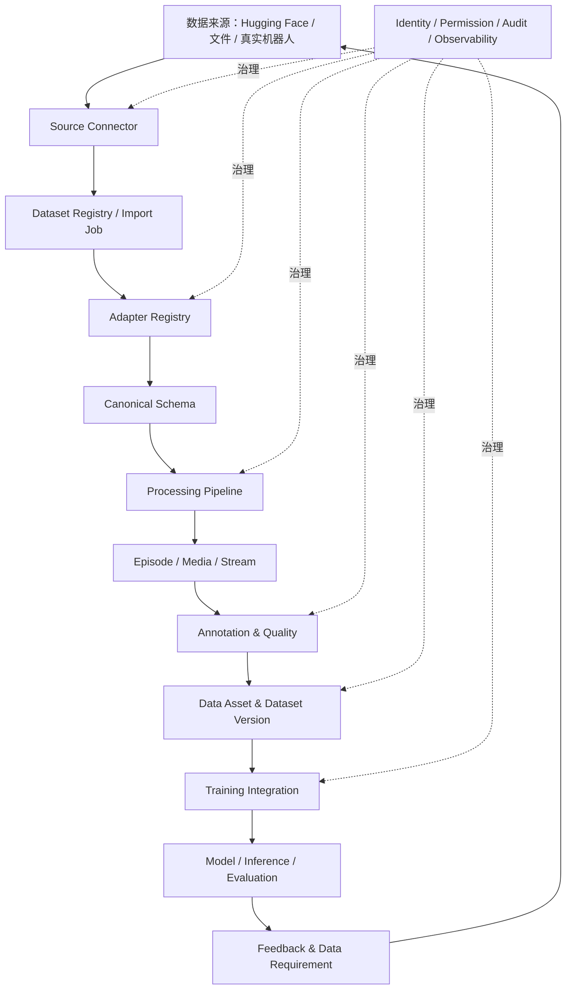

# DDP 具身智能数据闭环平台｜下一阶段建设蓝图 V2.0

## 0. 文档定位与承接原则

### 0.1 本蓝图的定位

本文件是 DDP 在《DDP_具身智能数据闭环平台建设总规范_V1.0_FINAL.md》基础上的下一阶段建设蓝图。V1.0 已作为既有产品、业务、架构和工程治理基线；本蓝图只规划后续增量建设、能力补齐和成熟度提升。

本蓝图不替代 V1.0，不要求重新搭建平台，不默认 V1.0 中每项设计都已在代码中完整落地。实际开发起点必须以当前 GitHub 仓库、运行结果、数据库、API 和测试证据为准。

### 0.2 本次规划依据

- **V1.0 总规范：** 定义 DDP 的产品定位、业务闭环、领域模块、技术架构、数据标准、代码规范、Agent 分工、GitHub 流程、安全、测试、部署和阶段路线。
- **V1.3 数据接入与样本验收中心 PRD：** 明确当前个人开发 / 测试 / 验证阶段，以 Hugging Face Hub 上公开第一人称数据集为主要输入，验证数据集导入、解析、视频审看、时间轴联动、人工审核和质量报告；采用全局复用优先策略。

### 0.3 总体承接原则

1. **保留既有成果：** 已开发、已验证、已验收的功能视为基线，不重复开发。
2. **先审计后开发：** 代码存在不等于功能可用；必须用真实数据和测试证据判断。
3. **差距驱动：** 只对缺失、不完整、不稳定或不可追溯的能力安排任务。
4. **Reuse First：** 先复用 DDP 现有实现，再用官方 SDK / API，再集成成熟开源项目，再建设薄 Adapter，最后才考虑自研。
5. **数据真实：** 不伪造字段、标注、时间轴、质量分数、训练结果或模型反馈。
6. **渐进扩展：** 当前先完成真实数据链路，再逐步引入真实机器人数据、标注质检、数据资产、训练与模型闭环。
7. **阶段门禁：** 每阶段明确范围、依赖、交付物、测试和验收证据，未经批准不进入下一阶段。

## 1. 产品愿景与下一阶段总目标

### 1.1 产品定位不变

DDP 仍然定位为面向具身智能行业的数据生产、治理、资产化与训练支撑平台，支持多项目、多机器人、多传感器、多格式、多基地、多供应商和多种训练数据需求。当前开发环境仍处于个人开发、功能测试和技术验证阶段，不将企业级规模化能力提前作为 MVP 的强制范围。

### 1.2 下一阶段总目标

在保留现有 DDP 系统的基础上，逐步形成以下可验证能力：

- 多来源数据可接入：Hugging Face 开源数据集、LeRobot 数据、后续真实机器人数据和文件数据；
- 多格式数据可统一：通过 Adapter 映射到 DDP Canonical Schema；
- 多模态数据可处理：媒体索引、时间同步、Episode 切片、质量预检；
- 样本可审看、可标注、可质检：人工审核为基础，AI 辅助为可选增强；
- 数据可资产化：元数据、检索、版本、血缘、数据集构建和冻结；
- 训练数据可交付：数据集筛选、划分、导出、训练平台集成；
- 模型问题可回流：评测结果、失败案例和数据缺口形成新数据需求；
- 工程可持续：模块边界清晰、测试可靠、权限安全、GitHub 流程和可观测性完整。

### 1.3 目标闭环

```text
算法 / 业务数据需求
        ↓
需求拆解与数据规格
        ↓
数据源 / 采集方案 / 场景动作 / SOP
        ↓
数据接入（HF / 文件 / 真实机器人）
        ↓
Adapter → Canonical Schema
        ↓
解析 / 时间同步 / Episode / 清洗
        ↓
标注 / AI 辅助 / 质检 / 返工
        ↓
数据资产 / 版本 / 血缘
        ↓
训练集构建 / 划分 / 冻结 / 导出
        ↓
训练平台集成 / 模型登记 / 推理评测
        ↓
模型问题 / 数据缺口 / 失败案例
        └──────────────→ 反向形成新数据需求
```

### 1.4 本阶段暂不追求

当前阶段不以“功能菜单齐全”为目标，不提前建设：
- 多甲方合同、采购、结算、回款和利润核算；
- 多供应商商务管理、多城市多基地复杂调度；
- 大规模组织人事和薪酬系统；
- 自研通用视频解码器、通用文件管理器、通用 Dataset Loader；
- 自建完整训练集群、模型训练框架或机器人厂商控制系统；
- 未经规模验证的微服务、Kubernetes、分布式存储和复杂消息中间件。

以上属于后续业务规模化或外部系统集成范畴，必须由真实需求触发。

## 2. 既有能力保护与现状判定

### 2.1 功能状态定义

所有 V1.0 能力和新增能力统一采用以下状态：

| 状态 | 定义 | 开发处理 |
|---|---|---|
| VERIFIED | 真实运行、测试通过、证据完整 | 冻结为基线，不重复建设 |
| PARTIAL | 已有部分实现，存在缺口 | 只补缺口 |
| UNVERIFIED | 代码存在但缺少运行或测试证据 | 先验证，不直接重写 |
| MISSING | 仓库和运行环境中均未发现 | 纳入规划 |
| BLOCKED | 受数据、权限、硬件、外部服务或环境限制 | 记录阻塞和解除条件 |

### 2.2 现状审计范围

至少核验：
- 前端路由、页面、播放器、时间轴和组件；
- 后端 API、业务服务、数据模型和状态机；
- 数据库结构、Migration 和已有数据；
- 文件服务、缓存目录、对象存储和访问控制；
- Hugging Face Connector、Dataset Registry、Import Job；
- Generic Video / LeRobot Adapter；
- Episode、MediaAsset、Stream、Annotation、TimelineEvent；
- 样本审核、质量检查、质量报告；
- 权限、Secret 管理、审计；
- 自动化测试、GitHub Actions、PR 规则；
- 日志、任务监控、异常恢复和备份。

每项必须附文件路径、接口、运行截图、测试报告或数据证据。

### 2.3 基线冻结要求

审计通过后形成：
- V1.0 已有功能基线；
- V1.3 数据接入 MVP 完成度矩阵；
- 当前数据模型和 API 契约清单；
- 已知缺陷和技术债务；
- 本阶段允许修改的模块范围；
- 不允许变更的稳定接口和数据库边界。

## 3. 下一阶段建设总架构

### 3.1 逻辑架构



### 3.2 技术架构原则

- 优先沿用当前 DDP 技术栈和部署方式；
- 默认采用清晰分层、领域模块化；优先评估模块化单体 + 异步 Worker；
- 大文件解析、转码、切片、质检和导出采用异步任务，不长期占用 HTTP 请求线程；
- 关系数据库保存业务元数据、状态、索引和引用；大文件保存在现有文件/对象存储；
- 第三方能力通过 Adapter / Port 接入，不让业务逻辑直接依赖底层 SDK；
- 不未经评估更换数据库、对象存储、任务队列、模型服务或前端组件库；
- 微服务、CQRS、Event Sourcing、Kubernetes 等不是默认建设项，必须以实际瓶颈和 ADR 论证。

### 3.3 核心领域模块

1. Project & Requirement：项目与数据需求；
2. Collection & Device：采集方案、场景、动作、SOP、机器人和设备；
3. Data Ingestion：数据源、上传、导入任务、原始资产；
4. Data Processing：解析、同步、清洗、切片；
5. Episode & Media：Episode、Frame、Observation、Action、媒体流；
6. Annotation：标签 Schema、标注任务和结果；
7. Quality：规则、检测、问题、抽检和返工；
8. Data Asset & Dataset：资产目录、数据集、版本、血缘和导出；
9. Training Integration：训练需求、数据交付和外部训练引用；
10. Model & Evaluation：模型登记、推理、评测和反馈；
11. Operations & Governance：权限、审计、任务监控、配置和运维。

## 4. 分阶段建设范围

### Phase N0：既有成果审计与基线冻结

**目标：** 确认 V1.0 和当前 MVP 哪些已完成、哪些仍有缺口，确定真实开发起点。

**建设任务：**
- 只读审计当前 GitHub 仓库和运行环境；
- 建立 V1.0 功能矩阵和 V1.3 PRD 验收矩阵；
- 核验真实数据导入、播放、时间轴、人工审核和报告；
- 盘点 Schema、API、数据库 Migration 和文件存储；
- 输出复用清单、技术债务、风险和依赖图；
- 冻结已验收功能，定义本阶段修改边界。

**交付物：** 现状审计报告、功能矩阵、数据流图、模块依赖图、复用评估、差距清单、下一阶段 Sprint Backlog。

**验收：** 所有结论有代码或运行证据；没有证据的功能不得标记 VERIFIED。

**门禁：** 本阶段只读，不修改业务代码、数据库和生产配置。

### Phase N1：数据接入与样本验收 MVP 完整性固化

**目标：** 将现有 Hugging Face 第一人称数据接入链路固化为稳定、可重复验证的基线。已完成且 VERIFIED 的项目不重复开发。

**重点核验/补齐：**
- Hugging Face Hub 连接、Dataset Card、License、Gated 状态；
- Repo ID、Revision、Config、Split 和样本范围；
- 小样本导入、Streaming、缓存复用和任务状态；
- 下载失败重试、取消、部分成功和错误定位；
- Generic Video、LeRobot v2.1 / v3.0 Adapter；
- Episode、MediaAsset、Stream、Annotation、Timestamp、Frame；
- 视频播放、时间轴联动、多视角（仅在真实存在时）；
- 人工审核状态、备注、历史记录和自动下一条；
- 质量报告和 JSON / CSV / Markdown 导出；
- Token 不暴露、缓存数据不进入 Git。

**验收：** 至少一个真实公开第一人称数据集完成从 Repo 到统一 Schema、播放、时间轴、人工审核和质量报告的完整流程；刷新后记录仍存在；失败路径有明确状态。

### Phase N2：Canonical Schema 与多格式 Adapter 扩展

**目标：** 让 DDP 不依赖单一 Hugging Face 数据集结构，为真实机器人数据接入打好统一数据基础。

**优先支持：**
- 普通 MP4 + CSV / JSON / JSONL；
- Hugging Face Datasets Video Feature；
- LeRobot v2.1；
- LeRobot v3.0；
- 后续按实际数据样本验证 MCAP、ROS bag / rosbag2、HDF5、Parquet。

**建设任务：**
- 建立 Adapter Registry 和统一 Adapter 接口；
- 定义每种 Adapter 的支持字段、缺失字段、映射结果和版本；
- 统一 DatasetSource、ImportJob、Episode、Frame、MediaAsset、Stream、Annotation、TimelineEvent；
- 保留原始字段、原始路径、来源 Repo、Revision、License 和 Hash；
- Adapter 输出 Canonical Schema，不允许特定数据集字段污染通用业务层；
- 为每种 Adapter 建立真实样本测试夹具和兼容性测试。

**验收：** 至少两种不同来源/格式的数据进入同一套 Canonical Schema；缺失字段明确标识；原始数据和来源可追溯。

### Phase N3：多模态处理 Pipeline 与 Episode 工程

**目标：** 建立可复现、可追踪、可重试的数据处理流程。

**处理链路：**
```text
Raw Asset
→ File Validation
→ Metadata Extraction
→ Format Parsing
→ Timestamp Normalization
→ Stream Alignment
→ Calibration Validation
→ Episode Segmentation
→ Data Cleaning
→ Quality Pre-check
→ Processed Artifact Registration
```

**建设任务：**
- Pipeline / Job / Step 的状态、日志、参数、输入输出和版本；
- 文件完整性、Hash、大小、格式、可解析性校验；
- 时间戳标准化，保留原始时间戳、时钟来源和转换依据；
- 多路视频和状态流的同步偏差检测；
- Episode 起止时间、帧索引和边界校验；
- 传感器采样频率、丢帧、缺失数据和异常值检查；
- 失败重试、幂等、取消和部分成功；
- 处理产物与原始资产关联，禁止覆盖 Raw。

**验收：** 同一输入和 Pipeline 版本可重复得到一致结果；处理失败可定位到文件、Episode 或 Step；原始资产不被覆盖。

### Phase N4：标注中心与数据质量中心

**目标：** 形成从标签规范、标注任务到自动检测、人工复核和返工的闭环。

**建设任务：**
- Label Schema 版本管理；
- 任务级、Episode 级、时间片段、动作阶段、语言指令、失败原因等标签；
- 标注任务分配、提交、审核、返工、仲裁和版本；
- 优先复用 Label Studio 等成熟标注工具，通过集成 Adapter 同步任务和结果；
- 质量规则配置、规则版本、自动检测、问题归因；
- 人工抽检、质量报告、返工闭环；
- AI 辅助标注作为增强能力，记录模型、版本、Prompt、置信度和人工修改。

**验收：** 标签有版本，标注有审核记录，质量规则可复现，问题可定位并完成返工；AI 结果与人工验收结果分开保存。

### Phase N5：数据资产与 Dataset 生命周期管理

**目标：** 将合格数据沉淀为可检索、可复用、可冻结和可追溯的训练资产。

**建设任务：**
- 资产目录和多维检索；
- 元数据、标签、质量、设备、场景、动作和来源关联；
- Dataset Builder：按项目、任务、场景、动作、设备、质量和标签筛选；
- 去重、覆盖率、样本平衡和数据泄漏检查；
- Train / Validation / Test 划分；
- Dataset Version、Manifest、Hash 和版本冻结；
- 数据血缘正向/反向追踪；
- LeRobot 等训练格式导出；
- 数据集授权、归档和访问记录。

**验收：** 冻结的数据集版本可复现；导出内容与 Manifest 一致；可从训练数据追溯到 Episode、原始资产和采集任务。

### Phase N6：训练平台集成与模型评测支撑

**目标：** 让 DDP 成为训练数据交付和模型评测结果管理的枢纽，而不是重复建设训练平台。

**建设任务：**
- Training Request：目标、数据类型、动作/场景、数量、质量阈值、格式和交付时间；
- 需求与 Dataset Version 匹配；
- 数据导出任务、交付记录和外部训练任务引用；
- 通过 Adapter 对接已有算法训练平台；
- Model / ModelVersion 登记；
- 推理服务、Inference Job、日志和结果引用；
- Evaluation Result：指标、数据集版本、模型版本、配置和运行环境；
- 训练/评测失败原因和数据缺口记录。

**验收：** 算法团队可以获取指定冻结版本的数据集；训练/评测结果可关联到数据集版本和模型版本；外部训练系统不可用时 DDP 核心数据管理不受影响。

### Phase N7：模型反馈与数据闭环智能化

**目标：** 将模型评测和失败案例转化为可执行的数据生产需求。

**建设任务：**
- 失败案例归档和分类；
- 按场景、动作、视角、设备、环境和技能分析数据缺口；
- 覆盖率、长尾分布和难例分析；
- 从评测问题生成候选 DataRequirement；
- 智能推荐采集场景、动作和补充数据；
- AI 标注建议和人工确认；
- 跟踪新数据进入训练集后模型指标变化。

**验收：** 反馈有来源、有证据、有责任人；自动生成的需求必须经过人工确认，不自动下发真实采集任务。

### Phase N8：真实机器人数据采集与设备集成

**目标：** 在 Canonical Schema 和处理链路稳定后，逐步接入真实机器人、传感器和现场采集任务。

**建设任务：**
- 机器人、设备、传感器档案和能力描述；
- 设备 Adapter：连接、状态、能力、健康检查、数据元信息；
- 采集方案、场景、动作、SOP 和质量要求；
- 采集任务、批次、人员和设备关联；
- 真实数据上传、校验和处理；
- 采集异常、设备故障和数据返工记录；
- 首批适配对象按实际条件逐个验证：天机机器人、智元精灵 G1/G2、Franka、ARX、灵犀、Ego / UMI 和第三方数据。

**验收：** 至少一种真实机器人/设备数据完成从采集任务或设备导出文件到 DDP Episode、质检和数据资产的全链路验证。无硬件或 SDK 条件时保持 BLOCKED，不伪造成功。

### Phase N9：规模化运营与企业治理

**目标：** 在真实业务规模和组织协作需求明确后，建设多项目、多基地、多供应商和规模化交付能力。

**建设任务：**
- 多项目、组织和权限隔离；
- 多基地、人员、场地、设备和产能管理；
- 供应商资源、交付质量和协作记录；
- 采集任务排期、产能冲突和资源调度；
- 交付验收、成本核算和经营分析；
- 安全审计、数据保留、备份恢复、监控告警和发布治理。

**验收：** 多项目隔离正确；资源冲突可识别；交付、质量和成本可追溯；安全、备份和恢复经过验证。

## 5. 下一阶段优先级

| 优先级 | 建设项 | 原因 |
|---|---|---|
| P0 | N0 基线审计与冻结 | 避免重复开发和破坏现有成果 |
| P0 | N1 数据接入 MVP 缺口闭环 | 先保证真实数据可导入、可审看、可验收 |
| P1 | N2 Canonical Schema / Adapter | 避免系统被单一数据集锁死 |
| P1 | N3 多模态处理 / Episode | 支撑真实机器人数据 |
| P1 | N4 标注与质量闭环 | 形成可训练数据的质量保障 |
| P1 | N5 数据资产 / Dataset Version | 数据可复用、可复现 |
| P2 | N6 训练与评测集成 | 依赖数据集版本和稳定导出 |
| P2 | N7 模型反馈智能化 | 依赖真实训练/评测数据 |
| P2 | N8 真实采集与设备集成 | 依赖硬件、SDK 和真实业务条件 |
| P3 | N9 规模化运营 | 由真实项目规模触发 |

## 6. 最终目标与成功标准

DDP 的最终目标不是“功能菜单全部开发完”，而是建立可持续、可追溯、可复现的具身智能数据生产和训练支撑能力。

最终应具备：
1. 多来源数据统一接入；
2. 多机器人、多传感器、多格式统一 Schema；
3. 原始数据、处理产物、Episode、标注和质量结果关联；
4. 数据集可检索、可版本化、可冻结、可复现；
5. 训练数据可稳定交付；
6. 模型评测问题可回流形成新数据需求；
7. 真实采集任务和设备数据可逐步纳入；
8. 多项目和规模化运营具备可扩展能力；
9. 每个模块有清晰边界、测试、审计和 Owner；
10. 每次变更有 GitHub PR、测试证据、验收记录和回滚方案。

**最终判断标准：DDP 能否持续稳定地产出高质量、可追溯、可复现的具身智能训练数据，并通过真实训练/评测反馈持续改善数据生产。**
