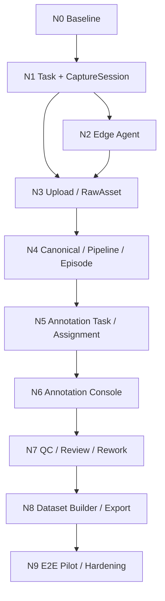

# DDP V3.1 实施 WBS、依赖 DAG 与里程碑

## 1. 阶段总览

| 阶段 | ID | 目标 | 优先级 | 依赖 |
|---|---|---|---|---|
| N0 | V31-N0 | 当前 HEAD 复核、冻结基线 | P0 | 无 |
| N1 | V31-N1 | CollectionTask / Device / CaptureSession 贯通 | P0 | N0 |
| N2 | V31-N2 | Edge Capture Agent | P0 | N1 |
| N3 | V31-N3 | Upload / RawAsset / Ingestion 贯通 | P0 | N1/N2 |
| N4 | V31-N4 | Adapter / Canonical / Episode Pipeline | P0 | N3 |
| N5 | V31-N5 | AnnotationTaskSpec / Batch / Assignment | P0 | N4 |
| N6 | V31-N6 | Annotation Console 前端 | P0 | N5 |
| N7 | V31-N7 | QC / Review / Rework / Arbitration | P1 | N6 |
| N8 | V31-N8 | Dataset Builder / Freeze / Export | P1 | N7 |
| N9 | V31-N9 | 真实端到端 Pilot / Hardening | P0 Release Gate | N1-N8 |

## 2. WBS 明细

### N0 当前 HEAD 复核
- N0-001 读取 Git 状态、commit、分支、未提交改动；
- N0-002 核对现有 API / OpenAPI / Migration；
- N0-003 核对 Collection / Device / Upload / Episode / Annotation / Dataset；
- N0-004 标注控制台页面现状审计；
- N0-005 复核 V2.1 中每条 VERIFIED / PARTIAL / MISSING；
- N0-006 输出 Capability Matrix / No-Go List / Backlog Freeze。

### N1 采集业务关联
- N1-001 核对 CollectionTask 状态机和执行权限；
- N1-002 核对 Device / Sensor / Calibration 关系；
- N1-003 设计并最小实现 CaptureSession；
- N1-004 CollectionTask → CaptureSession 关联；
- N1-005 CaptureSession → Device/Sensor/Calibration Snapshot；
- N1-006 采集执行页和 Session 详情；
- N1-007 Audit / Outbox / Idempotency / If-Match；
- N1-008 PG 迁移、回滚和并发测试。

### N2 Edge Agent
- N2-001 定义 Agent 协议与设备身份；
- N2-002 Filesystem Export Adapter；
- N2-003 Manifest Schema / Generator；
- N2-004 Preflight；
- N2-005 Local Spool / SQLite state；
- N2-006 SHA256 / file signature；
- N2-007 Upload Client；
- N2-008 Agent restart / network recovery；
- N2-009 Linux workstation packaging / logs。

### N3 Upload / RawAsset
- N3-001 复用现有 Upload API / S3；
- N3-002 UploadSession 与 CaptureSession 关联；
- N3-003 Manifest 验证；
- N3-004 Multipart resume / idempotency；
- N3-005 RawAsset registration；
- N3-006 quarantine / duplicate / checksum；
- N3-007 Outbox → Ingestion Worker；
- N3-008 Upload Center UI；
- N3-009 E2E upload recovery。

### N4 Canonical / Pipeline / Episode
- N4-001 Adapter Registry；
- N4-002 LeRobot v3.0 regression；
- N4-003 Generic MP4 + JSON/CSV；
- N4-004 首个真实机器人格式（MCAP/rosbag2/厂商导出，按实际样本选）；
- N4-005 Canonical Schema version；
- N4-006 timestamp normalization；
- N4-007 Episode segmentation；
- N4-008 Media / Stream / Observation / Action；
- N4-009 Processing run logs / retries；
- N4-010 Episode Explorer / Review entry。

### N5 Annotation Task / Assignment
- N5-001 复核现有 AnnotationTask 模型和 API；
- N5-002 LabelSchema / TaskSpec 版本绑定；
- N5-003 AnnotationBatch 创建；
- N5-004 Episode selection / duplicate prevention；
- N5-005 Assignment / assignee；
- N5-006 指定、批量分配、转派、回收；
- N5-007 My Work Queue；
- N5-008 Lease / optimistic lock；
- N5-009 Audit / Outbox / permission tests。

### N6 Annotation Console
- N6-001 路由与信息架构；
- N6-002 Task Queue；
- N6-003 Episode media player；
- N6-004 Timeline；
- N6-005 Schema-driven label editor；
- N6-006 Temporal segment editor；
- N6-007 autosave / draft / conflict；
- N6-008 submit / result version；
- N6-009 keyboard shortcuts；
- N6-010 frontend interaction tests；
- N6-011 reviewer read-only comparison。

### N7 Quality / Review
- N7-001 Annotation QC rules；
- N7-002 QC result and evidence；
- N7-003 Review Queue；
- N7-004 Accept / Rework；
- N7-005 Rework assignment / history；
- N7-006 Arbitration；
- N7-007 quality dashboard；
- N7-008 dataset gate rules。

### N8 Dataset Builder / Export
- N8-001 candidate Episode query；
- N8-002 eligibility gate；
- N8-003 duplicate / leakage checks；
- N8-004 split strategy；
- N8-005 DatasetVersion snapshot；
- N8-006 Manifest / hash；
- N8-007 Canonical export；
- N8-008 LeRobot v3.0 export if consumer confirms；
- N8-009 official reader round-trip；
- N8-010 export download / handoff。

### N9 Pilot / Hardening
- N9-001 HF regression E2E；
- N9-002 actual hardware or real exported-file pilot；
- N9-003 upload interruption recovery；
- N9-004 annotation assignment and console E2E；
- N9-005 QC/rework E2E；
- N9-006 dataset freeze/export E2E；
- N9-007 access control / audit / security；
- N9-008 performance / storage / backup；
- N9-009 final evidence bundle and user acceptance。

## 3. Dependency DAG

## 4. 并行策略

N1 数据模型和 N6 UX 原型可并行设计，但共享 API/Schema 由单一 Owner 冻结；N2 Agent 与 N3 后端上传协议可并行开发，协议先冻结；N5 后端任务分配与 N6 UI 可按契约并行；N7 质量规则设计可与 N6 组件实现并行，但不得绕过状态机；N8 Dataset Builder 可先做只读候选查询，不得在门禁规则未冻结前发布版本。

## 5. Release Gate

V3.1 只有在 N9 真实 E2E 证据齐全后才能标记 Pilot Accepted。没有真实硬件时可标记 File-based Pilot Accepted，但必须注明硬件采集未验收。
